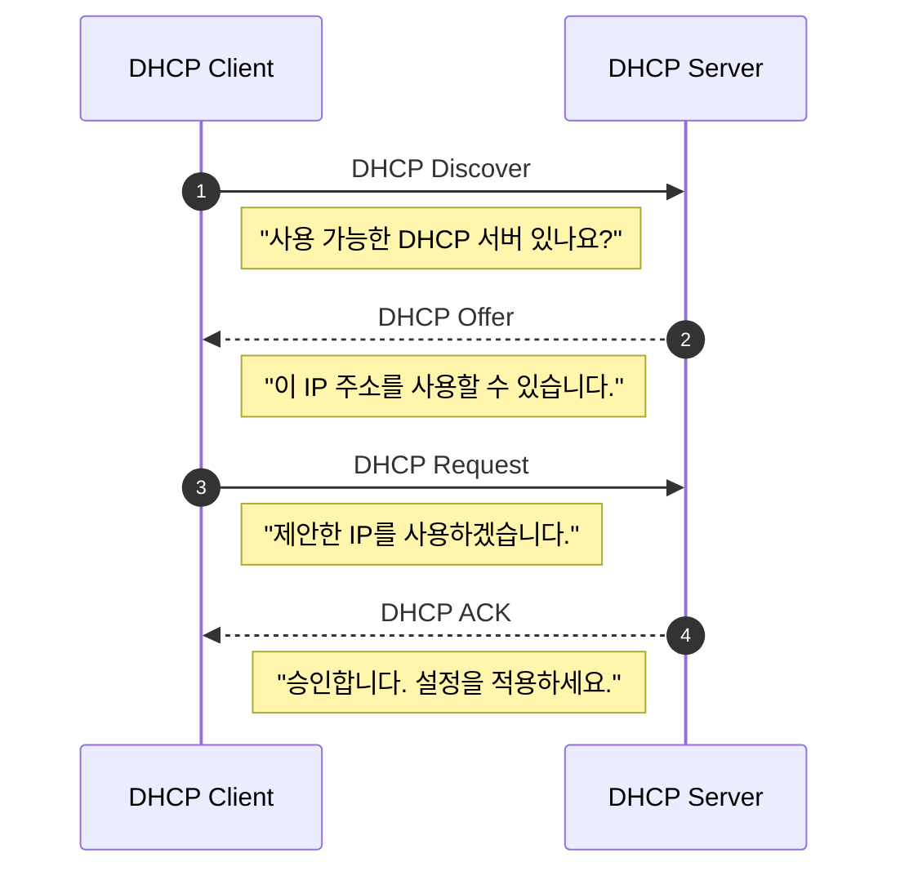

DHCP란 네트워크에 접속한 호스트에게 IP 주소와 네트워크 설정 정보를 자동으로 할당하는 프로토콜이다.  ^intro

DHCP 서버는 클라이언트에게 보통 다음 정보를 제공한다.

- [[IP]] 주소
- [[Subnet#서브넷 마스크|서브넷 마스크]]
- 기본 게이트웨이(Default Gateway)
- [[DNS]] 서버 주소
- IP 임대 시간(Lease Time)

IP 네트워크에서 각각의 장치는 통신을 위해 IP 주소를 가지고 있어야 한다.
만약 DHCP가 없다면 관리자가 모든 장치에 직접 IP를 설정해야 한다.
또한 IP 충돌과 같은 문제를 자동적으로 해결한다.  

DHCP는 기본적으로 **Client-Server 구조**로 동작한다.

- Client: 노트북, 스마트폰, 태블릿 등 우리가 사용하는 기기
- 일반적으로 공유기

## DORA

클라이언트와 서버는 아래와 같은 4가지 단계를 거쳐 연결한다.  



## 왜 IP를 임대하는가?

DHCP가 제공하는 IP 주소는 일반적으로 영구적으로 소유하는 주소가 아니다.  
클라이언트가 연결 종료시 계속적으로 특정 IP를 점유하지 않도록 하기 위함이다.  

## DHCP는 UDP를 사용

DHCP를 요청하는 클라이언트는 아직 정상적인 IP 설정조차 되어 있지 않을 수 있다. 따라서 처음부터 TCP 연결을 맺는 방식보다는 Broadcast가 가능한 [[UDP]] 기반으로 간단한 메시지를 교환하는 것이 적합하다.

## 출처 및 참고자료

```cardlink
url: https://minha0220.tistory.com/45
title: "[DHCP]DHCP DORA란? 리눅스 DHCP 서버 구성 방법"
description: "DHCP(Dynamic Host Configuration Protocol)는 자동으로 IP 주소, 서브넷 마스크, 게이트웨이를 할당해주는 프로토콜입니다. PC의 MAC 주소에 IP 주소를 할당하기 때문에 동일한 MAC 주소를 사용하더라도 각각 다른 IP 주소를 할당해주므로 IP자원을 효율적으로 관리할 수 있게 해줍니다. 제 PC에서 사용하고 있는 WIFI 는 자동으로 IP 주소를 받는걸로 설정이 되어있어서 DHCP 사용이 허용된 상태입니다. cmd 창에서 ipconfig /all 명령어로 IP 주소 정보를 확인할 수 있으니 가볍게 확인하고 지나갑시다. [ DHCP 과정 4단계(DORA) ] DHCP가 IP를 할당하기 위해서는 4번의 메세지 전송 절차를 밟아야 합니다. 메세지 전송 방식은 IPv4의 uni.."
host: minha0220.tistory.com
favicon: https://t1.daumcdn.net/tistory_admin/favicon/tistory_favicon_32x32.ico
image: https://img1.daumcdn.net/thumb/R800x0/?scode=mtistory2&fname=https%3A%2F%2Fblog.kakaocdn.net%2Fdna%2FHfufa%2Fbtr4TJMq1sM%2FAAAAAAAAAAAAAAAAAAAAAKrz7a06BhjHIzU5ffP22D2n9s2ZIFqeoJIStcIe2Cm0%2Fimg.jpg%3Fcredential%3DyqXZFxpELC7KVnFOS48ylbz2pIh7yKj8%26expires%3D1793458799%26allow_ip%3D%26allow_referer%3D%26signature%3DmMooiAXBQo8i%252FK%252F231vFdrP9Sm8%253D
```


```cardlink
url: https://inpa.tistory.com/entry/WEB-%F0%9F%8C%90-DHCP-%EC%9D%B4%EB%9E%80-%EB%AC%B4%EC%97%87%EC%9D%B8%EA%B0%80
title: "🌐 DHCP 이란 무엇인가? (그림으로 쉽게 정리)"
description: "DHCP DHCP는 Dynamic Host Configuration Protocol의 약자이다. DHCP란 단어 그대로 동적으로 호스트를 설정하는 규악이다. 네트워크 안에 컴퓨터에 자동으로 네임 서버 주소, IP주소, 게이트웨이 주소를 할당해주는 것을 의미하고, 해당 클라이언트에게 일정 기간 임대를 하는 동적 주소 할당 프로토콜이다. PC의 수가 많거나 PC 자체 변동사항이 많은 경우 IP 설정이 자동으로 되기 때문에 효율적으로 사용 가능하고, IP를 자동으로 할당해주기 때문에 IP 충돌을 막을 수 있다. 하지만, DHCP 서버에 의존하기 때문에 서버가 다운되면 ip 할당이 제대로 이루어지지 않는다. 1. 공유기에 노트북을 LAN으로 연결하면 자동으로 DHCP Client의 MAC 주소(8c:85...).."
host: inpa.tistory.com
favicon: https://tistory2.daumcdn.net/tistory/4939852/5c9a55d8962c4e0fbe6292153897ff69
image: https://img1.daumcdn.net/thumb/R800x0/?scode=mtistory2&fname=https%3A%2F%2Fblog.kakaocdn.net%2Fdna%2FskhzS%2FbtrfnUsilaU%2FAAAAAAAAAAAAAAAAAAAAAElppJ2mYDQXRReyxIjr417wyfkFMCrT2MAzUCCTUaAG%2Fimg.jpg%3Fcredential%3DyqXZFxpELC7KVnFOS48ylbz2pIh7yKj8%26expires%3D1793458799%26allow_ip%3D%26allow_referer%3D%26signature%3DePQD9%252FXbmyeD2WUwr70Q7GkbP1k%253D
```
