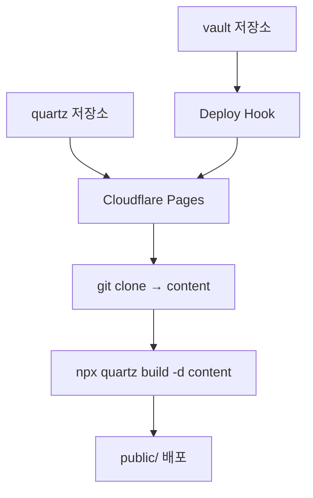

> Cloudflare Page로 Quartz를 배포할 때 만약 Quartz 레포지토리와 실질적인 노트를 관리하는 레포지토리가 다를 때 해당 방식을 사용할 수 있을 것이다.  

Quartz를 사용할 때 저장소가 분리되어 있을 때 배포하기 까다롭다.  
이 때 배포 레포지토리 타겟은 유지하되 노트 저장소에 변경이 발생할때마다 배포할 수 있다면 관리하기 편할 것이다.  
이를 Webhook을 활용한다면 쉽게 관리할 수 있다.  

흐름은 다음과 같다.  



## 스크립트 설정

우선 스크립트 설정에 아래와 같이 추가한다.   
Worker & Pages → Settings → Build configuration → Build command에 입력

```sh
git clone --depth 1 [노트가 있는 저장소 url] [quartz 저장소에 저장할 경로] && npx quartz build -d [quartz 저장소에 저장할 경로]
```

예시는 다음과 같다.  

```sh
git clone --depth 1 https://github.com/user/vault.git content && npx quartz build -d content
```

## Deploy Hook 추가

Worker & Pages → Settings → Deploy Hook  

![[IMG-20261104044951617.png]]

적절한 이름과 타겟 브랜치를 설정한다.  

![[IMG-20261104045043341.png|355]]

그렇게 된다면 `Deploy hook created` 문구와 함께 WebHook URL이 생성된다.  

## Github Webhooks 등록

- 이후 노트가 있는 레포지토리에 Settings → Webhooks로 이동
- `Add webhook` 클릭

![[IMG-20261104045142818.png]]

아래 정보들을 입력

- Payload URL: 아까 발급한 Cloudflare Deploy Hook
- Content type: 일단 유지?
- Secret: 비워두기
- SSL verification: Enable
- Events: Just the push event
- Active: 체크

![[IMG-20261104045250356.png]]

이후 vault 저장소에서 push할때마다 quartz repo와 연동된 Cloudflare Page의 deploy가 동작한다.  

![[IMG-20261104054019939.png]]