# 백엔드 기술 면접 대비 - 기술별 특징 및 차이점

## 학습 목적

과거에 학습했던 기술들을 다시 상기하고, 현재 주로 사용하는 기술과의 차이점을 이해한다.

단순히 기술별 장단점을 암기하는 것이 아니라, 각 기술의 등장 배경과 동작 원리, 기술 선택 기준을 이해하고 면접에서 설명할 수 있도록 준비한다.

| 비교 대상 | 핵심 비교 포인트 |
| --- | --- |
| Spring vs Spring Boot | 자동 설정과 개발 환경 구성 |
| WAR vs JAR | 패키징 구조와 애플리케이션 실행 주체 |
| Maven vs Gradle | 빌드 생명주기와 의존성 관리 |
| Oracle vs MySQL vs PostgreSQL | 데이터 저장 구조, 트랜잭션, SQL 문법 |
| MyBatis vs JPA | SQL Mapper와 ORM |
| JSP vs React vs Next.js | 렌더링 방식과 FE/BE 아키텍처 |

---

# 1. Spring vs Spring Boot

## 1.1. Spring Framework

Java 기반의 엔터프라이즈 애플리케이션을 개발하기 위한 프레임워크이다.

객체의 생성과 의존관계 관리, 횡단 관심사 분리, 트랜잭션 관리 등 애플리케이션 개발에 필요한 기반을 제공한다.

### 주요 특징

- **IoC(Inversion of Control)**: 객체의 생성과 생명주기를 Spring Container가 관리한다.
- **DI(Dependency Injection)**: 객체 간 의존관계를 외부에서 주입한다.
- **AOP(Aspect-Oriented Programming)**: 로깅, 트랜잭션 등의 횡단 관심사를 분리한다.
- **PSA(Portable Service Abstraction)**: 구체적인 구현 기술에 종속되지 않는 일관된 추상화를 제공한다.
- **Spring MVC**: Servlet 기반 웹 애플리케이션 개발 환경을 제공한다.

### 전통적인 Spring 웹 프로젝트

전통적인 Spring 웹 프로젝트에서는 다음과 같은 설정을 개발자가 직접 구성하는 경우가 많았다.

- DispatcherServlet 등록
- DataSource 설정
- TransactionManager 설정
- ViewResolver 설정
- 의존성 및 라이브러리 버전 관리
- 외부 WAS 설치 및 설정
- WAR 패키징 및 배포

XML 기반 설정을 사용하는 경우도 많았으나, Spring Framework 자체에서도 Java Config 및 애너테이션 기반 설정을 지원한다.

## 1.2. Spring Boot

Spring Framework를 기반으로 애플리케이션의 설정, 실행, 배포 및 운영을 간소화하는 프로젝트이다.

Spring을 대체하는 프레임워크가 아니라, Spring을 보다 편리하게 사용할 수 있도록 지원한다.

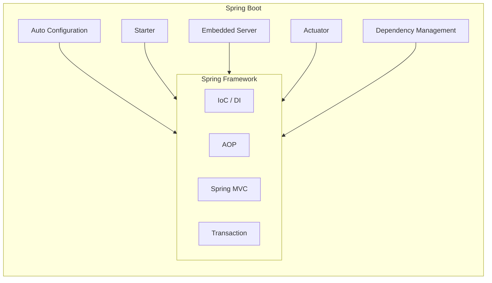

### 주요 특징

| 기능 | 설명 |
| --- | --- |
| Auto Configuration | 클래스패스, 등록된 Bean, 프로퍼티 등을 기반으로 자동 설정 |
| Starter | 특정 기능에 필요한 의존성을 묶어서 제공 |
| Dependency Management | 호환성을 고려한 라이브러리 버전 관리 |
| Embedded Server | 내장 웹 서버를 통한 독립 실행 지원 |
| Externalized Configuration | properties, YAML, 환경 변수 등을 통한 외부 설정 관리 |
| Actuator | 헬스 체크, 메트릭 등 운영 기능 제공 |

## 1.3. 차이점 비교

| 구분 | 전통적인 Spring 구성 | Spring Boot |
| --- | --- | --- |
| 핵심 목적 | 애플리케이션 개발 기반 제공 | Spring 개발 및 운영 간소화 |
| 환경 설정 | 개발자가 직접 구성 | 자동 설정 중심 |
| Bean 등록 | XML, Java Config, 컴포넌트 스캔 | 기존 방식 + 자동 설정 |
| 의존성 관리 | 필요한 라이브러리 직접 구성 | Starter 및 BOM 활용 |
| WAS | 외부 WAS 사용이 일반적 | 내장 WAS 사용이 일반적 |
| 패키징 | WAR 중심의 웹 프로젝트 | 실행 가능한 JAR 중심 |
| 모니터링 | 별도 구성 | Actuator 활용 |
| 초기 개발 비용 | 상대적으로 높음 | 상대적으로 낮음 |

단, Spring Framework만으로도 내장 서버를 구성할 수 있으며, Spring Boot 역시 외부 WAS에 WAR 형태로 배포할 수 있다.

## 1.4. Auto Configuration의 동작 원리

`@SpringBootApplication`은 다음 세 가지 주요 애너테이션을 포함한다.

```java
@SpringBootConfiguration
@EnableAutoConfiguration
@ComponentScan
public @interface SpringBootApplication {
    // ...
}
```

| 애너테이션 | 역할 |
| --- | --- |
| `@SpringBootConfiguration` | Spring Boot 애플리케이션의 설정 클래스 지정 |
| `@EnableAutoConfiguration` | 자동 설정 활성화 |
| `@ComponentScan` | 컴포넌트 스캔 수행 |

`@EnableAutoConfiguration`을 통해 자동 설정 기능이 활성화된다.

현대적인 Spring Boot에서는 다음 파일에 등록된 자동 설정 클래스들을 후보로 활용한다.

```text
META-INF/spring/
    org.springframework.boot.autoconfigure.AutoConfiguration.imports
```

과거 Spring Boot에서는 `META-INF/spring.factories`를 활용하여 자동 설정 클래스를 등록했다. Spring Boot 2.7부터 새로운 등록 방식이 도입되었으며, Spring Boot 3부터는 자동 설정 등록에 새로운 방식을 사용해야 한다.

### 동작 과정

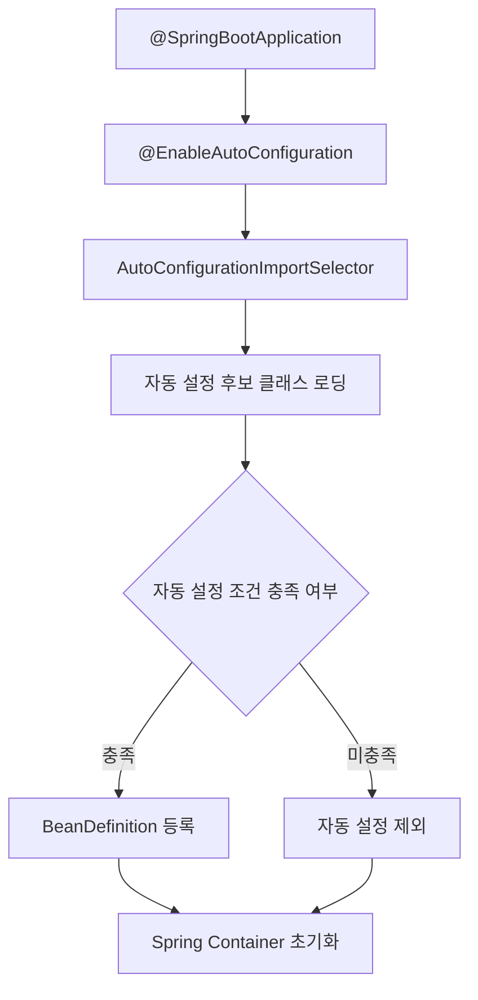

대표적인 조건부 애너테이션은 다음과 같다.

| 애너테이션 | 동작 조건 |
| --- | --- |
| `@ConditionalOnClass` | 특정 클래스가 존재하는 경우 |
| `@ConditionalOnMissingBean` | 특정 Bean이 등록되어 있지 않은 경우 |
| `@ConditionalOnBean` | 특정 Bean이 등록되어 있는 경우 |
| `@ConditionalOnProperty` | 특정 설정값이 조건을 만족하는 경우 |

모든 Bean을 무조건 자동 등록하는 것이 아니라, 현재 애플리케이션의 환경에 맞는 Bean을 조건부로 등록한다.

예를 들어 개발자가 직접 DataSource Bean을 등록하면, `@ConditionalOnMissingBean` 등의 조건에 의해 기본 자동 설정이 적용되지 않을 수 있다.

## 1.5. 참고 자료

### 공식 문서

- [Spring Framework - Overview](https://docs.spring.io/spring-framework/reference/overview.html)
- [Spring Boot - Auto-configuration](https://docs.spring.io/spring-boot/reference/using/auto-configuration.html)
- [Spring Boot - Creating Your Own Auto-configuration](https://docs.spring.io/spring-boot/reference/features/developing-auto-configuration.html)
- [Spring Boot - Embedded Web Servers](https://docs.spring.io/spring-boot/how-to/webserver.html)

### 한글 참고 자료

- [Spring AutoConfiguration의 동작 원리](https://ssartel.org/spring-autoconfigurationyi-dongjag-weonri/)
- [스프링 부트 자동 구성의 동작 원리 파헤쳐보기](https://yeees.tistory.com/477)
- [스프링 부트의 AutoConfiguration 원리 및 만들어 보기](https://donghyeon.dev/spring/2020/08/01/스프링부트의-AutoConfiguration의-원리-및-만들어-보기/)
    - 구버전 Spring Boot의 `spring.factories` 기반 동작 원리를 이해하기 좋은 자료이다.

## 1.6. 면접용 답변

### Q. Spring과 Spring Boot의 차이점은 무엇인가요?

> Spring은 IoC, DI, AOP, 트랜잭션 관리 등 애플리케이션 개발에 필요한 핵심 기능을 제공하는 프레임워크입니다.
>
> Spring Boot는 이러한 Spring Framework를 기반으로 개발 환경 구성과 배포를 간소화하는 프로젝트입니다.
>
> 대표적으로 Auto Configuration을 통해 클래스패스와 Bean 등록 여부에 따라 설정을 자동화하고, Starter를 통해 의존성 관리를 편리하게 할 수 있습니다. 또한 내장 WAS를 지원하기 때문에 별도의 WAS 설치 없이 애플리케이션을 실행할 수 있습니다.
>
> 따라서 두 기술은 대체 관계가 아니며, Spring Boot는 Spring의 핵심 기능을 보다 편리하게 사용할 수 있도록 지원한다고 이해하고 있습니다.

### 예상 꼬리 질문

- Spring Boot의 Auto Configuration은 어떻게 동작하나요?
- Starter와 Auto Configuration의 차이는 무엇인가요?
- Spring Boot에서도 외부 Tomcat을 사용할 수 있나요?
- 자동 설정된 Bean을 개발자가 변경할 수 있나요?
- `@SpringBootApplication`은 어떤 애너테이션으로 구성되어 있나요?

---

# 2. WAR vs JAR

## 2.1. JAR(Java Archive)

Java 클래스 파일과 리소스, 메타데이터 등을 하나의 파일로 압축한 패키징 형식이다.

일반적으로 Java 라이브러리 배포나 독립 실행형 애플리케이션 배포에 사용한다.

### 내부 구조

```text
example.jar
├── META-INF/
│   └── MANIFEST.MF
└── com/
    └── example/
        └── Application.class
```

`MANIFEST.MF`에 `Main-Class`가 지정되어 있고 필요한 의존성을 로딩할 수 있다면 다음 명령어로 실행할 수 있다.

```bash
java -jar example.jar
```

모든 JAR 파일이 실행 가능한 것은 아니다. 다른 애플리케이션의 의존성으로 사용되는 라이브러리 용도의 JAR도 존재한다.

## 2.2. WAR(Web Application Archive)

Java 웹 애플리케이션을 배포하기 위한 표준 패키징 형식이다.

Servlet, JSP, HTML, CSS, JavaScript, 라이브러리 등 웹 애플리케이션에 필요한 파일들을 포함한다.

### 내부 구조

```text
example.war
├── META-INF/
├── WEB-INF/
│   ├── web.xml
│   ├── classes/
│   └── lib/
├── index.jsp
├── css/
└── js/
```

| 구성 요소 | 역할 |
| --- | --- |
| `WEB-INF/web.xml` | 웹 애플리케이션 배포 및 Servlet 설정 |
| `WEB-INF/classes` | 컴파일된 Java 클래스 및 리소스 |
| `WEB-INF/lib` | 애플리케이션에서 사용하는 라이브러리 |
| `META-INF` | 패키지 관련 메타데이터 |

`web.xml`은 전통적인 Servlet 설정 파일이며, 현대적인 Servlet 환경에서는 애너테이션이나 Java 기반 초기화 방식으로 대체할 수 있다.

`WEB-INF` 내부의 리소스는 일반적으로 클라이언트가 URL을 통해 직접 접근할 수 없다.

일반적인 WAR 배포에서는 Tomcat과 같은 외부 Servlet Container가 애플리케이션을 로딩하고 Servlet의 생명주기를 관리한다.

## 2.3. 차이점 비교

| 구분 | JAR | WAR |
| --- | --- | --- |
| 전체 명칭 | Java Archive | Web Application Archive |
| 주요 목적 | Java 라이브러리 및 애플리케이션 | Java 웹 애플리케이션 |
| 대표 디렉터리 | META-INF | META-INF, WEB-INF |
| 일반적인 실행 방식 | java -jar 또는 클래스패스에 포함 | 외부 Servlet Container에 배포 |
| 실행 주체 | 실행형 JAR에서는 애플리케이션 | 일반적인 WAR에서는 WAS |
| 서버 관리 | 애플리케이션별 구성 가능 | 외부 WAS에서 관리 |
| 대표적인 사용 환경 | Spring Boot | 전통적인 Spring MVC, JSP |

## 2.4. 배포 및 실행 구조의 차이

### 전통적인 WAR 배포

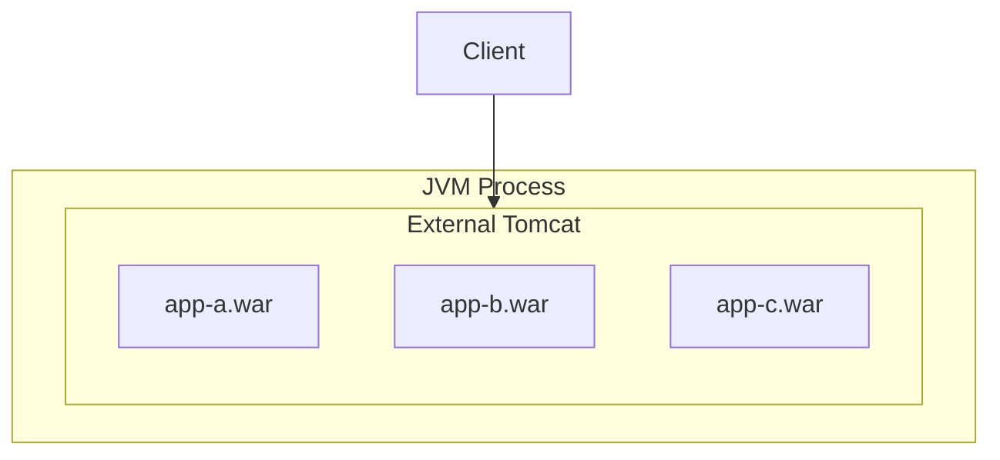

1. 외부 WAS를 설치하고 실행한다.
2. 웹 애플리케이션을 WAR 파일로 패키징한다.
3. WAR 파일을 외부 WAS에 배포한다.
4. WAS가 애플리케이션을 로딩하고 Servlet의 생명주기를 관리한다.

### Spring Boot 실행형 JAR 배포

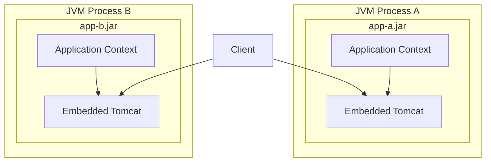

1. 애플리케이션과 필요한 의존성을 JAR 파일로 패키징한다.
2. `java -jar` 명령어로 애플리케이션을 실행한다.
3. Spring Boot가 ApplicationContext를 초기화하는 과정에서 내장 웹 서버를 구성하고 시작한다.
4. 애플리케이션이 독립적으로 HTTP 요청을 처리한다.

### 운영 관점에서의 차이

전통적인 WAR 배포 방식은 여러 웹 애플리케이션을 하나의 WAS에서 관리할 수 있다.

그러나 하나의 WAS 프로세스에서 여러 애플리케이션을 실행한다면 해당 프로세스의 장애나 자원 경합이 함께 배포된 애플리케이션에도 영향을 줄 수 있다.

Spring Boot의 독립 실행형 배포 방식은 애플리케이션별 실행 환경과 서버 버전을 관리하기 편리하다.

다만 각각의 JVM과 WAS를 실행하는 만큼 추가적인 자원 사용이 발생할 수 있다.

이는 대표적인 배포 구성의 차이이며, WAR도 애플리케이션마다 별도의 WAS를 구성하여 격리할 수 있다.

## 2.5. Spring Boot의 Executable JAR

Spring Boot의 실행 가능한 JAR은 일반적인 JAR과 내부 구조가 다르다.

```text
app.jar
├── META-INF/
│   └── MANIFEST.MF
├── org/
│   └── springframework/
│       └── boot/
│           └── loader/
└── BOOT-INF/
    ├── classes/
    │   └── Application.class
    └── lib/
        ├── spring-context.jar
        ├── tomcat-embed-core.jar
        └── ...
```

| 구성 요소 | 역할 |
| --- | --- |
| BOOT-INF/classes | 애플리케이션의 클래스 및 리소스 |
| BOOT-INF/lib | 애플리케이션 실행에 필요한 의존성 |
| springframework/boot/loader | Spring Boot 실행을 위한 Launcher |

현대적인 Spring Boot의 `MANIFEST.MF`에는 일반적으로 다음과 같은 실행 정보가 등록된다.

```text
Main-Class: org.springframework.boot.loader.launch.JarLauncher
Start-Class: com.example.Application
```

### 실행 과정

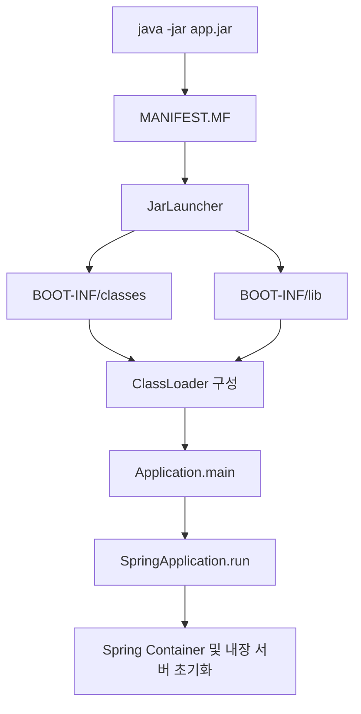

`JarLauncher`가 중첩된 JAR 파일들을 읽을 수 있도록 ClassLoader를 구성하고, `Start-Class`에 지정된 애플리케이션의 `main()` 메서드를 호출한다.

Spring Boot의 실행형 JAR은 의존성 JAR을 내부에 그대로 포함하는 Nested JAR 구조를 사용한다.

이를 넓은 의미에서 Fat JAR 또는 Uber JAR이라고 부르기도 하지만, 모든 Fat JAR가 Spring Boot와 동일한 패키징 구조를 사용하는 것은 아니다.

## 2.6. 참고 자료

### 공식 문서

- [Java - JAR File Specification](https://docs.oracle.com/en/java/javase/21/docs/specs/jar/jar.html)
- [Spring Boot - Nested JARs](https://docs.spring.io/spring-boot/specification/executable-jar/nested-jars.html)
- [Spring Boot - Traditional Deployment](https://docs.spring.io/spring-boot/how-to/deployment/traditional-deployment.html)
- [Spring Boot - Packaging Executable Archives](https://docs.spring.io/spring-boot/maven-plugin/packaging.html)

### 한글 참고 자료

- [Spring Boot 핵심 기능 1 - 내장 톰캣](https://hanseom.tistory.com/331)
    - 내장 Tomcat과 실행형 JAR, JarLauncher의 역할을 이해하기 좋은 자료이다. 구버전 Spring Boot의 클래스 경로를 사용한다는 점에 주의한다.

## 2.7. 면접용 답변

### Q. WAR와 JAR의 차이점은 무엇인가요?

> JAR와 WAR는 모두 Java 애플리케이션을 패키징하기 위한 파일 형식입니다. JAR는 일반적인 Java 라이브러리나 애플리케이션을 배포하기 위한 형식이고, WAR는 Servlet이나 JSP 등의 웹 애플리케이션을 배포하기 위한 형식입니다.
>
> 전통적인 WAR 배포 방식에서는 외부 WAS가 애플리케이션을 로딩하고 실행합니다. 반면 Spring Boot의 실행 가능한 JAR는 내장 WAS와 필요한 의존성을 포함하고 있어 java -jar 명령어로 독립 실행할 수 있습니다.
>
> 다만 Spring Boot에서도 WAR 패키징과 외부 WAS 배포를 지원하기 때문에 반드시 특정 프레임워크가 특정 패키징 형식을 사용해야 하는 것은 아닙니다.

### 예상 꼬리 질문

- 모든 JAR 파일은 `java -jar`로 실행할 수 있나요?
- 내장 Tomcat과 외부 Tomcat의 차이는 무엇인가요?
- Fat JAR란 무엇인가요?
- Spring Boot의 JarLauncher는 어떤 역할을 하나요?
- WAR를 사용하는 기존 서비스에 Spring Boot를 도입할 수 있나요?
- WEB-INF 디렉터리의 역할은 무엇인가요?

---

# 3. Maven vs Gradle

Maven과 Gradle은 모두 소프트웨어 프로젝트의 의존성 관리, 컴파일, 테스트, 패키징 및 배포를 자동화하는 빌드 도구이다.

가장 큰 차이점은 **빌드 작업을 정의하고 실행하는 방식**이다.

## 3.1. Maven

Apache에서 개발한 빌드 및 프로젝트 관리 도구이다.

POM(Project Object Model)을 기반으로 프로젝트의 구성과 의존성을 선언적으로 정의한다.

### 주요 특징

- XML 기반의 `pom.xml`을 사용한다.
- 표준화된 빌드 생명주기(Lifecycle)를 제공한다.
- Convention over Configuration 철학을 따른다.
- 플러그인을 통해 빌드 기능을 확장한다.
- 정해진 프로젝트 구조와 빌드 순서로 일관성을 확보하기 좋다.

### 의존성 선언

```xml
<dependencies>
    <dependency>
        <groupId>org.springframework.boot</groupId>
        <artifactId>spring-boot-starter-web</artifactId>
    </dependency>
</dependencies>
```

### 빌드 생명주기

Maven에는 세 가지 기본 Lifecycle이 존재한다.

| Lifecycle | 역할 |
| --- | --- |
| clean | 이전 빌드 결과물 제거 |
| default | 컴파일, 테스트, 패키징 및 배포 |
| site | 프로젝트 문서 생성 |

`default` Lifecycle의 대표적인 Phase는 다음과 같다.

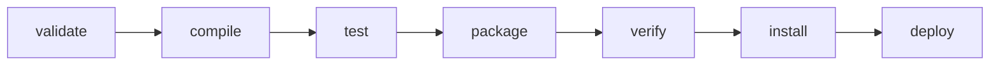

| Phase | 역할 |
| --- | --- |
| validate | 프로젝트 구성 검증 |
| compile | 소스 코드 컴파일 |
| test | 테스트 실행 |
| package | JAR 또는 WAR 생성 |
| verify | 빌드 결과물 검증 |
| install | 로컬 Maven 저장소에 등록 |
| deploy | 원격 Maven 저장소에 등록 |

`mvn package`를 실행하면 동일한 Lifecycle에서 `package` 이전에 정의된 Phase들도 순차적으로 실행된다.

위 다이어그램은 전체 Phase 중 대표적인 Phase만 나타낸 것이다.

### Lifecycle, Phase, Goal의 관계

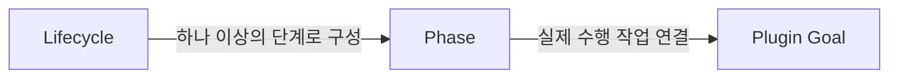

- **Lifecycle**: 빌드의 전체 생명주기
- **Phase**: 생명주기를 구성하는 단계
- **Goal**: 플러그인이 수행하는 구체적인 작업

예를 들어 `compile` Phase에 Maven Compiler Plugin의 `compile` Goal을 연결할 수 있다.

여기서 `deploy`는 일반적으로 운영 서버에 애플리케이션을 실행하는 것이 아니라 원격 아티팩트 저장소에 빌드 결과물을 등록하는 것을 의미한다.

## 3.2. Gradle

Groovy 또는 Kotlin 기반 DSL(Domain Specific Language)을 사용하는 빌드 자동화 도구이다.

Maven처럼 의존성 관리와 표준 빌드 기능을 제공하면서도 작업 간 의존관계를 더욱 유연하게 구성할 수 있다.

### 주요 특징

- Groovy DSL 또는 Kotlin DSL을 사용한다.
- Task 간 의존관계를 기반으로 빌드한다.
- Incremental Build를 지원한다.
- Build Cache를 지원한다.
- Configuration Cache를 지원한다.
- Gradle Daemon을 통해 반복 빌드 시 JVM 시작 비용 등을 줄인다.
- 복잡한 멀티 모듈 프로젝트와 커스텀 빌드 구성에 유연하다.

### 의존성 선언

```kotlin
dependencies {
    implementation("org.springframework.boot:spring-boot-starter-web")
}
```

### 빌드 생명주기

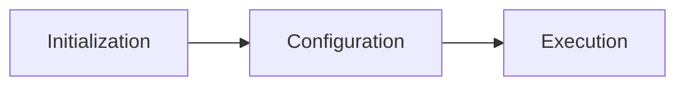

| 단계 | 역할 |
| --- | --- |
| Initialization | 빌드 대상 프로젝트 결정 |
| Configuration | 빌드 스크립트 평가 및 Task 실행 그래프 구성 |
| Execution | 필요한 Task 실행 |

Gradle은 Task 간 의존관계를 DAG(Directed Acyclic Graph) 형태로 구성하고 실행한다.

### Task Graph

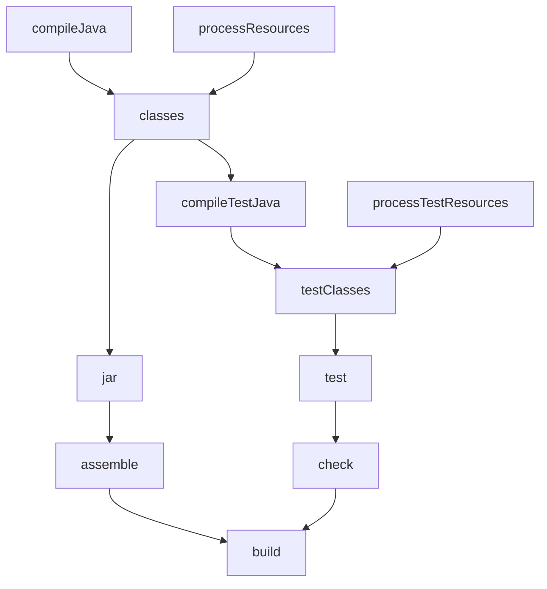

위 다이어그램은 Java Plugin의 대표적인 Task 실행 관계를 단순화한 것이다.

화살표는 선행 작업에서 후속 작업으로 향하는 실행 관계를 나타낸다.

Maven처럼 모든 작업을 하나의 고정된 Lifecycle 순서로 처리하는 것이 아니라, 실행하려는 Task와 해당 Task가 의존하는 작업을 기반으로 실행 그래프를 구성한다.

## 3.3. Gradle이 반복 빌드에서 유리한 이유

### Incremental Build

Task의 입력과 출력이 이전 실행 이후 변경되지 않았다면 해당 Task를 다시 실행하지 않는다.

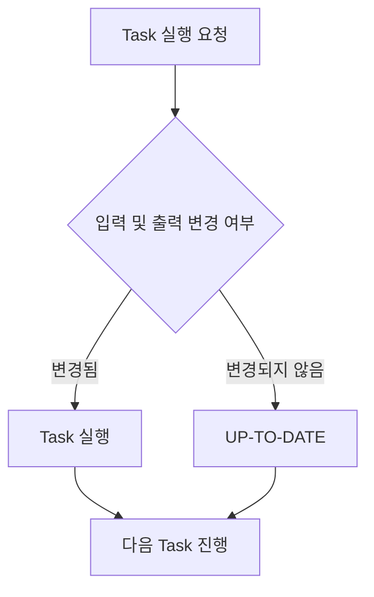

### Build Cache

동일한 입력에 대한 Task 실행 결과가 캐시에 존재한다면 해당 결과물을 재사용한다.

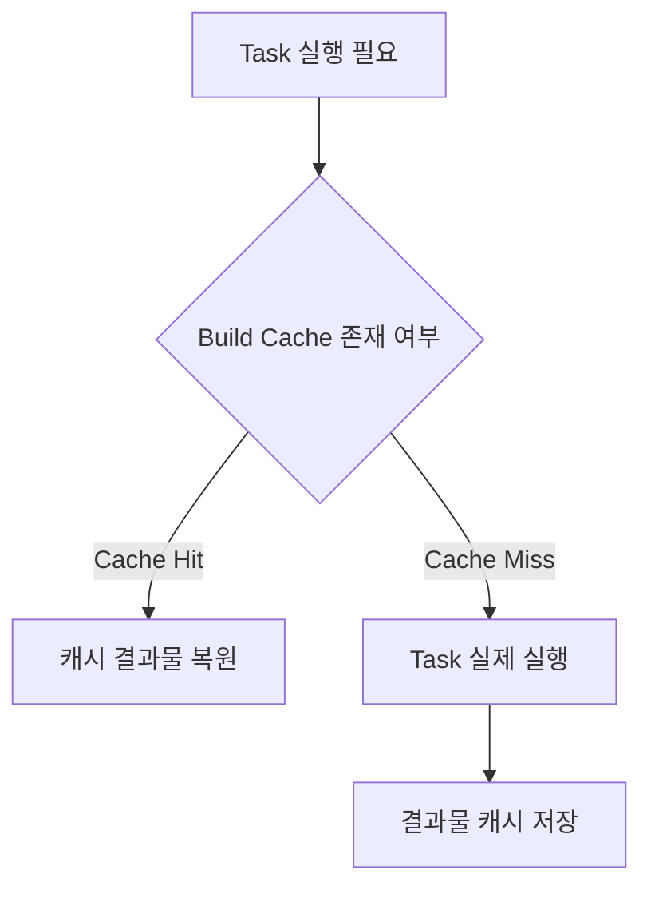

### 주요 빌드 최적화 기능

| 기능 | 설명 |
| --- | --- |
| Incremental Build | 입력과 출력이 변경되지 않은 Task 실행 생략 |
| Build Cache | 동일한 입력에 대한 이전 Task 결과물 재사용 |
| Configuration Cache | 이전 빌드의 구성 결과 재사용 |
| Gradle Daemon | 빌드 프로세스를 재사용하여 시작 비용 감소 |
| Parallel Execution | 실행 가능한 독립 작업을 병렬 처리 |

단순히 XML 대신 DSL을 사용하기 때문에 빠른 것이 아니다.

**불필요한 작업 자체를 줄이는 빌드 최적화 기능이 핵심이다.**

Build Cache와 Configuration Cache 등은 사용 환경에 맞게 활성화 및 구성해야 하며, 모든 Task가 캐싱 가능한 것은 아니다.

## 3.4. 차이점 비교

| 구분 | Maven | Gradle |
| --- | --- | --- |
| 설정 파일 | pom.xml | build.gradle(.kts) |
| 설정 언어 | XML | Groovy, Kotlin DSL |
| 빌드 모델 | Lifecycle, Phase, Goal | Task, Task Graph |
| 빌드 방식 | 표준 단계 중심 | 작업 의존관계 중심 |
| 증분 빌드 | 플러그인 등에 따라 지원 | 빌드 시스템 수준에서 지원 |
| 빌드 캐싱 | 확장 기능 등을 통해 지원 | 자체 Build Cache 지원 |
| 유연성 | 표준화 중심 | 커스터마이징 중심 |
| 기본 버전 충돌 해결 | 의존성 트리에서 가까운 버전 | 요청된 버전 중 높은 버전 |
| 기본 결과물 경로 | target/ | build/ |
| 학습 난이도 | 상대적으로 낮음 | 복잡한 구성에서는 높음 |

### 의존성 버전 충돌 해결

다음과 같은 의존성 관계가 존재한다고 가정한다.

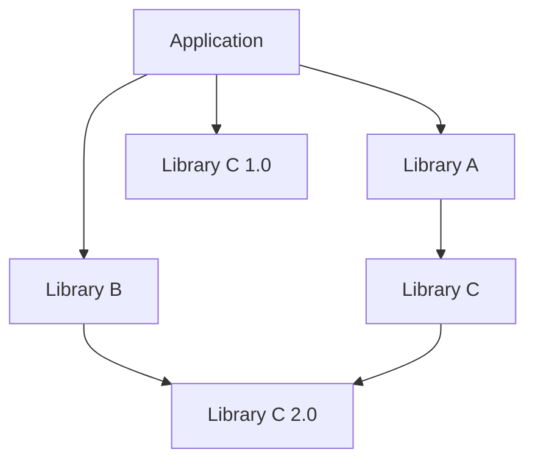

- Maven: 기본적으로 의존성 트리에서 가장 가까운 선언을 선택한다. 동일한 깊이라면 먼저 선언된 의존성이 우선한다.
- Gradle: 기본적으로 충돌한 모듈 버전 중 더 높은 버전을 선택한다.

위 예시에서는 별도의 버전 제약이 없다면 Maven은 1.0, Gradle은 2.0을 선택할 수 있다.

단, BOM, Dependency Management, Version Constraint, Resolution Rule 등에 따라 실제 선택 결과는 달라질 수 있다.

### 의존성 Scope 비교

| Maven | Gradle | 역할 |
| --- | --- | --- |
| compile | implementation / api | 컴파일 및 실행에 필요한 의존성 |
| provided | compileOnly | 실행 환경에서 별도로 제공하는 의존성 |
| runtime | runtimeOnly | 실행 시 필요한 의존성 |
| test | testImplementation | 테스트에 필요한 의존성 |

각 Scope와 Configuration의 의미가 완전히 일대일 대응하는 것은 아니다.

특히 Gradle의 `api`와 `implementation`은 Java Library Plugin에서 외부 모듈에 대한 의존성 노출 여부를 구분할 수 있다.

### 자주 사용하는 명령어

| 목적 | Maven | Gradle |
| --- | --- | --- |
| 빌드 결과 제거 | mvn clean | gradlew clean |
| 컴파일 | mvn compile | gradlew compileJava |
| 테스트 | mvn test | gradlew test |
| 패키징 | mvn package | gradlew assemble |
| Spring Boot 실행 | mvn spring-boot:run | gradlew bootRun |
| 의존성 확인 | mvn dependency:tree | gradlew dependencies |

`mvn package`는 일반적으로 이전 테스트 Phase까지 실행한다. 반면 `gradlew assemble`은 기본적으로 테스트를 실행하지 않으므로 완전히 동일한 명령어는 아니다.

Gradle에서 테스트와 패키징을 모두 수행하려면 일반적으로 `gradlew build`를 사용한다.

## 3.5. 참고 자료

### 공식 문서

- [Maven - Introduction to the Build Lifecycle](https://maven.apache.org/guides/introduction/introduction-to-the-lifecycle)
- [Maven - Introduction to the Dependency Mechanism](https://maven.apache.org/guides/introduction/introduction-to-dependency-mechanism)
- [Gradle - Build Lifecycle](https://docs.gradle.org/current/userguide/build_lifecycle.html)
- [Gradle - Incremental Builds](https://docs.gradle.org/current/userguide/incremental_build.html)
- [Gradle - Build Cache](https://docs.gradle.org/current/userguide/build_cache.html)
- [Gradle - Migrating Builds From Apache Maven](https://docs.gradle.org/current/userguide/migrating_from_maven.html)

### 한글 참고 자료

- [웹 백엔드를 위한 Java 입문 - JDK, JVM, 빌드 도구](https://w3c.io/java/java-for-web/)
- [전자정부 표준프레임워크 - Gradle](https://www.egovframe.go.kr/docs/archive/egovframework/개발환경/dev3.7/dep/build_tool/gradle.html)
    - 전자정부 프레임워크의 구버전 문서이므로 현재 Gradle 기능은 공식 문서를 우선 참고한다.

## 3.6. 면접용 답변

### Q. Maven과 Gradle의 차이점은 무엇인가요?

> Maven과 Gradle은 모두 프로젝트의 의존성 관리와 빌드 과정을 자동화하는 도구입니다.
>
> Maven은 XML 기반의 pom.xml을 사용하며, 정해진 빌드 생명주기를 따라 컴파일, 테스트, 패키징 등을 수행합니다. 표준화된 구조를 제공하기 때문에 프로젝트 간 일관성을 유지하기 좋습니다.
>
> 반면 Gradle은 Groovy나 Kotlin 기반의 DSL을 사용하고, Task 간 의존관계를 기반으로 빌드를 수행합니다. 증분 빌드와 빌드 캐시를 통해 불필요한 작업을 줄일 수 있으며, 빌드 과정의 커스터마이징에도 유연합니다.
>
> 다만 프로젝트의 규모나 기존 빌드 환경, 팀의 숙련도에 따라 Maven을 유지하는 것이 더 적합할 수도 있다고 생각합니다.

### 예상 꼬리 질문

- Gradle의 증분 빌드는 어떻게 동작하나요?
- Gradle은 왜 Maven보다 빠르다고 하나요?
- Incremental Build와 Build Cache의 차이는 무엇인가요?
- `implementation`과 `api`의 차이는 무엇인가요?
- Maven과 Gradle의 의존성 충돌 해결 방식은 어떻게 다른가요?
- Gradle Wrapper는 왜 사용하나요?
- Maven의 Lifecycle, Phase, Goal의 차이는 무엇인가요?

---

# 4. Oracle vs MySQL vs PostgreSQL

세 기술 모두 관계형 데이터베이스이며, SQL을 기반으로 데이터를 관리하고 ACID 트랜잭션을 지원한다.

MySQL은 이하 내용에서 InnoDB 스토리지 엔진을 기준으로 설명한다.

단순한 CRUD 기능만 보면 큰 차이가 없어 보이지만, 내부 저장 구조, 동시성 제어 방식, 인덱스 구조, SQL 문법, 운영 비용에서 차이가 발생한다.

## 4.1. Oracle Database

Oracle에서 개발한 데이터베이스 제품이다.

대규모 엔터프라이즈 시스템에서 사용되는 다양한 기능과 운영 도구를 제공한다.

### 주요 특징

- PL/SQL을 통한 저장 프로시저 및 함수 지원
- RAC(Real Application Clusters)를 통한 클러스터 구성 지원
- Data Guard를 통한 재해 복구 구성 지원
- Flashback을 통한 과거 데이터 조회 및 복구 관련 기능
- Undo Segment 기반의 읽기 일관성 제공
- 기본 트랜잭션 격리 수준은 READ COMMITTED

### 장점

- 대규모 기업 시스템을 위한 다양한 운영 기능 제공
- 고가용성 및 장애 복구 기능
- 전문적인 벤더 지원
- 기존 기업 시스템과의 호환성

### 단점

- 에디션 및 사용 기능에 따른 라이선스 비용
- 운영 및 관리의 복잡성
- Oracle 전용 SQL이나 PL/SQL 사용에 따른 벤더 종속성

무료 에디션도 존재하므로 Oracle을 반드시 유료로만 사용할 수 있는 것은 아니다.

또한 RAC 등의 기능은 에디션과 라이선스에 따라 사용 가능 여부가 달라진다.

## 4.2. MySQL

오픈소스 관계형 데이터베이스로, 현재 Oracle에서 관리한다.

### 주요 특징

- 스토리지 엔진을 교체할 수 있는 아키텍처
- InnoDB를 통한 ACID 트랜잭션 지원
- Primary Key 기반 Clustered Index 구조
- Undo Log 기반 MVCC
- Replication을 통한 복제 구성 지원
- 기본 트랜잭션 격리 수준은 REPEATABLE READ

### 스토리지 엔진 구조

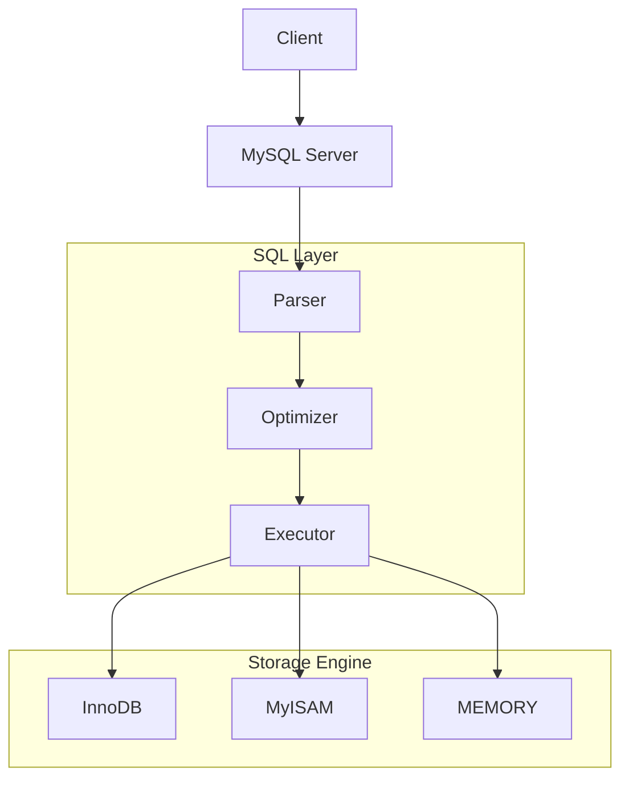

MySQL은 SQL 처리 계층과 실제 데이터 저장을 담당하는 스토리지 엔진 계층이 구분된다.

현대적인 MySQL에서는 InnoDB가 기본 스토리지 엔진으로 사용된다.

### 장점

- 넓은 사용자 생태계
- 다양한 개발 프레임워크 및 클라우드 환경 지원
- 범용적인 웹 애플리케이션 개발에 활용하기 좋음
- Primary Key 기반 조회에 적합한 저장 구조

### 단점 및 고려 사항

- Clustered Index 구조에서 Primary Key 선택이 중요함
- Secondary Index 크기에 Primary Key 크기가 영향을 줌
- 격리 수준과 쿼리에 따른 Gap Lock 및 Next-Key Lock 고려
- 특정 SQL 기능 및 데이터 타입은 버전에 따라 차이가 있음

## 4.3. PostgreSQL

오픈소스 객체 관계형 데이터베이스(ORDBMS)이다.

SQL 표준 준수와 확장성을 중시하며, 다양한 데이터 타입과 인덱스 구조를 지원한다.

### 주요 특징

- SQL 표준을 폭넓게 지원
- JSONB, Array, Range 등 다양한 데이터 타입
- B-Tree, Hash, GIN, GiST, BRIN 등 다양한 인덱스
- PostGIS 등 Extension을 통한 기능 확장
- Heap Tuple 기반 MVCC
- VACUUM 및 Autovacuum을 통한 불필요한 행 버전 관리
- 기본 트랜잭션 격리 수준은 READ COMMITTED

### 대표적인 인덱스

| 인덱스 | 대표적인 활용 |
| --- | --- |
| B-Tree | 동등 조건, 범위 검색, 정렬 |
| Hash | 동등 조건 |
| GIN | JSONB, 배열, 전문 검색 |
| GiST | 공간 데이터, 범위 검색 |
| BRIN | 물리적 저장 순서와 상관관계가 높은 대용량 데이터 |

### 장점

- 다양한 데이터 타입 및 인덱스 지원
- 복잡한 SQL 및 데이터 처리 기능
- Extension 기반 확장성
- 허용적인 오픈소스 라이선스

### 단점 및 고려 사항

- VACUUM 및 Autovacuum 관리
- UPDATE와 DELETE가 빈번한 환경에서 Dead Tuple 및 Bloat 고려
- 워크로드에 맞는 인덱스와 운영 설정 필요

## 4.4. 차이점 비교

| 구분 | Oracle | MySQL | PostgreSQL |
| --- | --- | --- | --- |
| 개발 및 관리 | Oracle | Oracle | 오픈소스 커뮤니티 |
| 라이선스 | 상용 중심, 무료 에디션 존재 | GPL Community 및 상용 | PostgreSQL License |
| DB 유형 | RDBMS | RDBMS | ORDBMS |
| 기본 저장 구조 | Heap Table | InnoDB Clustered Index | Heap Table |
| 기본 격리 수준 | READ COMMITTED | REPEATABLE READ | READ COMMITTED |
| MVCC 구현 | Undo Segment | Undo Log | Heap Tuple Version |
| 프로시저 언어 | PL/SQL | Stored Program SQL | PL/pgSQL 등 |
| 자동 증가 키 | Sequence, Identity | AUTO_INCREMENT | Sequence, Identity, SERIAL |
| 대표적 강점 | 기업용 고가용성 및 운영 기능 | 생태계 및 범용 웹 서비스 | 확장성, 데이터 타입, SQL 기능 |
| 운영 시 고려 사항 | 라이선스 및 운영 복잡성 | InnoDB 구조와 잠금 | VACUUM 및 튜닝 |

## 4.5. 핵심 차이 ① - MVCC 구현 방식

MVCC(Multi-Version Concurrency Control)는 데이터의 여러 버전을 관리하여 트랜잭션 간 읽기 일관성을 확보하는 동시성 제어 방식이다.

세 데이터베이스 모두 MVCC를 지원하지만 과거 버전의 데이터를 관리하는 방식이 다르다.

### Oracle / MySQL

Oracle과 MySQL은 Undo 정보를 활용하여 이전 데이터 버전을 재구성한다.

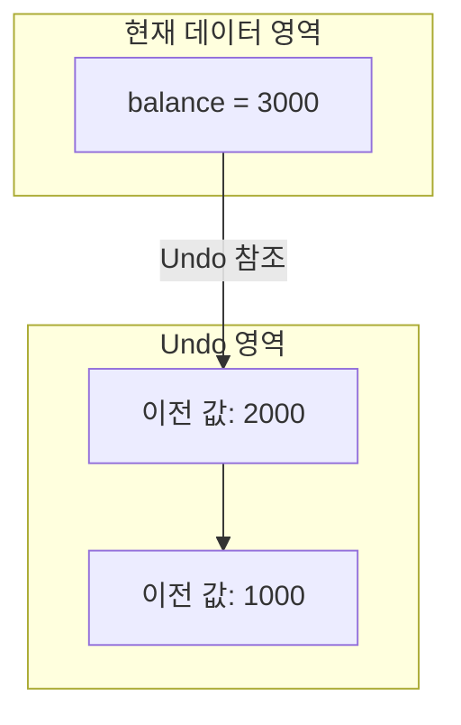

1. UPDATE를 수행하면 현재 데이터가 변경된다.
2. 변경 이전의 데이터를 재구성하는 데 필요한 정보가 Undo 영역에 기록된다.
3. 이전 버전이 필요한 트랜잭션은 Undo 정보를 활용하여 자신의 Snapshot에서 읽을 수 있는 데이터를 조회한다.
4. 더 이상 필요하지 않은 Undo 정보는 각 DBMS의 정책에 따라 정리되거나 재사용된다.

위 다이어그램은 공통적인 개념을 단순화한 것으로, Oracle과 InnoDB의 실제 Undo 구조는 서로 다르다.

### PostgreSQL

PostgreSQL은 이전 버전과 새로운 버전의 Tuple을 Heap 영역에 관리한다.

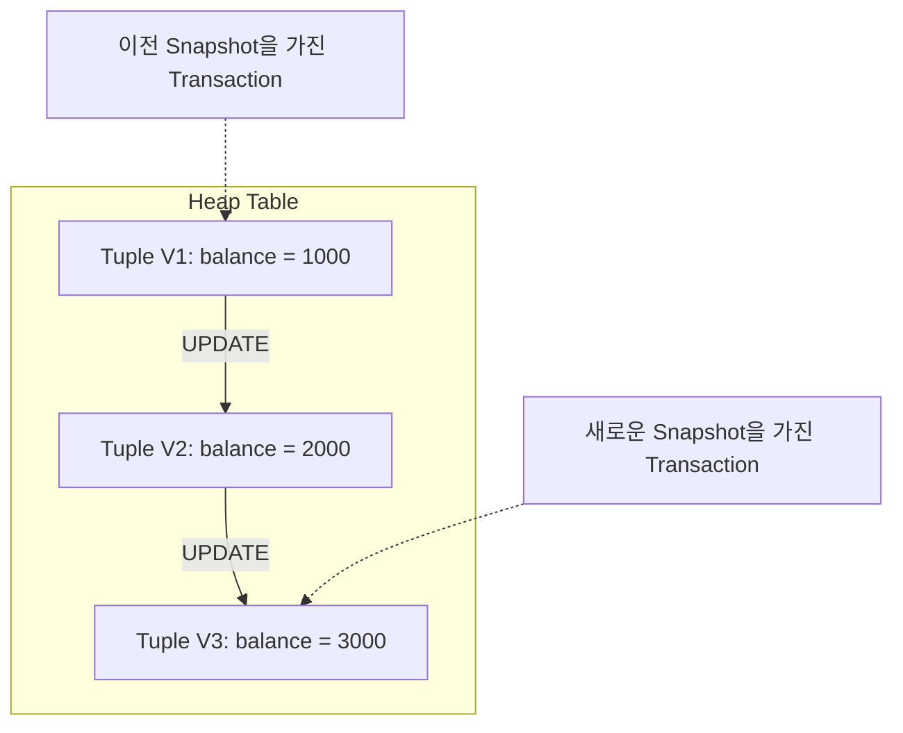

1. UPDATE를 수행하면 새로운 Tuple 버전이 생성된다.
2. 이전 Tuple 버전은 즉시 제거되지 않는다.
3. 트랜잭션은 Snapshot과 Tuple의 가시성 정보를 기준으로 읽을 버전을 결정한다.
4. 더 이상 어떤 트랜잭션에도 필요하지 않은 Tuple은 VACUUM 등의 정리 대상이 된다.

이전 버전이 존재한다고 해서 항상 Dead Tuple로 즉시 정리할 수 있는 것은 아니다. 실행 중인 트랜잭션에서 해당 버전이 필요할 수 있기 때문이다.

### VACUUM

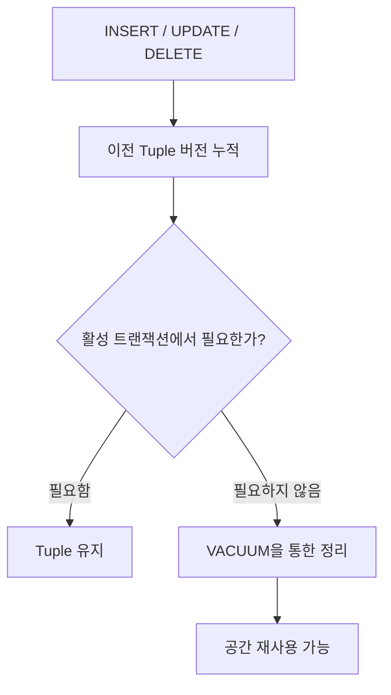

PostgreSQL에서는 UPDATE나 DELETE가 반복될수록 불필요한 행 버전이 누적될 수 있다.

VACUUM은 이러한 Tuple을 정리하고 해당 공간을 재사용할 수 있도록 관리한다.

일반적인 VACUUM은 공간을 재사용할 수 있도록 만드는 것이며, 반드시 운영체제에 디스크 공간을 반환하는 것은 아니다.

### MVCC 구현 비교

| 구분 | Oracle / MySQL | PostgreSQL |
| --- | --- | --- |
| 과거 버전 관리 | Undo 영역 | Heap의 행 버전 |
| 이전 데이터 조회 | Undo 정보를 이용해 재구성 | Snapshot에 따라 보이는 Tuple 선택 |
| 불필요한 버전 처리 | Undo 관리 및 재사용, Purge 등 | VACUUM 및 페이지 정리 |
| 대표 운영 문제 | Undo 보존 및 정리 지연 | Dead Tuple 누적 및 테이블 Bloat |

## 4.6. 핵심 차이 ② - 인덱스와 데이터 저장 구조

### MySQL - InnoDB Clustered Index

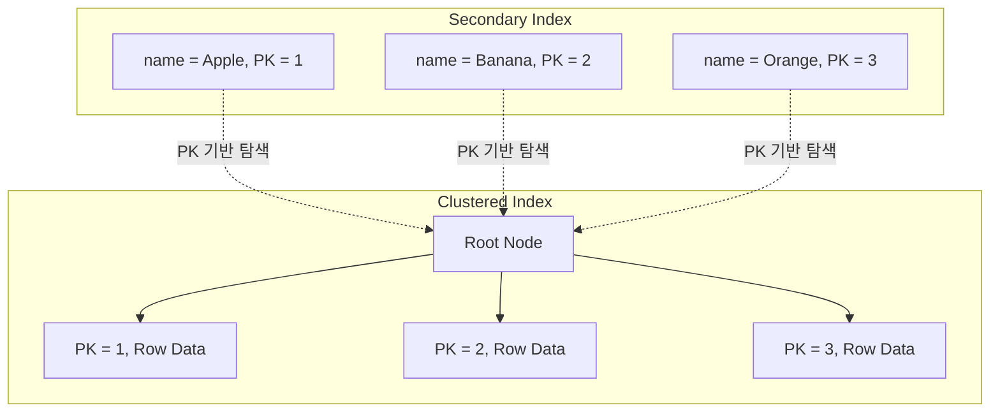

InnoDB의 Clustered Index는 일반적으로 Primary Key를 기준으로 구성된다.

Clustered Index의 리프 페이지에는 실제 행 데이터가 저장된다.

Secondary Index에는 Primary Key 값이 포함되므로, 필요한 컬럼이 Secondary Index에 모두 존재하지 않는다면 해당 Primary Key를 이용하여 Clustered Index를 추가 탐색한다.

Primary Key가 없다면 적절한 UNIQUE NOT NULL 인덱스를 사용하거나 내부적으로 숨겨진 행 식별자를 생성하여 Clustered Index를 구성한다.

### PostgreSQL / Oracle - 일반적인 Heap Table

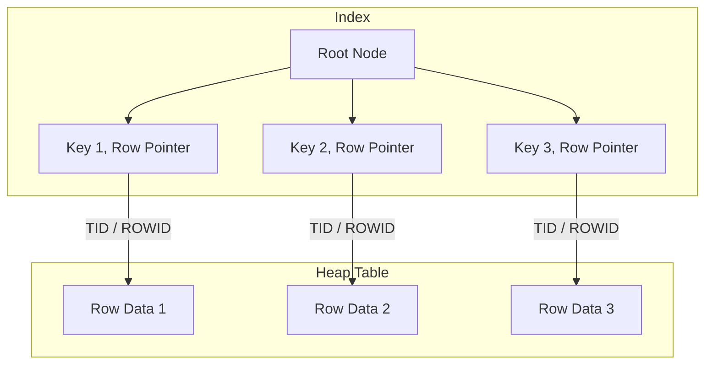

PostgreSQL과 Oracle의 일반적인 Heap Table은 인덱스와 실제 행의 저장 영역이 분리되어 있다.

- PostgreSQL: TID(Tuple Identifier)를 이용하여 실제 Tuple의 위치를 참조한다.
- Oracle: ROWID를 이용하여 실제 행의 위치를 참조한다.

Oracle의 Index-Organized Table(IOT) 등 예외적인 저장 구조는 제외한 비교이다.

### 저장 구조 비교

| 구분 | MySQL(InnoDB) | PostgreSQL / Oracle Heap Table |
| --- | --- | --- |
| 실제 행 저장 위치 | Clustered Index의 리프 페이지 | Heap 영역 |
| 보조 인덱스의 참조 정보 | Primary Key 등 Clustered Key | TID / ROWID |
| 추가 데이터 조회 | Clustered Index 탐색 | Heap 데이터 접근 |
| PK 크기의 영향 | Secondary Index 크기에 직접적인 영향 | InnoDB와 동일한 구조적 영향은 없음 |

이러한 구조적 차이 때문에 MySQL에서는 Primary Key의 크기와 선택이 Secondary Index의 크기 및 탐색 비용에도 영향을 줄 수 있다.

단, Covering Index나 Index Only Scan 등을 활용하면 실제 행 데이터에 대한 추가 접근을 줄일 수 있다.

## 4.7. 핵심 차이 ③ - 트랜잭션 격리 수준

| 격리 수준 | Oracle | MySQL(InnoDB) | PostgreSQL |
| --- | --- | --- | --- |
| READ UNCOMMITTED | 미지원 | 지원 | READ COMMITTED로 동작 |
| READ COMMITTED | 기본값 | 지원 | 기본값 |
| REPEATABLE READ | 미지원 | 기본값 | 지원 |
| SERIALIZABLE | 지원 | 지원 | 지원 |

Oracle은 이외에 READ ONLY 트랜잭션 모드도 지원한다.

### READ COMMITTED

일반적으로 각 SQL 문장이 실행되는 시점에 커밋된 데이터를 조회할 수 있다.

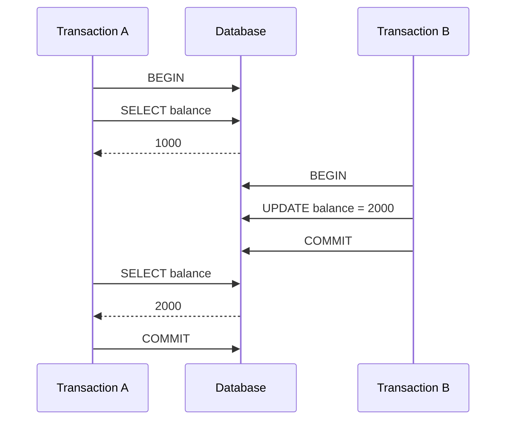

Oracle과 PostgreSQL의 기본 격리 수준에서 위와 같은 일반 SELECT를 수행하면 Non-Repeatable Read가 발생할 수 있다.

### REPEATABLE READ

MySQL InnoDB의 기본 격리 수준에서는 첫 번째 일반적인 consistent read에서 생성된 Snapshot을 이후 consistent read에서도 사용한다.

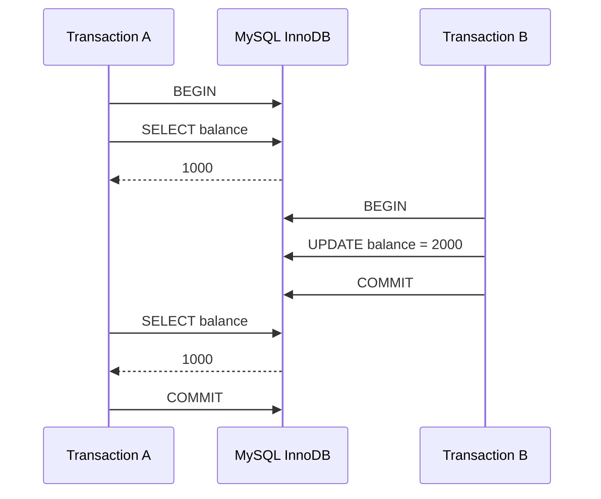

Transaction A는 Transaction B가 변경 사항을 커밋하더라도 기존 Snapshot을 기준으로 데이터를 조회한다.

### 기본 격리 수준에서의 결과 비교

| DBMS | 첫 번째 SELECT | 다른 트랜잭션 UPDATE 및 COMMIT | 두 번째 SELECT |
| --- | --- | --- | --- |
| Oracle | 1000 | 2000 | 2000 |
| MySQL | 1000 | 2000 | 1000 |
| PostgreSQL | 1000 | 2000 | 2000 |

단, MySQL의 `SELECT FOR UPDATE`와 같은 잠금 읽기는 일반적인 Snapshot Read와 동작 방식이 다르다.

동일한 이름의 트랜잭션 격리 수준이라도 DBMS별 잠금 및 동시성 제어의 세부 구현은 다를 수 있다.

## 4.8. 핵심 차이 ④ - SQL 문법

| 기능 | Oracle | MySQL | PostgreSQL |
| --- | --- | --- | --- |
| 조회 개수 제한 | ROWNUM, FETCH FIRST | LIMIT | LIMIT, FETCH FIRST |
| 페이징 | OFFSET ... FETCH | LIMIT ... OFFSET | LIMIT ... OFFSET |
| NULL 대체 | NVL, COALESCE | IFNULL, COALESCE | COALESCE |
| 문자열 연결 | `\|\|` | CONCAT() | `\|\|`, CONCAT() |
| 현재 시간 | SYSDATE, SYSTIMESTAMP | NOW() | NOW() |
| UPSERT 관련 문법 | MERGE | ON DUPLICATE KEY UPDATE | ON CONFLICT, MERGE |
| 자동 증가 키 | Sequence, Identity | AUTO_INCREMENT | Sequence, Identity, SERIAL |
| 실행 계획 | EXPLAIN PLAN | EXPLAIN | EXPLAIN |

MERGE와 각 DBMS의 UPSERT 전용 문법은 동시성 및 충돌 처리 방식까지 완전히 동일하지는 않다.

### 페이징

#### Oracle 11g 등에서 사용하던 방식

```sql
SELECT *
FROM (
    SELECT p.*, ROWNUM AS rn
    FROM (
        SELECT *
        FROM product
        ORDER BY id
    ) p
    WHERE ROWNUM <= 30
)
WHERE rn > 20;
```

#### Oracle 12c 이후 지원하는 방식

```sql
SELECT *
FROM product
ORDER BY id
OFFSET 20 ROWS FETCH NEXT 10 ROWS ONLY;
```

#### MySQL / PostgreSQL

```sql
SELECT *
FROM product
ORDER BY id
LIMIT 10 OFFSET 20;
```

Oracle에서도 현대적인 페이징 문법을 지원한다.

Oracle은 반드시 ROWNUM을 사용해야 한다고 답변하지 않도록 주의한다.

### NULL 처리

Oracle은 길이가 0인 문자열을 NULL로 처리하는 특징이 있다.

MySQL과 PostgreSQL은 일반적으로 빈 문자열과 NULL을 서로 다른 값으로 취급한다.

DBMS 마이그레이션 과정에서 문자열 및 NULL 처리의 차이가 비즈니스 로직에 영향을 줄 수 있다.

### 실행 계획 비교

| 개념 | Oracle | MySQL | PostgreSQL |
| --- | --- | --- | --- |
| 테이블 전체 탐색 | TABLE ACCESS FULL | ALL | Seq Scan |
| 인덱스 전체 탐색 | INDEX FULL SCAN | index | Index Scan 또는 Index Only Scan |
| 인덱스 범위 탐색 | INDEX RANGE SCAN | range | Index Scan 또는 Index Only Scan |
| 유일한 키 탐색 | INDEX UNIQUE SCAN | const, eq_ref 등 | Index Scan 또는 Index Only Scan |
| 인덱스만으로 조회 | 인덱스에서 필요한 컬럼 충족 | Using index | Index Only Scan |
| 비트맵 기반 탐색 | Bitmap 관련 연산 | Index Merge 등 | Bitmap Index Scan + Bitmap Heap Scan |
| 병렬 순차 탐색 | 병렬 TABLE ACCESS FULL | 직접 대응하는 일반적 실행 계획 유형 없음 | Parallel Seq Scan |

MySQL의 `ALL`, `index`, `range` 등은 EXPLAIN의 접근 방식(type)이며, PostgreSQL의 실행 계획 노드와 완전히 동일한 개념은 아니다.

특히 MySQL의 Index Merge는 PostgreSQL의 Bitmap Scan과 일대일로 대응하는 기능은 아니다.

## 4.9. 참고 자료

### 공식 문서

- [Oracle - Data Concurrency and Consistency](https://docs.oracle.com/en/database/oracle/oracle-database/21/cncpt/data-concurrency-and-consistency.html)
- [MySQL - Clustered and Secondary Indexes](https://dev.mysql.com/doc/refman/8.4/en/innodb-index-types.html)
- [MySQL - InnoDB Multi-Versioning](https://dev.mysql.com/doc/refman/8.4/en/innodb-multi-versioning.html)
- [MySQL - Transaction Isolation Levels](https://dev.mysql.com/doc/refman/8.4/en/innodb-transaction-isolation-levels.html)
- [MySQL - EXPLAIN Output Format](https://dev.mysql.com/doc/refman/8.4/en/explain-output.html)
- [PostgreSQL - Transaction Isolation](https://www.postgresql.org/docs/current/transaction-iso.html)
- [PostgreSQL - Routine Vacuuming](https://www.postgresql.org/docs/current/routine-vacuuming.html)
- [PostgreSQL - Index Types](https://www.postgresql.org/docs/current/indexes-types.html)

### 한글 참고 자료

- [우아한형제들 기술블로그 - PostgreSQL Vacuum에 대한 거의 모든 것](https://techblog.woowahan.com/9478/)
    - Oracle, MySQL, PostgreSQL의 MVCC 구현 차이와 PostgreSQL의 VACUUM 동작 원리를 이해하기 좋은 자료이다.
    - 우선적으로 정독할 것을 권장한다.
- [AWS - PostgreSQL과 MySQL 비교](https://aws.amazon.com/ko/compare/the-difference-between-mysql-vs-postgresql/)
    - 두 데이터베이스의 기능 및 아키텍처 차이를 폭넓게 비교한다.
    - 성능에 관한 일반화는 실제 워크로드와 구분하여 이해해야 한다.

## 4.10. 면접용 답변

### Q. Oracle, MySQL, PostgreSQL의 차이점을 설명해 주세요.

> 세 데이터베이스 모두 관계형 데이터베이스로 SQL과 ACID 트랜잭션을 지원하지만, 내부 저장 구조와 동시성 제어 방식에서 차이가 있습니다.
>
> Oracle은 기업 환경에서 요구하는 고가용성과 장애 복구 등의 기능을 폭넓게 제공하며, MySQL은 InnoDB 스토리지 엔진을 기반으로 Primary Key 중심의 Clustered Index 구조를 사용합니다.
>
> PostgreSQL은 SQL 표준을 폭넓게 지원하며 JSONB나 다양한 인덱스, Extension을 통한 확장성이 특징입니다.
>
> 내부적으로 Oracle과 MySQL은 Undo 정보를 활용해 과거 데이터 버전을 관리하는 반면, PostgreSQL은 Heap에 여러 Tuple 버전을 관리하기 때문에 VACUUM이라는 정리 작업이 필요합니다.
>
> 따라서 어떤 데이터베이스가 무조건 우수하다기보다 서비스의 요구사항과 쿼리 특성, 운영 환경을 고려하여 선택해야 한다고 생각합니다.

### 예상 꼬리 질문

- PostgreSQL의 VACUUM은 왜 필요한가요?
- MySQL과 PostgreSQL의 MVCC 구현 방식은 어떻게 다른가요?
- MySQL의 기본 트랜잭션 격리 수준은 무엇인가요?
- Clustered Index와 Non-clustered Index의 차이는 무엇인가요?
- MySQL에서 Primary Key의 크기가 중요한 이유는 무엇인가요?
- Oracle에서 사용하던 SQL을 PostgreSQL에서도 그대로 사용할 수 있나요?
- 프로젝트에서 PostgreSQL을 선택한 이유는 무엇인가요?
- 데이터베이스를 마이그레이션한다면 어떤 점을 고려해야 하나요?

---

# 5. MyBatis vs JPA

두 기술 모두 Java 애플리케이션에서 관계형 데이터베이스에 접근하는 과정에서 JDBC를 직접 다루는 부담을 줄여준다.

하지만 MyBatis는 **SQL 중심의 데이터 접근 기술**이고, JPA는 **객체 중심의 데이터 접근 기술**이라는 차이가 있다.

## 5.1. MyBatis

개발자가 직접 작성한 SQL과 Java 객체를 매핑하는 SQL Mapper 프레임워크이다.

### 주요 특징

- SQL을 개발자가 직접 작성한다.
- XML 또는 애너테이션을 통해 SQL을 정의한다.
- SQL 실행 결과를 Java 객체로 매핑한다.
- 동적 SQL을 지원한다.
- DBMS에 특화된 SQL이나 저장 프로시저를 활용하기 편리하다.
- JDBC의 반복적인 코드를 줄여준다.

### Mapper 인터페이스

```java
@Mapper
public interface ProductMapper {

    Product findById(@Param("id") Long id);

    int updatePrice(
        @Param("id") Long id,
        @Param("price") int price
    );
}
```

### Mapper XML

```xml
<mapper namespace="com.example.ProductMapper">

    <select id="findById"
            resultType="com.example.Product">
        SELECT id, name, price
        FROM product
        WHERE id = #{id}
    </select>

    <update id="updatePrice">
        UPDATE product
        SET price = #{price}
        WHERE id = #{id}
    </update>

</mapper>
```

### 동작 원리

```mermaid
flowchart TD
    A["Service"]
    B["Mapper Interface"]
    C["Mapper Proxy"]
    D["SqlSession"]
    E["Executor"]
    F["StatementHandler"]
    G["JDBC"]
    H["Database"]

    A --> B
    B --> C
    C --> D
    D --> E
    E --> F
    F --> G
    G --> H
```

1. Service에서 Mapper 인터페이스의 메서드를 호출한다.
2. MyBatis가 생성한 Mapper Proxy가 메서드 호출을 처리한다.
3. Mapper 메서드에 대응하는 MappedStatement를 찾는다.
4. SqlSession과 Executor를 통해 SQL 실행을 처리한다.
5. StatementHandler 등을 통해 JDBC 작업을 수행한다.
6. 조회 결과를 Java 객체로 매핑하여 반환한다.

MyBatis는 JDBC의 PreparedStatement 생성, 파라미터 바인딩, ResultSet 매핑 등의 반복 작업을 추상화한다.

### 동적 SQL

MyBatis는 XML 태그를 사용하여 실행할 SQL을 동적으로 구성할 수 있다.

```xml
<select id="findProducts" resultType="Product">
    SELECT *
    FROM product

    <where>
        <if test="name != null">
            AND name = #{name}
        </if>

        <if test="minPrice != null">
            AND price >= #{minPrice}
        </if>
    </where>
</select>
```

| 태그 | 역할 |
| --- | --- |
| if | 조건에 따른 SQL 추가 |
| choose / when / otherwise | 여러 조건 중 하나 선택 |
| where | WHERE 절 구성 및 불필요한 AND, OR 처리 |
| set | UPDATE의 SET 절 구성 |
| foreach | 컬렉션을 반복하며 SQL 구성 |
| trim | SQL 앞뒤의 불필요한 문자열 처리 |

### `#{}`와 `${}`의 차이

| 구분 | `#{}` | `${}` |
| --- | --- | --- |
| 처리 방식 | PreparedStatement 파라미터 바인딩 | 문자열 직접 치환 |
| SQL Injection | 방어에 유리 | 취약할 수 있음 |
| 대표 용도 | 검색값, ID, 가격 | 동적 컬럼명, 테이블명 |
| 권장 방식 | 일반적인 값 전달 | 필요한 경우 화이트리스트 검증 후 사용 |

예를 들어 다음 SQL은 JDBC의 파라미터 바인딩을 사용한다.

```sql
SELECT *
FROM product
WHERE id = #{id}
```

실제로는 다음과 같은 PreparedStatement가 구성된다.

```sql
SELECT *
FROM product
WHERE id = ?
```

반면 `${}`는 입력된 문자열을 SQL에 직접 포함한다.

```sql
SELECT *
FROM product
ORDER BY ${column}
```

컬럼명이나 테이블명은 일반적인 PreparedStatement 파라미터로 바인딩할 수 없기 때문에 필요한 경우 `${}`를 사용할 수 있다.

다만 사용자 입력을 그대로 전달하지 않도록 주의해야 한다.

## 5.2. JPA

JPA(Java Persistence API, 현재 Jakarta Persistence)는 Java 객체와 관계형 데이터베이스 간 매핑을 정의하는 ORM 표준 명세이다.

Hibernate, EclipseLink 등의 구현체가 존재한다.

### 주요 특징

- 객체와 테이블을 매핑한다.
- 영속성 컨텍스트를 통해 엔티티를 관리한다.
- Dirty Checking을 지원한다.
- 연관관계 매핑을 지원한다.
- 지연 로딩 및 즉시 로딩을 지원한다.
- JPQL을 통한 객체 중심의 쿼리를 작성할 수 있다.
- Hibernate의 Dialect와 같은 기능을 통해 DBMS별 SQL 차이를 일부 추상화할 수 있다.

### Entity

```java
@Entity
public class Product {

    @Id
    @GeneratedValue
    private Long id;

    private String name;

    private int price;

    public void changePrice(int price) {
        this.price = price;
    }
}
```

### Service

```java
@Transactional
public void changePrice(Long id, int price) {
    Product product = entityManager.find(
        Product.class,
        id
    );

    product.changePrice(price);
}
```

MyBatis에서는 UPDATE SQL을 명시적으로 호출하지만, JPA에서는 관리 중인 엔티티의 상태를 변경하면 Flush 시점에 변경 사항을 데이터베이스에 반영할 수 있다.

### JPA 관련 기술의 관계

```mermaid
flowchart TD
    A["Application"]
    B["Spring Data JPA"]
    C["Jakarta Persistence"]
    D["Hibernate"]
    E["JDBC"]
    F["Database"]

    A --> B
    A -.->|"직접 사용 가능"| C
    B -->|"표준 API 사용"| C
    D -.->|"표준 명세 구현"| C
    D --> E
    E --> F
```

| 기술 | 역할 |
| --- | --- |
| JPA | ORM 표준 API 및 명세 |
| Hibernate | JPA 구현체 |
| Spring Data JPA | JPA 사용을 편리하게 해주는 Repository 추상화 |
| JDBC | 데이터베이스 연결 및 SQL 실행 |

JPA 자체가 구현체인 것은 아니다.

## 5.3. 동일한 기능을 구현할 때의 차이

상품의 가격을 변경하는 기능을 가정한다.

### MyBatis

```java
@Transactional
public void changePrice(Long id, int price) {
    Product product = productMapper.findById(id);

    product.changePrice(price);

    productMapper.updatePrice(
        product.getId(),
        product.getPrice()
    );
}
```

```mermaid
sequenceDiagram
    participant S as Service
    participant M as MyBatis Mapper
    participant DB as Database

    S->>M: findById(id)
    M->>DB: SELECT
    DB-->>M: ResultSet
    M-->>S: Product 객체

    Note over S: product.changePrice(price)

    S->>M: updatePrice(id, price)
    M->>DB: UPDATE
    DB-->>M: 변경된 행 수
    M-->>S: 실행 결과
```

Java 객체의 상태를 변경하는 것만으로는 데이터베이스의 값이 변경되지 않는다.

개발자가 명시적으로 UPDATE SQL에 대응하는 Mapper 메서드를 호출해야 한다.

단순한 가격 변경만 필요하다면 사전에 SELECT하지 않고 바로 UPDATE를 수행하는 것도 가능하다.

### JPA

```java
@Transactional
public void changePrice(Long id, int price) {
    Product product = entityManager.find(
        Product.class,
        id
    );

    product.changePrice(price);
}
```

```mermaid
sequenceDiagram
    participant S as Service
    participant EM as EntityManager
    participant PC as Persistence Context
    participant DB as Database

    S->>EM: find(Product.class, id)
    EM->>PC: 엔티티 조회
    PC-->>EM: Cache Miss
    EM->>DB: SELECT
    DB-->>EM: Row Data
    EM->>PC: 엔티티 관리 시작
    EM-->>S: Managed Entity

    Note over S,PC: product.changePrice(price)

    Note over EM,PC: Flush 시점
    EM->>PC: 변경 사항 감지
    EM->>DB: UPDATE
    DB-->>EM: 실행 결과
```

JPA는 영속성 컨텍스트를 통해 관리 중인 엔티티의 상태를 추적한다.

Flush 시점에 변경 사항을 감지하고 필요한 SQL을 실행한다.

Flush는 반드시 트랜잭션 커밋 시점에만 발생하는 것은 아니다. 명시적인 `flush()` 호출이나 쿼리 실행 전에도 Flush가 발생할 수 있다.

## 5.4. 차이점 비교

| 구분 | MyBatis | JPA |
| --- | --- | --- |
| 기술 분류 | SQL Mapper | ORM 표준 |
| 개발 방식 | SQL 중심 | 객체 중심 |
| SQL 작성 | 개발자가 직접 작성 | 구현체가 생성하거나 개발자가 작성 |
| 매핑 대상 | SQL 실행 결과와 객체 | 엔티티와 테이블 |
| CRUD | SQL 정의 필요 | 기본 API 제공 |
| 객체 상태 관리 | 미지원 | 영속성 컨텍스트 |
| Dirty Checking | 미지원 | 지원 |
| 연관관계 | SQL 및 결과 매핑 중심 | 객체 간 연관관계 매핑 |
| 지연 로딩 | 설정을 통해 지원 | 연관관계 로딩 전략 지원 |
| 캐싱 | SqlSession 로컬 캐시, 선택적 2차 캐시 | 영속성 컨텍스트, 선택적 2차 캐시 |
| 동적 쿼리 | XML, SQL Provider 등 | Criteria API, QueryDSL 등 |
| DBMS 이식성 | 직접 작성한 SQL에 의존 | 상대적으로 추상화 가능 |
| SQL 제어 | 직접적 | 생성 SQL 확인 및 제어 필요 |
| 학습 비용 | SQL 중심 | ORM 내부 동작 이해 필요 |

## 5.5. MyBatis를 사용하는 이유

JPA가 등장했다고 해서 MyBatis를 사용해야 할 이유가 사라진 것은 아니다.

MyBatis는 다음과 같은 환경에서 유용할 수 있다.

- 복잡한 통계, 집계, 리포트 중심의 서비스
- DBMS에 특화된 SQL 기능을 적극적으로 사용하는 서비스
- 기존에 작성된 SQL이나 저장 프로시저가 많은 시스템
- 데이터베이스 스키마를 변경하기 어려운 시스템
- 실행되는 SQL을 개발자가 직접 관리해야 하는 환경

반대로 JPA는 다음과 같은 환경에서 유용할 수 있다.

- 엔티티의 상태 변화가 중요한 비즈니스 로직
- 객체 간 연관관계가 복잡한 도메인
- 반복적인 CRUD 작업이 많은 서비스
- 객체 중심의 도메인 모델을 구성하려는 서비스

다만 JPA도 Native SQL 등을 통해 복잡한 SQL을 작성할 수 있으므로, 복잡한 조회가 필요하다는 이유만으로 반드시 MyBatis를 도입해야 하는 것은 아니다.

## 5.6. MyBatis와 JPA 혼용

JPA와 MyBatis를 하나의 프로젝트에서 함께 사용하는 것도 가능하다.

```mermaid
flowchart TD
    A["Service Layer"]

    B["JPA Repository"]
    C["MyBatis Mapper"]

    D["EntityManager"]
    E["SqlSession"]

    F["DataSource"]
    G["Database"]

    A -->|"도메인 CRUD"| B
    A -->|"복잡한 SQL 조회"| C

    B --> D
    C --> E

    D --> F
    E --> F
    F --> G
```

예를 들어 일반적인 도메인 CRUD는 JPA로 처리하고, 복잡한 통계 조회는 MyBatis로 처리할 수 있다.

단, 동일한 트랜잭션에 참여하도록 DataSource와 TransactionManager 등을 적절히 구성해야 한다.

### 혼용 시 주의 사항

MyBatis를 통해 데이터베이스를 변경하더라도 JPA 영속성 컨텍스트가 해당 변경을 자동으로 인식하지는 못한다.

```mermaid
sequenceDiagram
    participant S as Service
    participant J as JPA
    participant M as MyBatis
    participant DB as Database

    S->>J: 상품 조회
    J->>DB: SELECT
    DB-->>J: price = 1000
    J-->>S: Managed Entity

    S->>M: 가격 변경
    M->>DB: UPDATE price = 2000

    S->>J: 동일 엔티티 다시 조회
    J-->>S: price = 1000

    Note over J,DB: 영속성 컨텍스트와 DB 상태 불일치
```

반대로 JPA가 아직 Flush하지 않은 변경 사항은 MyBatis 조회에서 확인되지 않을 수도 있다.

따라서 다음과 같은 처리를 고려해야 한다.

- JPA의 변경 사항을 MyBatis가 읽기 전에 Flush 수행
- MyBatis가 변경한 데이터에 대해 JPA 엔티티 Refresh 수행
- 필요에 따라 영속성 컨텍스트 Clear 수행
- 동일 엔티티에 대한 변경 책임 분리

Clear 수행 시 아직 Flush되지 않은 변경 사항이 유실될 수 있으므로 주의해야 한다.

## 5.7. 성능 관점에서의 차이

MyBatis가 JPA보다 항상 빠르다고 단정할 수는 없다.

MyBatis는 실행되는 SQL을 직접 제어하기 편리하며, JPA는 영속성 컨텍스트 관리에 추가적인 비용이 발생할 수 있다.

반면 JPA는 다음과 같은 기능을 활용할 수 있다.

- 1차 캐시를 통한 일부 조회 생략
- 동일성 보장
- Dirty Checking을 통한 변경 사항 반영
- JDBC Batch를 통한 SQL 전송 비용 절감
- 쓰기 작업의 지연 및 정렬 등 구현체의 최적화

실제 성능은 다음과 같은 요소에 의해 결정된다.

- SQL 실행 계획
- 쿼리 실행 횟수
- 조회하는 데이터 크기
- 네트워크 비용
- 캐시 활용 여부
- ORM 및 SQL Mapper 사용 방식

JPA와 MyBatis 모두 SQL과 데이터베이스에 대한 이해가 필요하다.

## 5.8. 참고 자료

### 공식 문서

- [MyBatis - 소개 (한글)](https://mybatis.org/mybatis-3/ko/index.html)
- [MyBatis - 시작하기 (한글)](https://mybatis.org/mybatis-3/ko/getting-started.html)
- [MyBatis - Mapper XML 파일 (한글)](https://mybatis.org/mybatis-3/ko/sqlmap-xml.html)
- [MyBatis - 동적 SQL (한글)](https://mybatis.org/mybatis-3/ko/dynamic-sql.html)
- [Jakarta EE - Introduction to Jakarta Persistence](https://jakarta.ee/learn/docs/jakartaee-tutorial/current/persist/persistence-intro/persistence-intro.html)
- [Hibernate ORM Documentation](https://hibernate.org/orm/documentation/)

### 한글 참고 자료

- [우아한형제들 기술블로그 - 우아한형제들 JPA 강의 소감과 적용 사례](https://techblog.woowahan.com/2598/)
    - JPA를 사용하는 이유와 실제 서비스에서 객체 중심 개발이 제공하는 장점을 이해하기 좋은 자료이다.

## 5.9. 면접용 답변

### Q. MyBatis와 JPA의 차이점은 무엇인가요?

> MyBatis는 개발자가 직접 작성한 SQL과 Java 객체를 매핑하는 SQL Mapper이고, JPA는 객체와 관계형 데이터베이스 간의 매핑을 정의하는 ORM 표준입니다.
>
> MyBatis는 SQL을 직접 제어할 수 있기 때문에 복잡한 집계 쿼리나 데이터베이스에 특화된 기능을 활용하기 편리합니다.
>
> 반면 JPA는 영속성 컨텍스트를 기반으로 엔티티의 상태를 관리하고 Dirty Checking과 연관관계 매핑 등을 지원하기 때문에 객체 중심의 비즈니스 로직을 작성하기 좋습니다.
>
> 저는 최근 프로젝트에서 JPA를 주로 사용했지만, 기존 SQL 자산이 많거나 SQL에 대한 세밀한 제어가 필요한 환경이라면 MyBatis도 충분히 적합한 선택이라고 생각합니다.

### 예상 꼬리 질문

- MyBatis를 ORM이라고 할 수 있나요?
- MyBatis의 `#{}`와 `${}`의 차이는 무엇인가요?
- MyBatis는 Mapper 인터페이스의 구현체를 어떻게 생성하나요?
- MyBatis도 캐시를 지원하나요?
- JPA의 영속성 컨텍스트가 제공하는 장점은 무엇인가요?
- MyBatis와 JPA 중 어느 것이 더 빠른가요?
- 두 기술을 하나의 프로젝트에서 함께 사용할 수 있나요?
- 두 기술을 혼용할 때 어떤 문제가 발생할 수 있나요?
- JPA를 사용하면 SQL을 공부하지 않아도 되나요?

---

# 6. JSP vs React vs Next.js

세 기술은 모두 웹 화면을 구성하는 데 사용되지만 동일한 계층의 기술은 아니다.

| 기술 | 분류 |
| --- | --- |
| JSP | Java 기반 서버 사이드 템플릿 기술 |
| React | 컴포넌트 기반 JavaScript UI 라이브러리 |
| Next.js | React 기반 웹 애플리케이션 프레임워크 |

이 비교에서는 다음 세 가지가 중요하다.

- HTML을 어디에서 생성하는가?
- 화면의 상태를 어디에서 관리하는가?
- 프론트엔드와 백엔드가 어떻게 통신하는가?

## 6.1. JSP(JavaServer Pages)

Java 기반의 동적 웹 페이지를 생성하기 위한 서버 사이드 템플릿 기술이다.

현재 Jakarta EE에서는 Jakarta Pages라는 이름으로 이어지고 있다.

HTML에 Java 코드, EL(Expression Language), JSTL 등을 결합하여 동적인 HTML을 생성할 수 있다.

```jsp
<h1>${product.name}</h1>
<p>가격: ${product.price}원</p>
```

### JSP 관련 기술

| 기술 | 역할 |
| --- | --- |
| Servlet | HTTP 요청 및 응답 처리 |
| JSP | 서버에서 동적인 HTML 생성 |
| EL | 데이터를 간결하게 참조하고 표현 |
| JSTL | 반복문, 조건문 등을 태그 형태로 제공 |
| Scriptlet | JSP 내부에 Java 코드 작성 |

현대적인 JSP 개발에서는 JSP 내부에 Java 코드를 직접 작성하는 Scriptlet 방식보다 EL과 JSTL을 활용하여 비즈니스 로직과 화면 표현을 분리하는 것이 일반적으로 권장된다.

### JSP 실행 과정

```mermaid
flowchart TD
    A["product.jsp"]
    B["Servlet Source Code 생성"]
    C["product_jsp.java"]
    D["Java Compilation"]
    E["product_jsp.class"]
    F["Servlet 실행"]
    G["HTML 생성"]
    H["HTTP Response"]

    A --> B
    B --> C
    C --> D
    D --> E
    E --> F
    F --> G
    G --> H
```

1. JSP 파일이 Servlet 소스 코드로 변환된다.
2. 생성된 Java 소스 코드가 컴파일된다.
3. Servlet Container가 컴파일된 Servlet을 로딩하고 실행한다.
4. Servlet이 동적인 HTML을 생성한다.
5. 생성된 HTML을 클라이언트에 반환한다.

JSP는 최초 요청 또는 사전 컴파일 등의 시점에 Servlet으로 변환된다.

이후에는 컴파일된 Servlet을 재사용할 수 있으며, JSP 파일이 변경되면 환경 설정에 따라 다시 컴파일할 수 있다.

### JSP의 생명주기

```mermaid
flowchart TD
    A["JSP Translation"]
    B["Compilation"]
    C["Class Loading"]
    D["jspInit"]
    E["_jspService"]
    F["jspDestroy"]

    A --> B --> C --> D --> E
    E -->|"추가 HTTP 요청"| E
    E -->|"Servlet 종료"| F
```

| 메서드 | 역할 |
| --- | --- |
| jspInit() | JSP Servlet 초기화 |
| _jspService() | 각 HTTP 요청 처리 |
| jspDestroy() | JSP Servlet 종료 및 자원 정리 |

### Spring MVC와 JSP

```java
@Controller
public class ProductController {

    @GetMapping("/products/{id}")
    public String findProduct(
            @PathVariable Long id,
            Model model
    ) {
        model.addAttribute(
            "product",
            productService.findById(id)
        );

        return "product/detail";
    }
}
```

Controller가 반환한 논리적 View 이름을 ViewResolver가 해석하여 해당 JSP로 전달한다.

```text
product/detail

        ↓ ViewResolver

/WEB-INF/views/product/detail.jsp
```

### 요청 처리 과정

```mermaid
sequenceDiagram
    participant C as Client
    participant DS as DispatcherServlet
    participant CT as Controller
    participant S as Service
    participant DB as Database
    participant VR as ViewResolver
    participant JSP as JSP View

    C->>DS: GET /products/1
    DS->>CT: 요청 위임
    CT->>S: 상품 조회
    S->>DB: SELECT
    DB-->>S: 상품 데이터
    S-->>CT: Product
    CT-->>DS: Model + View Name
    DS->>VR: View 해석
    VR-->>DS: JSP View
    DS->>JSP: View 렌더링
    JSP-->>DS: HTML 생성
    DS-->>C: HTML Response
```

위 다이어그램은 HandlerMapping, HandlerAdapter 등의 세부 구성 요소를 생략하고 View 렌더링 중심으로 표현한 것이다.

### 장점

- Java 기반 애플리케이션과 통합하기 편리하다.
- 별도의 프론트엔드 빌드 환경 없이 웹 페이지를 구성할 수 있다.
- 초기 HTML을 서버에서 제공한다.
- 기존 Servlet 및 Spring MVC 시스템과 호환성이 좋다.

### 단점

- 복잡한 UI 상태와 상호작용을 관리하기 어려워질 수 있다.
- 화면과 백엔드의 배포 주기가 결합되기 쉽다.
- 대규모 컴포넌트 기반 UI 구성에 추가적인 노력이 필요하다.

단, JSP 자체가 프론트엔드와 백엔드의 분리를 막는 것은 아니다.

MVC 패턴으로 관심사를 분리하고 JavaScript와 AJAX를 활용하는 것도 가능하다.

## 6.2. React

사용자 인터페이스를 개발하기 위한 JavaScript 라이브러리이다.

UI를 재사용 가능한 컴포넌트로 분리하고 상태를 기반으로 선언적으로 화면을 구성할 수 있다.

```jsx
function ProductDetail({ product }) {
    return (
        <div>
            <h1>{product.name}</h1>
            <p>가격: {product.price}원</p>
        </div>
    );
}
```

### 주요 특징

- 컴포넌트 기반 UI
- 선언적 렌더링
- Props 및 State 기반 데이터 관리
- 단방향 데이터 흐름
- Reconciliation을 통한 UI 갱신
- CSR, SSR 등 다양한 렌더링 방식 활용 가능

### React의 렌더링 과정

```mermaid
flowchart TD
    A["State 또는 Props 변경"]
    B["Render Phase"]
    C["새로운 렌더링 결과 계산"]
    D["Reconciliation"]
    E{"DOM 변경 필요 여부"}
    F["Commit Phase에서 DOM 갱신"]
    G["기존 DOM 유지"]

    A --> B
    B --> C
    C --> D
    D --> E
    E -->|필요함| F
    E -->|필요하지 않음| G
```

React는 컴포넌트의 렌더링 결과를 비교하여 필요한 DOM 변경 사항을 실제 DOM에 반영한다.

컴포넌트가 다시 렌더링되었다고 해서 반드시 실제 DOM 전체가 갱신되는 것은 아니다.

### React와 Spring Boot를 분리하는 방식

백엔드는 HTML 대신 JSON을 반환한다.

```java
@RestController
public class ProductController {

    @GetMapping("/api/products/{id}")
    public ProductResponse findProduct(
            @PathVariable Long id
    ) {
        return productService.findById(id);
    }
}
```

프론트엔드는 API를 통해 데이터를 조회하고 UI를 구성한다.

```jsx
useEffect(() => {
    fetch("/api/products/1")
        .then(response => response.json())
        .then(data => setProduct(data));
}, []);
```

위 코드는 데이터 조회 방식을 설명하기 위한 단순한 예시이다. 실제 개발에서는 오류 처리, 요청 취소, 캐싱 등을 고려해야 한다.

### 요청 처리 과정 - CSR 기반

```mermaid
sequenceDiagram
    participant C as Browser
    participant FE as Frontend Server
    participant BE as Spring Boot
    participant DB as Database

    C->>FE: 페이지 요청
    FE-->>C: HTML + JavaScript

    Note over C: React 실행

    C->>BE: GET /api/products/1
    BE->>DB: SELECT
    DB-->>BE: 상품 데이터
    BE-->>C: JSON Response

    Note over C: State 변경 및 UI 렌더링
```

이 구조에서는 백엔드가 비즈니스 로직과 데이터 처리를 담당하고 프론트엔드가 화면 구성과 상태 관리를 담당한다.

### 장점

- FE와 BE의 독립적인 개발 및 배포가 가능하다.
- 동일한 백엔드 API를 웹과 모바일에서 재사용할 수 있다.
- 복잡한 UI와 상호작용을 컴포넌트 단위로 관리하기 좋다.

### 단점

- 별도의 프론트엔드 개발 및 빌드 환경이 필요하다.
- API 명세를 통한 직군 간 협업이 필요하다.
- 서로 다른 Origin에서 통신할 경우 CORS 등 추가 설정이 필요하다.
- 순수 CSR 구조에서는 초기 JavaScript 로딩이나 SEO가 문제가 될 수 있다.

## 6.3. Next.js

React를 기반으로 라우팅, 서버 렌더링, 정적 페이지 생성, 캐싱, 서버 기능 등을 제공하는 웹 프레임워크이다.

React가 UI를 구성하기 위한 라이브러리라면 Next.js는 React 기반 애플리케이션을 구성하고 실행하기 위한 전반적인 환경을 제공한다.

```mermaid
flowchart TB
    subgraph Next["Next.js"]
        direction TB

        R["Routing"]
        SSR["Server Rendering"]
        SSG["Static Generation"]
        C["Caching"]
        API["Route Handler"]

        subgraph React["React"]
            direction LR
            CO["Component"]
            ST["State"]
            H["Hooks"]
            RE["Rendering"]
        end

        R --> React
        SSR --> React
        SSG --> React
        C --> React
        API --> React
    end
```

Spring Framework와 Spring Boot의 관계와 유사한 측면이 있지만, 각각의 기술적 역할까지 완전히 동일한 관계는 아니다.

### 주요 특징

- 파일 시스템 기반 라우팅
- Server-side Rendering
- Static Site Generation
- Incremental Static Regeneration
- React Server Components
- Route Handler를 통한 HTTP API 구성
- 이미지 및 메타데이터 관리 기능
- 캐싱 및 스트리밍

## 6.4. 대표적인 렌더링 방식

| 방식 | HTML 생성 시점 및 위치 | 대표 사용 사례 |
| --- | --- | --- |
| CSR | 브라우저에서 렌더링 | 관리자 페이지, 대시보드 |
| SSR | 요청 시 서버에서 렌더링 | 요청마다 달라지는 페이지 |
| SSG | 빌드 시 정적 HTML 생성 | 회사 소개, 기술 문서 |
| ISR | 배포 후 정적 페이지 재생성 | 상품 목록, 블로그 |

### CSR(Client-Side Rendering)

```mermaid
sequenceDiagram
    participant C as Browser
    participant S as Web Server
    participant API as Backend API

    C->>S: 페이지 요청
    S-->>C: HTML Shell + JavaScript

    Note over C: JavaScript 다운로드 및 실행

    C->>API: 데이터 요청
    API-->>C: JSON

    Note over C: 브라우저에서 UI 렌더링
```

브라우저가 JavaScript를 실행하고 필요한 데이터를 조회하여 화면을 구성한다.

### SSR(Server-Side Rendering)

```mermaid
sequenceDiagram
    participant C as Browser
    participant S as Rendering Server
    participant API as Backend API

    C->>S: 페이지 요청
    S->>API: 데이터 요청
    API-->>S: JSON

    Note over S: HTML 렌더링

    S-->>C: HTML + 필요한 JavaScript

    Note over C: HTML 표시 및 Hydration
```

클라이언트 요청에 따라 서버가 HTML을 생성하여 반환한다.

React 기반 SSR에서는 이후 브라우저가 필요한 JavaScript를 실행하고 Hydration을 수행하여 상호작용을 활성화할 수 있다.

### SSG(Static Site Generation)

```mermaid
flowchart TD
    subgraph Build["Build Time"]
        A["Source Code"]
        B["데이터 조회"]
        C["HTML 생성"]
        A --> B --> C
    end

    subgraph Runtime["Runtime"]
        D["Static HTML"]
        E["CDN / Web Server"]
        F["Client"]

        D --> E
        E --> F
    end

    C --> D
```

빌드 시점에 HTML을 미리 생성하고, 이후 클라이언트 요청에는 생성된 정적 파일을 반환한다.

요청마다 서버 렌더링을 수행할 필요가 없다는 장점이 있다.

### ISR(Incremental Static Regeneration)

```mermaid
flowchart TD
    A["Client Request"]
    B{"캐시 상태"}
    C["기존 Static HTML 반환"]
    D["기존 HTML 반환 및 재검증"]
    E["백그라운드 페이지 재생성"]
    F["새로운 Static HTML 저장"]
    G["이후 요청에 새로운 HTML 반환"]
    H["최초 페이지 생성"]

    A --> B
    B -->|유효한 캐시| C
    B -->|재검증 필요| D
    B -->|캐시 없음| H
    D --> E
    E --> F
    F --> G
    H --> F
```

정적으로 생성된 페이지를 배포 이후에도 특정 조건에 따라 재생성할 수 있다.

시간 기반 재검증에서는 캐시된 페이지를 먼저 반환하고 백그라운드에서 페이지를 갱신하는 방식 등을 활용한다.

실제 동작은 시간 기반 재검증, On-demand Revalidation, 최초 캐시 존재 여부 및 Next.js 설정에 따라 달라질 수 있다.

## 6.5. JSP, React, Next.js의 아키텍처 비교

### JSP + Spring MVC

```mermaid
flowchart TD
    C["Browser"]

    subgraph WAS["Java WAS"]
        CT["Spring MVC Controller"]
        S["Service"]
        V["JSP View"]

        CT --> S
        S -->|"조회 결과"| CT
        CT -->|"Model"| V
    end

    DB["Database"]

    C -->|"HTTP Request"| CT
    S --> DB
    DB --> S
    V -->|"HTML Response"| C
```

백엔드 서버에서 데이터 조회와 HTML 렌더링을 함께 수행하는 구조이다.

### React + Spring Boot

```mermaid
flowchart TD
    subgraph Browser["Browser"]
        R["React"]
        UI["UI Rendering"]

        R --> UI
    end

    FE["Frontend Server / CDN"]

    subgraph Backend["Spring Boot"]
        API["REST Controller"]
        S["Service"]

        API --> S
    end

    DB["Database"]

    FE -->|"HTML / JS / CSS"| R
    R -->|"API Request"| API
    API -->|"JSON Response"| R
    S --> DB
    DB --> S
```

백엔드는 데이터를 제공하고 브라우저의 React가 UI를 렌더링하는 대표적인 CSR 구조이다.

### Next.js + Spring Boot

```mermaid
flowchart TD
    C["Browser"]

    subgraph FE["Next.js Server"]
        N["Routing / Rendering"]
        F["Data Fetching"]

        N --> F
        F -->|"조회 결과"| N
    end

    subgraph BE["Spring Boot"]
        API["REST Controller"]
        S["Service"]

        API --> S
    end

    DB["Database"]

    C -->|"Page Request"| N
    N -->|"HTML / RSC Payload / JS"| C

    F -->|"API Request"| API
    API -->|"JSON Response"| F

    S --> DB
    DB --> S
```

별도의 프론트엔드 서버가 백엔드 API를 호출하고 React 기반 HTML을 생성하는 구조이다.

이는 Next.js App Router에서 서버 렌더링을 활용하는 경우의 대표적인 구성이다.

Next.js의 Client Component에서도 백엔드 API를 직접 호출할 수 있으며, 반드시 모든 API 요청이 Next.js 서버를 거쳐야 하는 것은 아니다.

## 6.6. JSP의 SSR과 Next.js의 SSR 차이

두 기술 모두 서버에서 HTML을 생성하여 클라이언트에 전달할 수 있다.

하지만 브라우저에서 HTML을 전달받은 이후 동작하는 방식이 다르다.

| 구분 | JSP | Next.js |
| --- | --- | --- |
| 서버 실행 환경 | JVM, Servlet Container | 일반적으로 Node.js 등 |
| HTML 생성 | JSP가 변환된 Servlet | React 서버 렌더링 |
| 브라우저 상태 관리 | JavaScript 등을 별도 구성 | React 컴포넌트 상태 |
| Hydration | 기본 제공하지 않음 | Client Component에 수행 |
| 페이지 이동 | 전체 페이지 요청이 일반적 | 클라이언트 라우팅 지원 |
| 정적 생성 및 재생성 | 별도 구성 | 프레임워크 기능 활용 |
| 대표 아키텍처 | Java 웹 애플리케이션에 통합 | 별도 FE 서버 구성 가능 |

### JSP의 페이지 렌더링

```mermaid
sequenceDiagram
    participant C as Browser
    participant S as Java WAS

    C->>S: 페이지 요청
    Note over S: JSP 실행 및 HTML 생성
    S-->>C: HTML + 선택적 JavaScript

    Note over C: HTML 표시 및 JavaScript 실행

    C->>S: 다른 페이지 요청
    Note over S: 새로운 HTML 생성
    S-->>C: 새로운 HTML
```

### Next.js의 페이지 렌더링

```mermaid
sequenceDiagram
    participant C as Browser
    participant S as Next.js Server

    C->>S: 최초 페이지 요청
    Note over S: React 서버 렌더링
    S-->>C: HTML + RSC Payload + JS

    Note over C: 초기 HTML 표시
    Note over C: Client Component Hydration

    C->>S: 클라이언트 라우팅 요청
    S-->>C: 필요한 RSC Payload 등

    Note over C: 변경된 UI 반영
```

Next.js의 실제 요청은 캐시와 Prefetch 여부 등에 따라 생략되거나 달라질 수 있다.

또한 JSP에서도 AJAX와 JavaScript를 활용하면 전체 페이지를 다시 로딩하지 않고 일부 화면을 변경할 수 있다.

## 6.7. Hydration

서버에서 미리 생성한 HTML에 React가 연결되어 이벤트 처리와 상호작용을 활성화하는 과정이다.

```mermaid
flowchart TD
    A["서버에서 React HTML 생성"]
    B["브라우저에 HTML 전달"]
    C["초기 화면 표시"]
    D["JavaScript 다운로드 및 실행"]
    E["Hydration"]
    F["이벤트 처리 및 사용자 상호작용 가능"]

    A --> B
    B --> C
    B --> D
    C --> E
    D --> E
    E --> F
```

예를 들어 서버에서 다음과 같은 버튼을 포함한 HTML을 생성했다고 가정한다.

```html
<button>장바구니 담기</button>
```

브라우저는 HTML을 전달받은 시점에 버튼을 화면에 표시할 수 있다.

하지만 React가 해당 버튼의 이벤트를 처리하려면 관련 JavaScript가 로딩되고 Hydration이 수행되어야 한다.

React에서는 `hydrateRoot()` API를 제공한다.

```jsx
import { hydrateRoot } from "react-dom/client";

hydrateRoot(
    document.getElementById("root"),
    <App />
);
```

Next.js에서는 이러한 과정을 프레임워크 내부에서 처리한다.

### Hydration Mismatch

서버가 렌더링한 HTML과 클라이언트의 초기 렌더링 결과가 서로 다를 때 발생할 수 있는 문제이다.

대표적인 원인은 다음과 같다.

- 서버와 브라우저에서 서로 다른 시간값 사용
- 랜덤값 사용
- 브라우저에서만 존재하는 API 사용
- 서버와 클라이언트의 초기 데이터 불일치

## 6.8. Server Component와 Client Component

React Server Component와 SSR은 동일한 개념이 아니다.

| 구분 | Server Component | Client Component |
| --- | --- | --- |
| 컴포넌트 실행 위치 | 서버 | 브라우저, 초기 서버 렌더링 참여 가능 |
| 브라우저로 컴포넌트 구현 JS 전달 | 불필요 | 필요 |
| useState, useEffect | 직접 사용 불가 | 사용 가능 |
| 브라우저 API 접근 | 직접 접근 불가 | 접근 가능 |
| 사용자 이벤트 처리 | 직접 처리 불가 | 처리 가능 |
| 서버 자원 접근 | 가능 | 직접 접근 불가 |

Next.js App Router에서는 일반적으로 Page와 Layout이 Server Component로 구성된다.

```mermaid
flowchart TD
    subgraph Server["Server"]
        A["Server Component"]
        B["Database / Backend API"]
        C["RSC Payload"]
        D["초기 HTML 생성"]

        A --> B
        B --> A
        A --> C
        C --> D
    end

    subgraph Browser["Browser"]
        E["HTML 표시"]
        F["RSC Payload 활용"]
        G["Client Component JavaScript"]
        H["Hydration"]

        E --> H
        F --> H
        G --> H
    end

    D --> E
    C --> F
```

Client Component는 `use client` 지시어를 통해 선언할 수 있다.

```jsx
"use client";

import { useState } from "react";

export default function Counter() {
    const [count, setCount] = useState(0);

    return (
        <button onClick={() => setCount(count + 1)}>
            {count}
        </button>
    );
}
```

다만 `use client`를 선언했다고 해서 해당 컴포넌트가 반드시 CSR로만 동작하는 것은 아니다.

Client Component 역시 초기 페이지 요청에서는 서버의 HTML 생성 과정에 참여할 수 있으며, 이후 브라우저에서 Hydration을 수행한다.

## 6.9. 전체 차이점 비교

| 구분 | JSP | React | Next.js |
| --- | --- | --- | --- |
| 기술 분류 | 서버 템플릿 | UI 라이브러리 | React 프레임워크 |
| 주요 언어 | Java, HTML, EL | JavaScript, TypeScript | JavaScript, TypeScript |
| 대표 렌더링 | SSR | CSR, SSR 가능 | SSR, CSR, SSG, ISR |
| UI 구성 | 템플릿 | 컴포넌트 | 컴포넌트 |
| 상태 관리 | JavaScript 등 별도 구성 | React State | React State |
| 라우팅 | Servlet, Spring MVC | 별도 라이브러리 활용 | 내장 라우팅 |
| SEO | 초기 HTML 제공 | 렌더링 방식에 따라 다름 | 서버 렌더링 및 정적 생성 활용 |
| 백엔드 연계 | Model, Request, Session | HTTP API 등이 일반적 | 서버 또는 클라이언트 API 호출 |
| 대표 배포 형태 | Java WAS | 정적 파일 또는 렌더링 서버 | Node.js 서버, 정적 배포 등 |
| 주요 장점 | Java 시스템 통합 | 복잡한 UI 구성 | 유연한 렌더링 및 앱 구성 |

## 6.10. 참고 자료

### 공식 문서

- [Jakarta EE - Jakarta Pages](https://jakarta.ee/specifications/pages/)
- [React - 빠르게 시작하기 (한글)](https://ko.react.dev/learn)
- [React - 렌더링 그리고 커밋 (한글)](https://ko.react.dev/learn/render-and-commit)
- [React - hydrateRoot (한글)](https://ko.react.dev/reference/react-dom/client/hydrateRoot)
- [Next.js - Server and Client Components](https://nextjs.org/docs/app/getting-started/server-and-client-components)
- [Next.js - Incremental Static Regeneration](https://nextjs.org/docs/app/guides/incremental-static-regeneration)

### 한글 참고 자료

- [화해 기술블로그 - React의 hydration mismatch 알아보기](https://blog.hwahae.co.kr/all/tech/13604)
    - Next.js를 실제 운영하면서 겪은 Hydration 문제를 설명한다.
    - 서버 렌더링과 브라우저 렌더링의 관계를 이해하기 좋은 자료이다.
- [Rendering 기법 - CSR, SSG, ISR, SSR, Hydration](https://mynamesieun.github.io/next.js/2-Rendering-기법(CSR,-SSG,-ISR,-SSR,-Hydration)/)
    - 대표적인 렌더링 방식의 차이를 복습하기 좋은 자료이다.
    - 현대적인 App Router의 Server Component 관련 동작은 공식 문서를 우선 참고한다.

## 6.11. 면접용 답변

### Q. JSP와 React, Next.js의 차이점은 무엇인가요?

> JSP는 Java 기반의 서버 사이드 템플릿 기술로, 서버에서 데이터를 조회하고 HTML을 생성한 뒤 클라이언트에 반환하는 방식입니다.
>
> 반면 React는 컴포넌트 기반의 UI 라이브러리로, 상태에 따른 화면 변화와 복잡한 사용자 상호작용을 관리하기에 적합합니다. Spring Boot와 분리하여 구성할 경우 백엔드는 REST API를 제공하고 프론트엔드는 화면 구성을 담당할 수 있습니다.
>
> Next.js는 React 기반 프레임워크로, 서버 사이드 렌더링과 정적 페이지 생성 등 다양한 렌더링 방식과 라우팅 기능을 제공합니다.
>
> JSP는 기존 Java 기반 시스템과 통합하기 편리하다는 장점이 있고, React와 Next.js는 복잡한 UI 개발이나 프론트엔드와 백엔드의 독립적인 개발 및 배포에 유리하다고 생각합니다.

### 예상 꼬리 질문

- JSP는 내부적으로 어떻게 실행되나요?
- Servlet과 JSP의 관계는 무엇인가요?
- JSP의 생명주기는 어떻게 구성되나요?
- EL과 JSTL은 무엇인가요?
- `@Controller`와 `@RestController`의 차이는 무엇인가요?
- CSR과 SSR의 차이는 무엇인가요?
- JSP의 SSR과 Next.js의 SSR은 어떻게 다른가요?
- React는 반드시 CSR로 동작하나요?
- Hydration이란 무엇인가요?
- Server Component와 SSR의 차이는 무엇인가요?
- 프론트엔드와 백엔드를 분리하면 어떤 장단점이 있나요?

---

# 7. 면접 직전 복습

## 7.1. 핵심 차이점 요약

| 비교 대상 | 핵심 차이 |
| --- | --- |
| Spring vs Spring Boot | 핵심 프레임워크와 자동 설정·실행·운영 편의 기능 |
| WAR vs JAR | 패키징 목적, 내부 구조 및 애플리케이션 실행 주체 |
| Maven vs Gradle | 표준 Lifecycle 기반 빌드와 Task Graph 기반 빌드 |
| Oracle vs MySQL vs PostgreSQL | 데이터 저장 구조, MVCC 구현 및 트랜잭션 격리 수준 |
| MyBatis vs JPA | SQL 중심의 매핑 방식과 객체 상태 관리 중심의 ORM 방식 |
| JSP vs React vs Next.js | 서버 템플릿, UI 라이브러리, 웹 프레임워크의 역할과 렌더링 방식 |

## 7.2. 복습 체크리스트

- [ ] Spring과 Spring Boot의 차이를 설명할 수 있다.
    - [ ] Auto Configuration의 동작 원리를 설명할 수 있다.
    - [ ] Starter의 역할을 설명할 수 있다.
    - [ ] 전통적인 Spring 프로젝트의 설정 방식을 이해한다.
- [ ] WAR와 JAR의 차이를 설명할 수 있다.
    - [ ] 외부 WAS와 내장 WAS의 차이를 설명할 수 있다.
    - [ ] 실행형 JAR의 내부 구조를 설명할 수 있다.
    - [ ] JarLauncher의 역할을 설명할 수 있다.
- [ ] Maven과 Gradle의 차이를 설명할 수 있다.
    - [ ] Lifecycle, Phase, Goal의 관계를 설명할 수 있다.
    - [ ] Task Graph의 개념을 설명할 수 있다.
    - [ ] Gradle의 빌드 최적화 원리를 설명할 수 있다.
    - [ ] 의존성 충돌 해결 방식의 차이를 설명할 수 있다.
- [ ] Oracle, MySQL, PostgreSQL의 차이를 설명할 수 있다.
    - [ ] MVCC 구현 방식의 차이를 설명할 수 있다.
    - [ ] Clustered Index와 Heap Table의 차이를 설명할 수 있다.
    - [ ] 기본 트랜잭션 격리 수준을 알고 있다.
    - [ ] VACUUM의 역할을 설명할 수 있다.
    - [ ] 대표적인 SQL 문법의 차이를 알고 있다.
- [ ] MyBatis와 JPA의 차이를 설명할 수 있다.
    - [ ] SQL Mapper와 ORM의 차이를 설명할 수 있다.
    - [ ] MyBatis의 Mapper Proxy 동작 원리를 설명할 수 있다.
    - [ ] `#{}`와 `${}`의 차이를 설명할 수 있다.
    - [ ] 영속성 컨텍스트와 Dirty Checking을 설명할 수 있다.
    - [ ] 두 기술을 혼용할 때 발생할 수 있는 문제를 설명할 수 있다.
- [ ] JSP, React, Next.js의 차이를 설명할 수 있다.
    - [ ] JSP가 Servlet으로 변환되는 과정을 설명할 수 있다.
    - [ ] Spring MVC와 JSP의 요청 처리 흐름을 설명할 수 있다.
    - [ ] CSR, SSR, SSG, ISR의 차이를 설명할 수 있다.
    - [ ] Hydration의 개념을 설명할 수 있다.
    - [ ] Server Component와 Client Component의 차이를 설명할 수 있다.

## 7.3. 면접에서 피해야 할 표현

| 피해야 할 답변 | 정확한 답변 방향 |
| --- | --- |
| Spring은 XML을 사용해야 한다. | Java Config와 애너테이션 기반 설정도 지원한다. |
| Spring Boot는 Spring을 대체한다. | Spring Framework를 기반으로 개발 및 운영을 간소화한다. |
| Spring Boot는 반드시 JAR를 사용한다. | WAR 패키징 및 외부 WAS 배포도 지원한다. |
| WAR는 독립 실행할 수 없다. | Spring Boot의 Executable WAR 등 예외가 존재한다. |
| Gradle은 무조건 Maven보다 빠르다. | 증분 빌드와 캐싱 등에 강점이 있으며 환경에 따라 다르다. |
| Maven은 캐싱이나 증분 빌드를 지원하지 않는다. | 플러그인 및 확장 기능을 통해 지원할 수 있다. |
| Oracle은 유료이고 MySQL은 무료이다. | 각각의 무료·상용 에디션 및 라이선스 정책을 고려해야 한다. |
| PostgreSQL은 무조건 MySQL보다 빠르다. | 실제 워크로드와 쿼리 특성에 따라 달라진다. |
| MyBatis는 캐시를 지원하지 않는다. | 로컬 캐시와 선택적인 2차 캐시를 지원한다. |
| JPA는 SQL을 작성하지 않는다. | JPQL, Native SQL 등을 사용할 수 있다. |
| MyBatis는 JPA보다 빠르다. | SQL과 데이터 접근 방식에 따라 달라진다. |
| JSP는 FE와 BE를 분리할 수 없다. | 관심사 분리는 가능하지만 통합 배포되는 구조가 일반적이다. |
| React는 CSR, Next.js는 SSR이다. | React도 SSR이 가능하며 Next.js는 다양한 렌더링 방식을 지원한다. |
| Client Component는 CSR이다. | 초기 서버 렌더링에 참여하고 이후 Hydration을 수행할 수 있다. |

## 7.4. 면접 답변 구성 방식

기술 비교 질문에 대해서는 다음 순서로 답변한다.

```mermaid
flowchart LR
    A["기술의 정의"]
    B["핵심 차이"]
    C["장점 및 트레이드오프"]
    D["선택 기준 또는 실제 경험"]

    A --> B --> C --> D
```

1. 각각 어떤 기술인지 정의한다.
2. 두 기술의 본질적인 차이점을 설명한다.
3. 해당 차이가 어떤 장점과 단점으로 이어지는지 설명한다.
4. 어떤 상황에서 각 기술을 선택할 것인지 설명한다.

단순히 새로운 기술이 기존 기술보다 우수하다고 답변하지 않는다.

기존 기술이 해결하고자 했던 문제와 새로운 기술이 제공하는 개선점을 이해하고, 서비스의 요구사항과 운영 환경에 따라 적절한 기술을 선택할 수 있음을 보여주는 것이 중요하다.