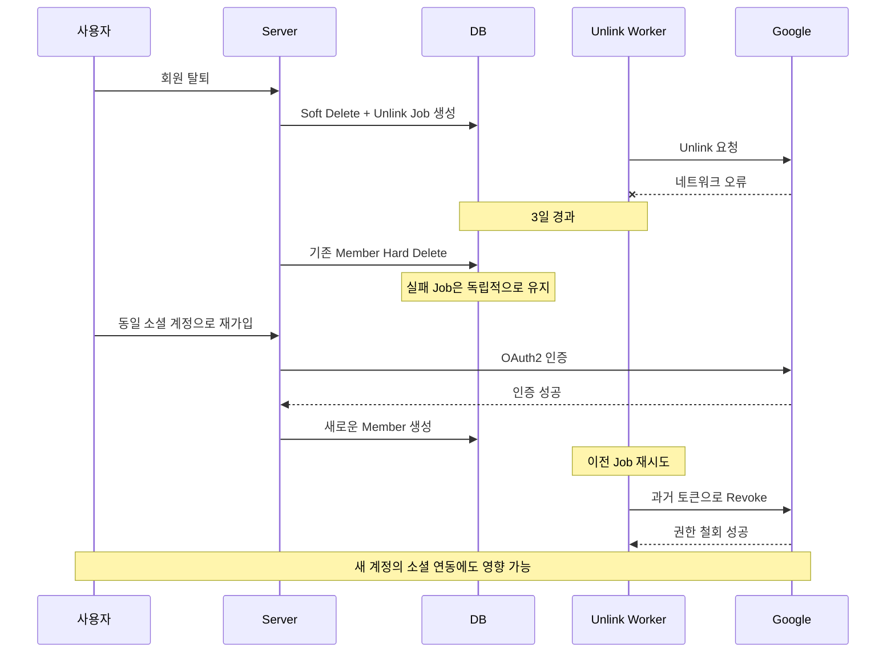

## Provider별 OAuth2 연결 해제 방식 파악

### 카카오

- admin key + provider 식별자로 해제 가능

https://developers.kakao.com/docs/ko/kakaologin/common#unlink

![[IMG-20261021010309448.png]]

### 네이버

- 대상 토큰이 있어야 토큰 폐기가 가능

https://developers.naver.com/docs/login/web/web.md  

```cardlink
url: https://developers.naver.com/docs/login/api/api.md#3-3--%ED%86%A0%ED%81%B0-%ED%8F%90%EA%B8%B0-%EC%9A%94%EC%B2%AD-oauth2-0revoke
title: "네이버 로그인 API 명세 - LOGIN"
description: "네이버 로그인 API 명세 네이버 로그인 API는 네이버 로그인 인증 요청 API, 접근 토큰 발급/갱신/삭제 요청API로 구성되어 있습니다. 네이버 로그인 인증 요청 API는 여러분의 웹 또는 앱에 네이버 로그인 화면을 띄우는 API입니다. 이용자가 네이버 회원"
host: developers.naver.com
```

![[IMG-20261109181522357.png]]

### 구글

- 대상 토큰이 있어야 토큰 폐기가 가능

https://developers.google.com/identity/protocols/oauth2/web-server?hl=ko#tokenrevoke

![[IMG-20261109181547132.png]]

구글과 같은 경우는 refreshToken이 내려오지 않을 수도 있다.  

![[IMG-20261109173647377.png]]

이를 위해 구글 OAuth 요청에는 아래와 같은 파라피터를 담아 보내야 한다.  

- `access_type=offline`: refresh token을 받을 수 있는 방식으로 요청
- `prompt=consent`: 이미 승인한 사용자에게도 동의 화면을 다시 표시


## 구현

| 객체                              | 담고 있는 내용                                        |
| ------------------------------- | ----------------------------------------------- |
| `OAuth2User`                    | provider 사용자 ID, 이메일 등 사용자 정보                   |
| `OAuth2AuthenticationToken`     | 로그인한 사용자와 어떤 provider로 인증했는지                    |
| `OAuth2AuthorizedClient`        | 해당 로그인에서 받은 provider access token·refresh token |
| `OAuth2AuthorizedClientService` | `OAuth2AuthorizedClient`를 저장하고 조회하는 서비스         |

### 토큰 만료일

만료일이 오지 않고 있고 있으나 만료일이 없는건 아니다.  
단지 OAuth2 표준 스펙에 Refresh Token에 대한 만료일이 필수 응답 항목이 아니어서이다.  

![[IMG-20261109175329876.png]]

구글과 같은 경우는 기한이 없으나 다음과 같은 조건이 있음

![[IMG-20261111212421944.png]]

네이버는 따로 명시된게 없음

## 암호화

평문으로 저장하지 않을 것을 권장함

![[IMG-20261111044626745.png]]

https://developers.google.com/identity/protocols/oauth2/resources/best-practices?hl=ko

![[IMG-20261111044737952.png]]

https://developers.kakao.com/docs/ko/getting-started/security-guideline?utm_source=chatgpt.com#access-token

암호화 방식을 고민했고 최종적으로 [[AES|AES-256-GCM]] 방식을 택함.  

| 방식              | 특징                | 권장 여부      |
| --------------- | ----------------- | ---------- |
| 평문 저장           | 원본 토큰이 그대로 노출     | 비권장        |
| SHA-256 해싱      | 원본 복원 불가능         | 현재 용도에 부적합 |
| BCrypt 해싱       | 원본 복원 불가능         | 현재 용도에 부적합 |
| AES-256-GCM 암호화 | 복호화 가능, 무결성 검증 제공 | 권장         |

## 중간 점검

1. 외부 Network 실패시 회원 탈퇴 로직이 롤백
2. 1번을 방지하기 위해 예외 전파 분리시 oauth2 unlink 동작이 조용히 실패함
3. 2번을 방지하기 위해 재시도 로직이 필요
	1. 타임아웃
	2. 최대 재시도
4. 정해진 재시도 limit이 넘어갔을 때 정책이 필요
	1. 실패 기록을 로그로 남기고 물리 삭제시 unlink 시도
	2. 재시도 시점이 언제인지 정책 확정 필요

## 재시도 로직 구현

| 기술                  | 책임                                    | 도입 판단  |
| ------------------- | ------------------------------------- | ------ |
| Transaction 분리      | 외부 API 장애가 회원 탈퇴 DB 작업에 영향을 주지 않도록 격리 | 필수     |
| Retry               | 일시적인 네트워크 장애에 제한적으로 재시도               | 필수     |
| [[Circuit Breaker]] | Provider 장애가 지속되면 불필요한 호출 차단          | 선택적 권장 |
| DB 기반 재처리           | 서버 재시작이나 재시도 소진 이후에도 실패 작업 보존         | 필수     |

1. 1차: 회원 탈퇴 트랜잭션 분리 + Outbox 기반 작업 저장
2. 2차: HTTP 타임아웃 + 제한적인 Retry + 실패 상태 관리
3. 3차: 기존 회원 삭제 스케줄러와 재처리 작업 연동
4. 4차: 장애 통계와 호출량을 관찰한 뒤 Circuit Breaker 활성화

### 트랜잭션 분리

Unlink 작업에 대한 스레드 설정 추가

```java
@Bean(OAUTH_UNLINK_EXECUTOR)  
public Executor oauthUnlinkExecutor() {  
    ThreadPoolTaskExecutor executor = new ThreadPoolTaskExecutor();  
    executor.setThreadNamePrefix("oauth-unlink-");  
    executor.setCorePoolSize(2);  // 탈퇴는 드문 이벤트가 아니라 판단
    executor.setMaxPoolSize(4);  // 순간 폭주 대비, 실질적으로 무의미
    executor.setQueueCapacity(100);  // 메모리 증가를 막는 상한선, 임의 지정
    executor.setRejectedExecutionHandler((task, pool) -> log.error("OAuth2 unlink task rejected: executor saturated"));  // 일단 로그만 기록, 추후 실패 로그를 DB에 저장
    executor.setWaitForTasksToCompleteOnShutdown(true);  
    executor.setAwaitTerminationSeconds(10);  // 임의값, Boot의 graceful shutdown과 통일 필요
    return executor;  
}
```

### 재시도를 언제하는가?

처음에는 회원 데이터 물리 삭제 스케줄러에서 재요청하도록 설계했습니다.  

그러나 외부 API 요청을 데이터 삭제 작업에 결합하면, OAuth 제공자의 응답 지연이나 장애가 물리 삭제 작업의 처리 시간에 영향을 줄 수 있다고 판단했습니다. 이에 두 작업의 실행 책임을 분리하고, 연결 해제 재시도는 독립적인 비동기 작업으로 처리하는 방안을 검토했습니다.



이 과정에서 비동기 재시도와 회원 물리 삭제가 동시에 진행되는 경우를 발견했습니다. 재시도 기록이 회원과 외래 키로 연결되어 있다면 물리 삭제 시 해당 기록도 함께 삭제되어, 재시도에 필요한 데이터를 확보하지 못할 수 있었습니다.

이를 해결하기 위해 회원과 독립적인 재시도 데이터를 유지하는 방법과 물리 삭제 이전에 재시도를 종료하는 방법을 비교했습니다.

최종적으로 회원 데이터의 3일 삭제 유예 기간을 활용하여, 해당 기간 동안 연결 해제를 재시도하고 물리 삭제 시점 이전에 재시도를 종료하는 정책을 선택했습니다.

이로써 물리 삭제와 외부 API 호출의 실행 책임을 분리하면서도, 회원 삭제 이후까지 토큰과 재시도 데이터를 별도로 보관해야 하는 복잡성을 줄일 수 있었습니다.

```sql
select * from oauth_unlink_job;  
  
-- error_message: 400 Bad Request on POST request for "https://oauth2.googleapis.com/revoke": "{<EOL>  "error": "invalid_token"<EOL>}"  
-- error_type: org.springframework.web.client.HttpClientErrorException$BadRequest
```

![[IMG-20261112190359437.png]]


## 예외처리 깔끔하게 관리하기

여러 try-catch depth가 이벤트 리스너에 몰려 있었음.

```java
@Async(AsyncConfig.OAUTH_UNLINK_EXECUTOR)  
@TransactionalEventListener(phase = TransactionPhase.AFTER_COMMIT)  
public void handle(OAuthUnlinkEvent event) {  
	Long memberId = event.memberId();  
	try {  
		oAuth2Unlinker.unlink(memberId);  
	} catch (MatchuriException e) {  
		log.error("log 1");  
	} catch (Exception e) {  
		log.warn("log 2");  
		recordFailure(memberId, e);  
	}  
}  

private void recordFailure(Long memberId, Exception cause) {  
	try {  
		oAuthUnlinkJobService.recordFailureJob(memberId, cause.getClass().getName(), cause.getMessage());  
	} catch (Exception recordException) {  
		recordException.addSuppressed(cause);  
		log.error("log 3", memberId, recordException);  
	}  
}  
```

별도의 Handler 빈을 만들어 관리

```java
@Slf4j  
@Component  
@RequiredArgsConstructor  
public class OAuthUnlinkFailureHandler {  
  
    private final OAuthUnlinkJobServiceImpl jobService;  
  
    public void handle(Long memberId, RuntimeException exception) {  
        Failure failure = classify(exception);  
        if (!failure.code().isRetryable()) {  
            log.error("OAuth2 unlink failed. memberId={} failureCode={} httpStatus={} errorType={}",  
                    memberId, failure.code(), failure.httpStatus(), exception.getClass().getSimpleName());  
            return;  
        }  
  
        log.warn("OAuth2 unlink attempt failed. memberId={} failureCode={} httpStatus={}",  
                memberId, failure.code(), failure.httpStatus());  
        try {  
            jobService.recordFailureJob(memberId, failure.code(), failure.httpStatus());  
        } catch (RuntimeException recordException) {  
            log.error("Failed to record OAuth2 unlink failure. memberId={} errorType={}",  
                    memberId, recordException.getClass().getSimpleName());  
        }  
    }  
  
    public void handleRetryFailure(Long jobId, RuntimeException exception) {  
        Failure failure = classify(exception);  
        jobService.recordRetryFailure(jobId, failure.code(), failure.httpStatus());  
    }  
  
    private Failure classify(RuntimeException exception) {  
        if (exception instanceof RestClientResponseException response) {  
            var status = response.getStatusCode();  
            FailureCode code = status.is5xxServerError() ? FailureCode.HTTP_5XX : FailureCode.HTTP_ERROR;  
            return new Failure(code, status.value());  
        }  
        if (exception instanceof ResourceAccessException access  
                && (access.contains(SocketTimeoutException.class) || access.contains(HttpTimeoutException.class))) {  
            return new Failure(FailureCode.TIMEOUT, null);  
        }  
        return new Failure(FailureCode.UNEXPECTED_ERROR, null);  
    }  
  
    private record Failure(FailureCode code, Integer httpStatus) {}  
}
```


> 비동기 예외 핸들러(`AsyncUncaughtExceptionHandler`)를 사용하지 않는 이유는 해당 핸들러는 모든 비동기 요청에 대한 핸들링임. 지금 상황은 예외에 따라 비지니스 로직 처리가 요구되기에 도입하기 적절하지 않다고 판단함. 
> 
> https://mjkim1201.tistory.com/56  
> https://dkswnkk.tistory.com/706#exception-handling

## 기타

네이버는 조용히 실패함, 잘못된 토큰 전달시 200 응답

![[IMG-20261112213811597.png]]

https://developers.naver.com/docs/login/devguide/devguide.md

## Provider별 응답 방식 비교

| 구분         | Google            | Naver                       | Kakao               |
| ---------- | ----------------- | --------------------------- | ------------------- |
| API        | `/revoke`         | `/oauth2.0/revoke`          | `/v1/user/unlink`   |
| Method     | POST              | POST                        | POST                |
| 성공 HTTP 상태 | 200               | 200                         | 200                 |
| 성공 응답 본문   | 별도 데이터 없음         | 없음                          | `{"id": 123456789}` |
| 유효하지 않은 토큰 | 400               | 200 가능                      | 인증 오류               |
| 성공 판단 기준   | HTTP 상태 코드        | HTTP 상태 코드                  | HTTP 상태 및 응답 ID     |
| 주요 특징      | 프로젝트의 OAuth 권한 철회 | 이미 폐기되었거나 존재하지 않는 토큰도 성공 처리 | 연결 해제된 사용자 ID 반환    |


## 배운 점

외부 Network API 요청을 비동기로 분리하는 이유가 장애 전파 차단만이 아니다.  
타임아웃, 실행 스레드 수, 재시도 횟수 등을 제한하면 동기 방식으로도 충분히 운영할 수 있다.  
문제의 본질은 외부 API 응답 지연이 삭제 작업의 수행 시간과 안정성에 영향을 줄 수 있다는 것이다.  

→ 회원 물리 삭제 작업과 외부 API 재시도의 책임을 분리해야 한다고 생각하자


## 출처 및 참고자료


```cardlink
url: https://developers.kakao.com/docs/ko/kakaologin/common#unlink
title: "카카오 로그인 > 이해하기 - 카카오디벨로퍼스 | 문서"
description: "이 문서는 카카오 로그인을 소개합니다."
host: developers.kakao.com
image: http://k.kakaocdn.net/14/dn/btqC4uKcq7H/4Pmwbc2IgMyWfsgGXm0fAK/o.jpg
```

```cardlink
url: https://docs.cloud.google.com/apigee/docs/api-platform/reference/policies/revoke-oauth-v2-policy?hl=ko
title: "OAuth V2 정책 취소  |  Apigee  |  Google Cloud Documentation"
host: docs.cloud.google.com
image: https://docs.cloud.google.com/_static/cloud/images/social-icon-google-cloud-1200-630.png?hl=ko
```

```cardlink
url: https://github.com/Team-Unearned-Income/11th-1team-BE/pull/363
title: "Refactor: 카카오 소셜 연결 해제에 OpenFeign 및 서킷 브레이커 적용 by Developer-Choi-Jae-Young · Pull Request #363 · Team-Unearned-Income/11th-1team-BE"
description: "PR 타입(하나 이상의 PR 타입을 선택해주세요) Feat : 새로운 백엔드 기능 추가 Bug : 서버/로직 버그 발견 및 수정 Refactor : 백엔드 코드 구조 개선 Chore : 의존성/설정/인프라 유지보수 API : API 엔드포인트 및 스펙 변경 DB : DB 스키마/쿼리/마이그레이션 변경 Performance : 성능 개선 ..."
host: github.com
favicon: https://github.githubassets.com/favicons/favicon.svg
image: https://opengraph.githubassets.com/2028ab072744701ce87ae2db8a0ccfeac25b25df2134e3d298d1b895e928b51d/Team-Unearned-Income/11th-1team-BE/pull/363
```

```cardlink
url: https://github.com/yourjinKR/11th-1team-BE/pull/1
title: "Refactor: 카카오 Unlink API 선언형 클라이언트 전환 및 서킷브레이커 적용 by yourjinKR · Pull Request #1 · yourjinKR/11th-1team-BE"
description: "PR 타입(하나 이상의 PR 타입을 선택해주세요) Feat : 새로운 백엔드 기능 추가 Bug : 서버/로직 버그 발견 및 수정 Refactor : 백엔드 코드 구조 개선 Chore : 의존성/설정/인프라 유지보수 API : API 엔드포인트 및 스펙 변경 DB : DB 스키마/쿼리/마이그레이션 변경 Performance : 성능 개선 ..."
host: github.com
favicon: https://github.githubassets.com/favicons/favicon.svg
image: https://opengraph.githubassets.com/a177b0dcd3d5f92dc7543fdaf122efd013fa9994e702b85d7e6085c2b38ca353/yourjinKR/11th-1team-BE/pull/1
```

```cardlink
url: https://velog.io/@dayoung_sarah/Spring-Boot-OAuth2-%EA%B0%84%ED%8E%B8-%EB%A1%9C%EA%B7%B8%EC%9D%B8%ED%83%88%ED%87%B4-%EC%B6%94%EC%83%81%ED%99%94#4-%ED%83%88%ED%87%B4%EC%97%B0%EB%8F%99-%ED%95%B4%EC%A0%9C-%EC%B2%98%EB%A6%AC-%ED%94%84%EB%A1%9C%EB%B0%94%EC%9D%B4%EB%8D%94%EB%B3%84%EB%A1%9C-%EB%8B%A4%EB%A5%B8-%EB%A1%9C%EC%A7%81
title: "[Spring Boot] OAuth2 간편 로그인·탈퇴 추상화"
description: "OAuth2 간편 로그인·탈퇴 추상화 패턴"
host: velog.io
favicon: https://static.velog.io/favicons/favicon-32x32.png
image: https://velog.velcdn.com/images/dayoung_sarah/post/46d25647-135d-4df5-ba19-02f61986edb5/image.png
```

```cardlink
url: https://developers.kakao.com/docs/ko/getting-started/security-guideline?utm_source=chatgpt.com#access-token
title: "이용 안내 > 보안 권장 사항 - 카카오디벨로퍼스 | 문서"
description: "이 문서는 카카오 플랫폼을 사용하는 서비스를 위한 보안 권장 사항을 안내합니다."
host: developers.kakao.com
image: http://k.kakaocdn.net/14/dn/btqC4uKcq7H/4Pmwbc2IgMyWfsgGXm0fAK/o.jpg
```

```cardlink
url: https://developers.google.com/identity/protocols/oauth2/resources/best-practices?hl=ko
title: "권장사항  |  Authorization Resources  |  Google for Developers"
description: "승인 리소스"
host: developers.google.com
image: https://www.gstatic.com/devrel-devsite/prod/v0bdbebc1f01a38de21004f32be4e375582bd633675ce8e19f11ee677174d47b4/developers/images/opengraph/blue.png
```
