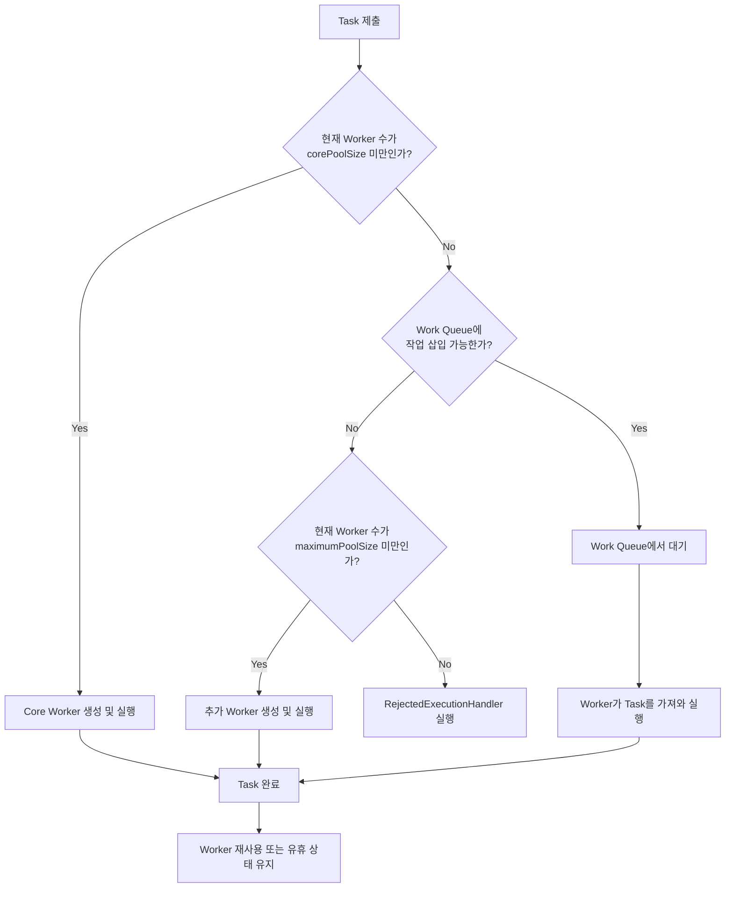

# 프로세스와 스레드

프로세스는 관리의 단위이다.  

프로세스(작업)는 최소 1개의 스레드(실행)를 갖는다.     
- 그러나 이 흐름이 1개가 아닌 N개가 될 수 있다. (멀티스레딩)
- 각각의 스레드는 **동시**에 각자 **작동**한다.

OS는 가상 메모리를 프로세스에게 할당한다.  
- 가상 메모리는 프로세스로 제한된 공간이다.  

**프로세스에 속한 모든 스레드는 프로세스의 가상메모리로 공간이 제약된다.**  

스레드마다 각자 고유한 **TLS(Thread Local Storage)** 를 가지고 있다.  
자바에서는 이를 [[ThreadLocal]]에서 관리한다.  

스레드는 프로세스에 비해 메모리를 작게 점유한다.  
그래서 스레드를 경량 프로세스라고 부르기도 한다.  

# 스레드 생성

자바에서 스레드를 생성하는 방법은 2가지
- `Runnable` 인터페이스
- `Thread` 클래스

### `run()`메서드와 `start()`메서드의 차이

- `run()`: 실행할 작업을 정의 (새로운 스레드를 실행하지 않음)
- `start()`: 실행 환경을 만들기 (새로운 스레드를 만듦)

내부적으로 `start()` 메서드는 아래 작업을 수행 

1. 새로운 스레드 생성
2. 스레드 상태 관리
3. 호출 스택 할당
4. 운영체제 스케줄러에 실행 요청
5. 새 스레드에서 `run()` 실행

```java
public class ThreadAndRunnableSample {  
    public static void main(String[] args) {  
        ThreadSample threadSample = new ThreadSample();  
        threadSample.run();  
        threadSample.start();  
  
        RunnableSample runnableSample = new RunnableSample();  
        runnableSample.run();  
        new Thread(runnableSample).start();  
    }  
}  
  
class ThreadSample extends Thread {  
    @Override  
    public void run() {  
        System.out.println(Thread.currentThread().getName() + ": thread sample");  
    }  
}  
  
class RunnableSample implements Runnable {  
    @Override  
    public void run() {  
        System.out.println(Thread.currentThread().getName() + ": runnable sample");  
    }  
}
```

```
main: thread sample
Thread-0: thread sample
main: runnable sample
Thread-1: runnable sample
```

## ThreadPoolExecutor

여러 풀링된 스레드 중 하나를 사용하여 제출된 각 작업을 실행하는 객체이다.  

```java
import java.util.concurrent.ThreadPoolExecutor;

ThreadPoolExecutor threadPoolExecutor = new ThreadPoolExecutor(  
        2,  // coreCoolSize
        4,  // maximumPoolSize
        60L,  // keepAliveTime
        TimeUnit.SECONDS,  // unit
        new LinkedBlockingDeque<>(10) // workQueue  
);  
  
threadPoolExecutor.execute(new Runnable() {  
    @Override  
    public void run() {  
        System.out.println("스레드 실행");  
    }  
});
```

- `corePoolSize`: 스레드 풀이 평소에 유지하는 최소 스레드 개수
- `maximumPoolSize`: 스레드 풀이 가질 수 있는 최대 스레드 개수
-  `keepAliveTime`: 사이즈만큼 큐에 스레드 보관
- `workQueue`: 새로운 작업이 대기하는 큐의 용량

### 종료 관련 메서드 

```java
executor.shutdown();
executor.shutdownNow();
executor.awaitTermination(30, TimeUnit.SECONDS);
```

| 메서드                  | 동작                                      |
| -------------------- | --------------------------------------- |
| `shutdown()`         | 새로운 작업을 거부하고, 기존 실행 중인 작업과 큐의 작업은 계속 처리 |
| `shutdownNow()`      | 실행 중인 작업에 인터럽트를 요청하고, 실행되지 않은 대기 작업을 반환 |
| `awaitTermination()` | 종료 완료를 지정한 시간 동안 기다림                    |

### ThreadPoolExecutor 동작 과정

Java의 `ThreadPoolExecutor`는 `corePoolSize`, `maximumPoolSize`, `workQueue` 설정에 따라 작업을 처리한다.



핵심적으로 다음 순서에 따라 동작한다.

1. 현재 Worker 수가 `corePoolSize` 미만이면 새로운 Worker를 생성한다.
2. Core Worker가 모두 생성된 상태라면 새로운 Task를 Queue에 삽입한다.
3. Queue가 가득 차면 `maximumPoolSize`까지 Worker를 추가로 생성할 수 있다.
4. Worker와 Queue가 모두 한계에 도달하면 작업 거부 정책을 적용한다.

> [!NOTE]
> 위 흐름은 Executor가 실행 중인 일반적인 상황을 기준으로 한다.
>
> 특히 Queue가 무제한이라면 작업을 계속 대기시킬 수 있으므로 `maximumPoolSize`까지 Worker가 증가하지 않을 수 있다.

%%%%
## Executors.newFixedThreadPool()의 문제점

Java에서 고정된 개수의 스레드를 사용하는 대표적인 방법은 `Executors.newFixedThreadPool()`이다.

```java
ExecutorService executorService = Executors.newFixedThreadPool(10);
```

위 코드는 최대 10개의 Worker Thread를 사용하는 Thread Pool을 생성한다.
이 때 `LinkedBlockingQueue`가 사용된다.  

```java
public static ExecutorService newFixedThreadPool(int nThreads) {
    return new ThreadPoolExecutor(
            nThreads,
            nThreads,
            0L,
            TimeUnit.MILLISECONDS,
            new LinkedBlockingQueue<Runnable>()
    );
}
```

`LinkedBlockingQueue`의 기본 생성자는 다음과 같으며 Queue의 최대 크기가 `Integer.MAX_VALUE`로 설정된다.

```java
public LinkedBlockingQueue() {
    this(Integer.MAX_VALUE);
}
```

$$
Integer.MAX\_VALUE = 2^{31}-1 = 2,147,483,647
$$

현실적인 메모리 환경에서는 사실상 무제한에 가깝다.  
따라서 `newFixedThreadPool()`을 사용하면 Worker Thread 수는 제한되지만 대기 Task는 계속 증가할 수 있다.

> [!WARNING] 주의사항
> `newFixedThreadPool()`이 항상 잘못된 선택이라는 의미는 아니다.  
> 제출되는 Task 수가 제한되어 있거나 작업 유입량을 충분히 통제할 수 있다면 적절하게 사용할 수 있다.  
> 그러나 작업 유입량을 예측하기 어려운 시스템에서는 Queue의 무제한 증가를 고려해야 한다.  

%%%%
### Bounded Queue를 통한 개선

Queue의 최대 크기를 제한하여 과도한 Task 적재를 방지할 수 있다.  
Java에서는 `ThreadPoolExecutor`를 직접 생성하여 스레드 수와 Queue 용량을 설정할 수 있다.

```java
ExecutorService executorService = new ThreadPoolExecutor(
        4,                              // corePoolSize
        8,                              // maximumPoolSize
        60L,                            // keepAliveTime
        TimeUnit.SECONDS,
        new ArrayBlockingQueue<>(100), // Queue Capacity
        new ThreadPoolExecutor.AbortPolicy()
);
```

각 설정의 의미는 다음과 같다.

| 옵션 | 설정값 | 설명 |
|---|---|---|
| corePoolSize | 4 | 기본적으로 유지할 Worker 수 |
| maximumPoolSize | 8 | 허용하는 최대 Worker 수 |
| keepAliveTime | 60초 | 초과 Worker가 유휴 상태로 유지되는 시간 |
| workQueue | 100 | 대기할 수 있는 Task의 최대 개수 |
| RejectedExecutionHandler | AbortPolicy | 작업 거부 시 예외 발생 |

### 작업 거부 정책

Worker와 Queue가 모두 한계에 도달하면 `RejectedExecutionHandler`를 통해 작업 거부 정책을 적용한다.  
Java에서 제공하는 대표적인 정책은 다음과 같다.

| 정책 | 동작 |
|---|---|
| AbortPolicy | `RejectedExecutionException` 발생 |
| CallerRunsPolicy | 작업을 제출한 스레드가 직접 실행 |
| DiscardPolicy | 새로 제출된 작업을 조용히 버림 |
| DiscardOldestPolicy | Queue에서 가장 오래 대기한 작업을 제거하고 재제출 시도 |

각 정책은 서로 다른 특성을 가지므로 작업의 중요도와 시스템 요구사항에 맞게 선택해야 한다.

특히 `CallerRunsPolicy`는 Executor가 실행 중일 때 작업을 제출한 스레드가 직접 실행하도록 하여 작업 제출 속도를 늦추는 효과를 기대할 수 있다.

다만 제출 스레드의 처리 지연이 발생하므로 항상 적절한 방식은 아니다.

> [!NOTE] Backpressure
> Backpressure는 작업을 소비하는 속도보다 생산하는 속도가 빠를 때 생산자 측에 압력을 전달하여 작업 유입 속도를 조절하는 개념이다.
>
> Bounded Queue와 적절한 거부 정책을 함께 활용하면 과도한 작업 유입으로부터 시스템을 보호하는 데 도움이 된다.

%%%%
## 출처 및 참고자료

https://www.youtube.com/watch?v=x-Lp-h_pf9Q  