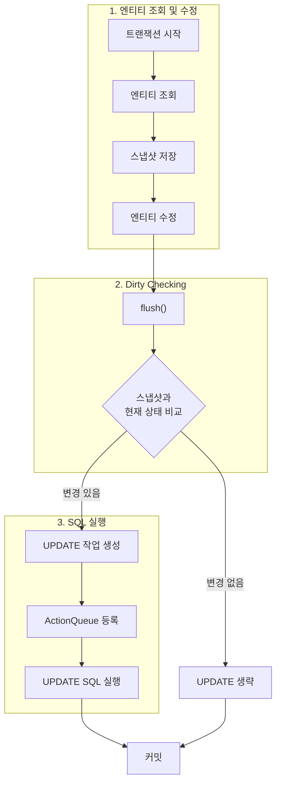

변경감지란 영속성 컨텍스트가 관리하는 엔티티의 값이 변경되었는지 확인 후 수정 SQL을 자동으로 생성하는 기능이다.  

- `fulsh()` 호출 시점에서 스냅샷과 영속성 컨텍스트 내 엔티티의 상태를 비교
- 별도의 `update()`나 `save()`를 호출하지 않아도 트랜잭션 커밋 시 데이터베이스에 반영
- 변경 감지는 영속 상태의 엔티티에만 적용 (준영속 또는 비영속 엔티티는 X)

## 동작 방식


%%%%
## DynamicUpdate

Dirty Checking으로 생성되는 update 쿼리는 기본적으로 **모든 필드**를 업데이트한다.  

- 생성되는 쿼리가 같아 **부트 실행시점에 미리 만들어서 재사용**가능합니다.
- 데이터베이스 입장에서 쿼리 재사용이 가능하다.
	- 동일한 쿼리를 받으면 이전에 파싱된 쿼리를 재사용한다.

이 때 필드가 과도하게 많아질 때는 모든 필드에 대한 update 쿼리는 다소 성능적으로 문제가 생길 수 있다.  
이 때 `@DynamicUpdate`를 사용하여 변경 필드만 반영되도록 수정할 수 있다.  

```java
@Getter
@NoArgsConstructor
@Entity
@DynamicUpdate // <- 추가
public class Exmample {
    
    @Id
    @GeneratedValue(strategy = GenerationType.IDENTITY)
    private Long id;
    
    private String columnA;
    private String columnB;
    private String columnC;
	// ... 
}
```


## 출처 및 참고자료


```cardlink
url: https://jojoldu.tistory.com/415
title: "더티 체킹 (Dirty Checking)이란?"
description: "Spring Data Jpa와 같은 ORM 구현체를 사용하다보면 더티 체킹이란 단어를 종종 듣게 됩니다. 더티 체킹이란 단어를 처음 듣는분들을 몇번 만나게 되어 이번 시간엔 더티 체킹이 무엇인지 알아보겠습니다. 모든 코드는 Github에 있습니다. 예를 들어 다음과 같은 코드가 있습니다. (Spring Data Jpa가 익숙하시겠지만, 네이티브한 코드 먼저 보고 가겠습니다.) @Slf4j @RequiredArgsConstructor @Service public class PayService { public void updateNative(Long id, String tradeNo) { EntityManager em = entityManagerFactory.createEntityManager(); Enti.."
host: jojoldu.tistory.com
image: https://img1.daumcdn.net/thumb/R800x0/?scode=mtistory2&fname=https%3A%2F%2Ft1.daumcdn.net%2Fcfile%2Ftistory%2F99BD7A4C5CC6747009
```
