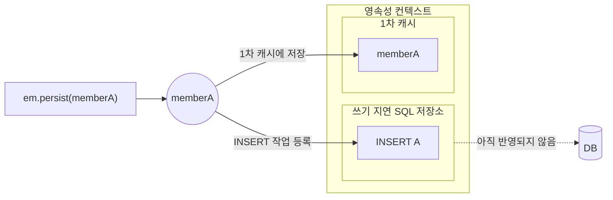
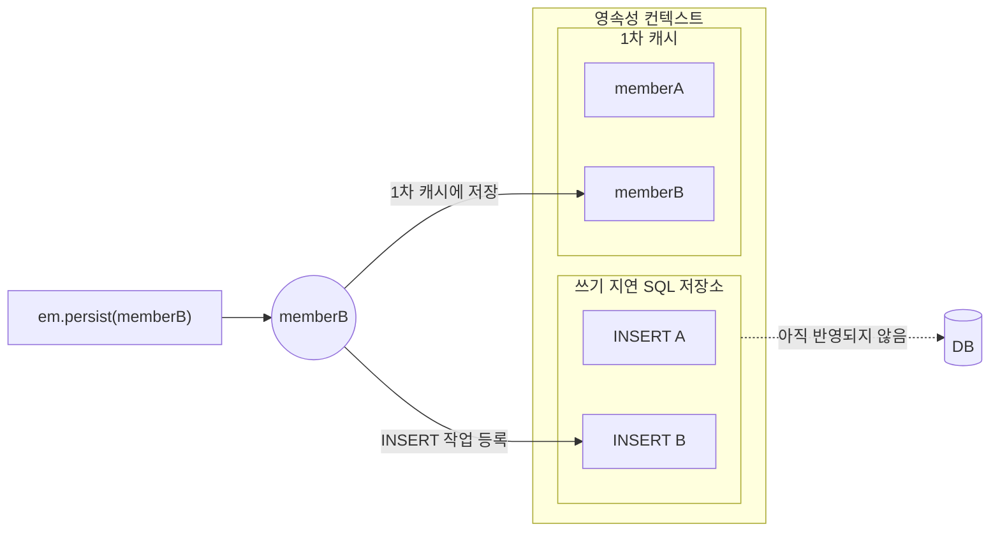

쓰기 지연이란 엔티티의 변경 사항을 [[JPA 영속성 컨텍스트|영속성 컨텍스트]]에 반영하고, 실제 SQL 실행을 `flush()` 시점까지 지연하는 방식입니다.  ^intro

## 동작 방식

1. 엔티티 영속화
2. SQL이 발송되지 않음
3. 영속성 컨텍스트 내부의 쓰기 지연 SQL 저장소에 SQL를 저장
4. 트랜잭션 커밋 시점에 SQL를 한 번에 전송

```java
@Transactional
public void save() {
    em.persist(memberA);
    em.persist(memberB);

    // 아직 INSERT 실행되지 않음

    em.flush(); // INSERT 실행

    // 아직 트랜잭션 커밋 전
}
```

**em.persist(memberA);** 




**em.persist(memberB);**




> Hibernate는 [[ActionQueue]]를 사용하여 INSERT, UPDATE, DELETE 및 Collection 관련 작업을 관리한다. 이때 SQL 문자열 자체를 저장하는 것이 아니라 실행할 작업(Action)을 관리하며, `flush()` 시점에 SQL을 실행한다.

## 쓰기 버퍼링

일반적으로 트랜잭션 시점에 Entity 개수만큼 INSERT/UPDATE 쿼리가 발생한다.  
아래와 같은 설정값을 통해 SQL문을 한번에 전송하여 데이터베이스 성능을 향상시킬 수 있다. (Batch Insert/Update)

```yaml
spring:
  jpa:
    properties:
      hibernate:
        # 한 번에 보낼 SQL 배치 크기 설정 (보통 20~50, 대용량은 100~500 설정)
        jdbc.batch_size: 50
        
        # 같은 엔티티끼리 SQL을 정렬하여 배치가 깨지지 않도록 함 (필수)
        order_inserts: true
        order_updates: true
```

## 출처 및 참고자료

```cardlink
url: https://daram.tistory.com/265
title: "JPA, 영속성 컨텍스트의 이점 (트랜잭션을 지원하는 쓰기 지연)"
description: "영속성 컨텍스트를 사용하면 5가지의 이점을 얻을 수 있다. • 1차 캐시 • 동일성(identity) 보장 • 트랜잭션을 지원하는 쓰기 지연 (transactional write-behind) • 변경 감지(Dirty Checking) • 지연 로딩(Lazy Loading) 1차 캐시에서 설명했던 것과 유사한 부분이다. 트랜잭션을 지원하는 쓰기 지연이란 알기 쉽게 말해서 query는 commit하는 시점에 날린다는 것이다. memberA와 memberB를 1차 캐시에 저장하는 persist 명령어를 사용하면, 쓰기 지연 SQL 저장소에 query문을 임시로 저장한다. commit 하는 시점에 쓰기 지연 SQL 저장소에 저장되어 있는 query들을 날려버린다. commit 하는 시점에 query를 모아서 .."
host: daram.tistory.com
favicon: https://t1.daumcdn.net/tistory_admin/favicon/tistory_favicon_32x32.ico
image: https://img1.daumcdn.net/thumb/R800x0/?scode=mtistory2&fname=https%3A%2F%2Fblog.kakaocdn.net%2Fdna%2FqHUT9%2FbtrsLybpKEF%2FAAAAAAAAAAAAAAAAAAAAAJCpi0IvllzwAOVu8ACVuFpMY_bRUZ4TSdCyTkJmkms8%2Fimg.png%3Fcredential%3DyqXZFxpELC7KVnFOS48ylbz2pIh7yKj8%26expires%3D1796050799%26allow_ip%3D%26allow_referer%3D%26signature%3Dh%252BhfwzhSjcuK70F9oDLrhV8s3fg%253D
```

```cardlink
url: https://junuuu.tistory.com/1029
title: "하이버네이트 flush 순서에 주의하자"
description: "대상독자하이버네이트 동작원리를 잘 모르고 사용했을 때 어떤 일이 발생할 수 있는지 궁금하신 분들   개요애플리케이션을 개발하던 중 하이버네이트의 동작원리를 잘 몰랐기 때문에 버그가 발생하게 되었습니다. 하이버네이트의 동작원리를 알아보면서 버그를 재현해보고 어떻게 해결할 수 있는지 정리해보고자 합니다.   하이버네이트란?하이버네이트(Hibernate)는 자바 애플리케이션과 관계형 데이터베이스 간의 상호작용을 간소화하기 위한 객체-관계 매핑(ORM) 도구입니다. 자바 클래스와 데이터베이스 테이블을 매핑하여, 자바 객체를 데이터베이스의 레코드로 변환하고 그 반대의 작업도 처리합니다. 이를 통해 개발자는 직접 SQL 코드를 작성할 필요 없이 데이터베이스와의 복잡한 상호작용을 처리할 수 있습니다. 하이버네이트를 .."
host: junuuu.tistory.com
favicon: https://t1.daumcdn.net/tistory_admin/favicon/tistory_favicon_32x32.ico
image: https://img1.daumcdn.net/thumb/R800x0/?scode=mtistory2&fname=https%3A%2F%2Fblog.kakaocdn.net%2Fdna%2Fb8j7KI%2FbtsKcSXmVAE%2FAAAAAAAAAAAAAAAAAAAAAJKHu1DdmrirR6qzwBHW6l7xlevi9SobCRCmSp-KjJ7h%2Fimg.png%3Fcredential%3DyqXZFxpELC7KVnFOS48ylbz2pIh7yKj8%26expires%3D1796050799%26allow_ip%3D%26allow_referer%3D%26signature%3DrjxZPnluecki2idlI5wS3Y%252FWisY%253D
```
