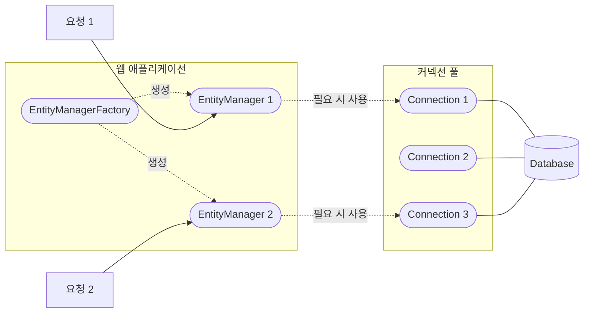

JPA에서 엔티티를 영구적으로 저장하고 관리하는 논리적인 메모리 공간이다.  

- EntityManagerFactory가 요청마다 EntityManager를 생성
- EntityManager는 내부적으로 DB Connection을 사용

## 사용 이점

 - 1차 캐시
 - 동일성 보장
 - 트랜잭션을 지원하는 [[JPA 쓰기 지연|쓰기 지연]] (transactional write-behind)
 - 변경 감지(Dirty Checking
 - 지연 로딩(Lazy Loading)

## 엔티티 생명주기

- **비영속(Transient)**: 객체를 생성했지만 아직 영속성 컨텍스트가 관리하지 않는 상태입니다.
- **영속(Managed)**: `persist()`로 저장하거나 조회하여 영속성 컨텍스트가 관리하는 상태입니다. 변경 감지와 1차 캐시의 대상이 됩니다.
- **준영속(Detached)**: 한때 영속 상태였지만 `detach()`, `clear()`, `close()` 등으로 영속성 컨텍스트의 관리를 벗어난 상태입니다. 값을 변경해도 변경 감지가 동작하지 않습니다.
- **삭제(Removed)**: `remove()`가 호출되어 삭제 대상으로 관리되는 상태입니다. 실제 DELETE SQL은 보통 플러시 시점에 실행됩니다.