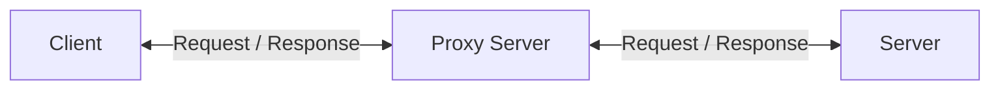
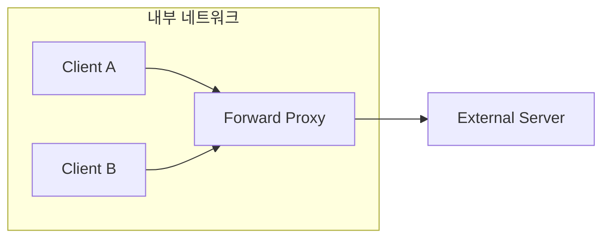
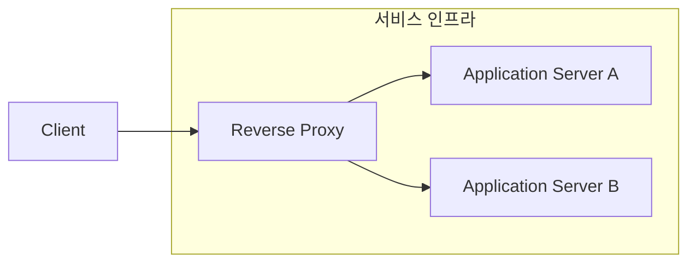
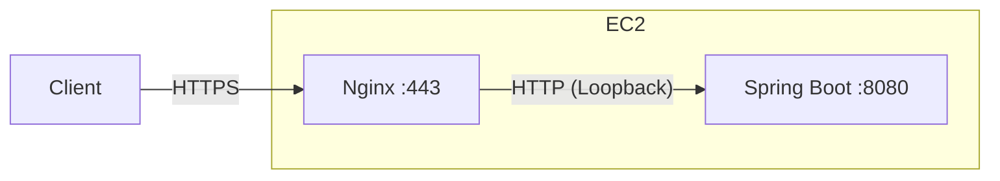
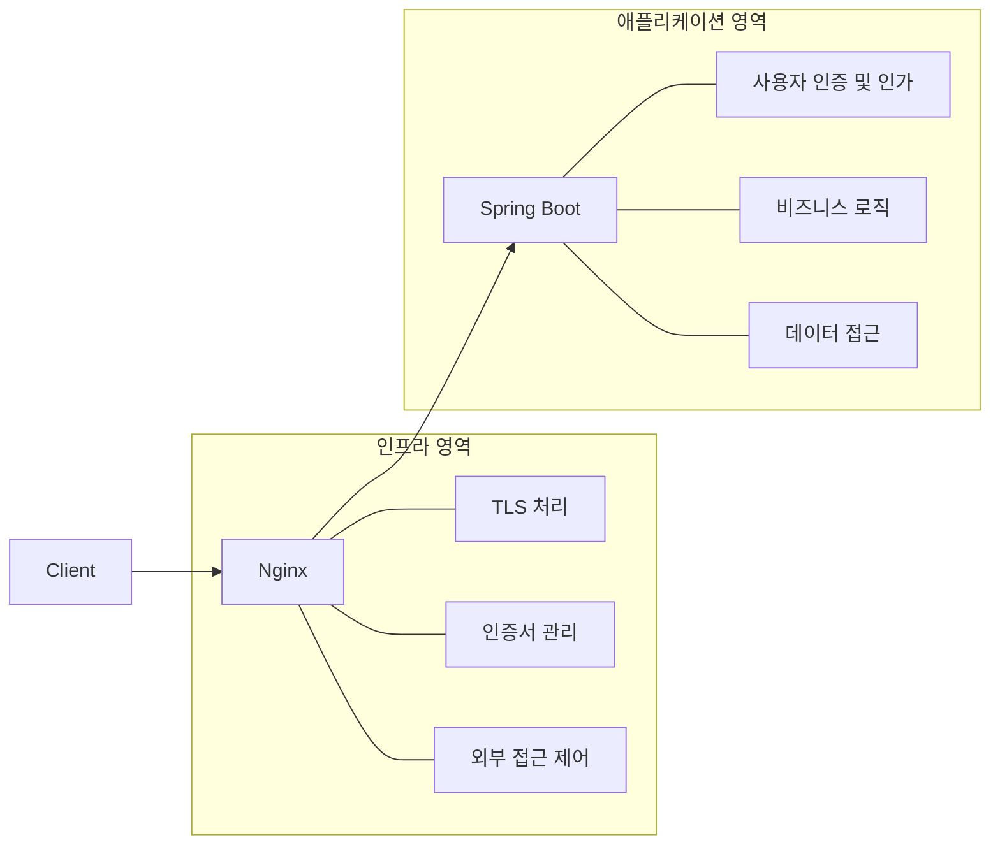
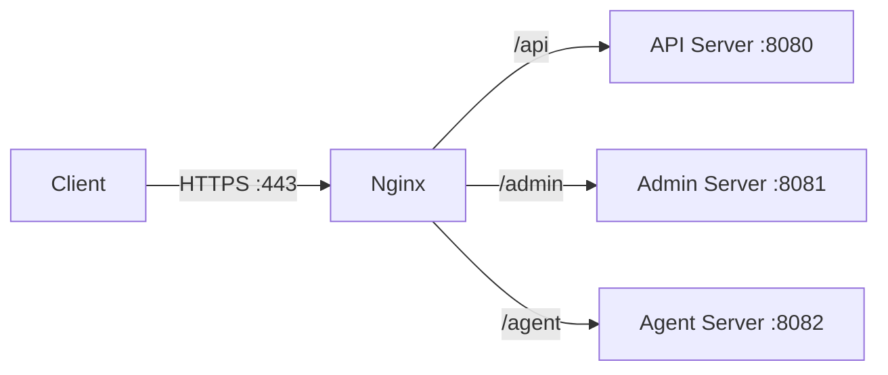
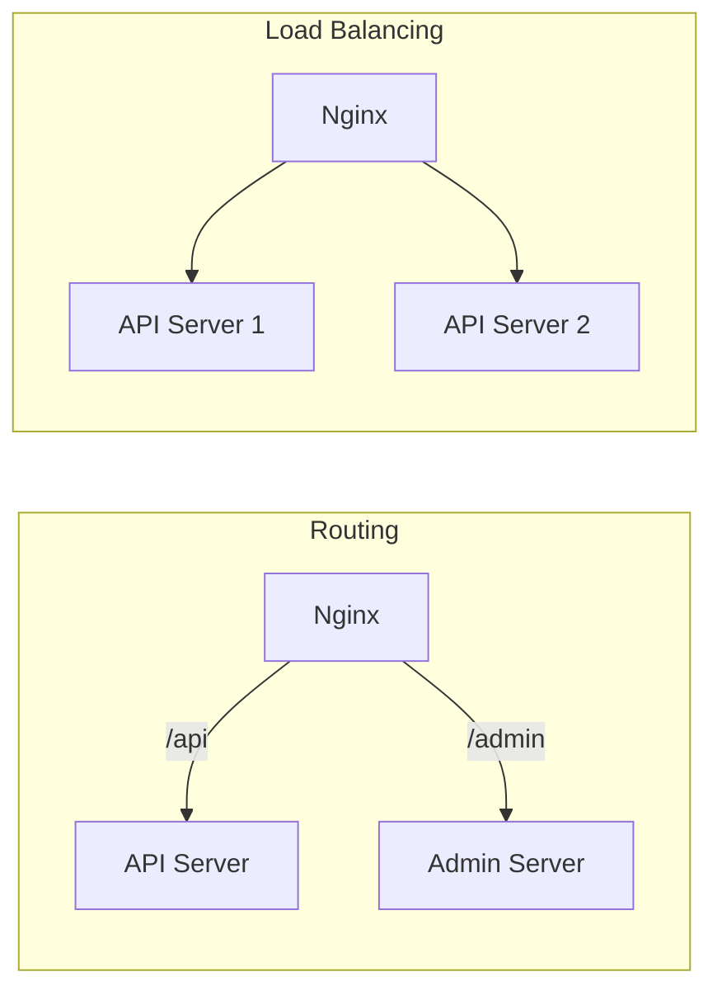
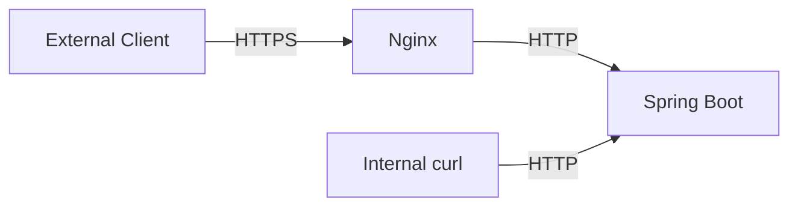

Proxy Server란 클라이언트와 서버 사이에서 요청과 응답을 중계하는 서버 애플리케이션이다.

단순히 요청과 응답을 전달하는 것뿐만 아니라, 통신 과정에 개입하여 접근 제어, 암호화·복호화, 요청 분배 등의 부가적인 작업을 수행할 수 있다.



Proxy Server는 반드시 별도의 물리적 서버에 존재할 필요는 없다. 실제 애플리케이션과 동일한 호스트에서 독립적인 프로세스로 동작할 수도 있다.

## Proxy의 종류

### Forward Proxy

클라이언트를 대신하여 서버와 통신하는 프록시이다.



- 클라이언트의 외부 인터넷 접근 제어
- 클라이언트의 IP 주소 노출 최소화
- 외부 서비스에 대한 접근 기록 관리

### Reverse Proxy

서버를 대신하여 클라이언트와 통신하는 프록시이다.

클라이언트의 요청을 먼저 수신하고, 적절한 내부 서버(Upstream Server)로 전달한다.



- 외부에서 들어오는 요청에 대한 접근 제어
- 내부 서버의 네트워크 정보 노출 최소화
- 내부 서버 구조 및 변경사항 추상화
- TLS 처리 및 부하 분산

### Forward Proxy vs Reverse Proxy

| 구분     | Forward Proxy | Reverse Proxy |
| ------ | ------------- | ------------- |
| 대리 대상  | 클라이언트         | 서버            |
| 관리 주체  | 클라이언트 측 관리자   | 서비스 운영자       |
| 접근 제어  | 외부로 나가는 요청    | 외부에서 들어오는 요청  |
| 추상화 대상 | 클라이언트         | 내부 서버         |
| 주요 목적  | 외부 접근 통제      | 서버 보호 및 요청 관리 |

두 프록시의 차이는 요청이 이동하는 방향이 아닌 **누구를 대신하여 통신하는가**에 있다.

## Reverse Proxy의 활용 방식

| 기능              | 설명                              |
| --------------- | ------------------------------- |
| TLS Termination | 클라이언트와의 TLS 연결 및 암호화·복호화 처리     |
| Access Control  | IP, 인증 정보 등을 기반으로 요청의 접근 제어     |
| Load Balancing  | 동일한 서비스를 제공하는 여러 서버에 요청 분산      |
| Rate Limiting   | 일정 시간 내 요청 처리 빈도 제한             |
| Routing         | 도메인, URL 경로 등의 조건에 따라 다른 서버로 전달 |
| Caching         | 응답을 저장하여 이후 요청에서 재사용            |
| Buffering       | 요청 및 응답 데이터를 임시 저장하여 전달         |
| Compression     | 응답 데이터를 압축하여 전송량 감소             |

### TLS Termination

클라이언트와의 TLS 연결을 Reverse Proxy에서 종료하고, 내부 애플리케이션으로 별도의 요청을 전달하는 방식이다.



- Nginx에서 [[TLS#TLS Handshake|TLS Handshake]] 및 요청 데이터 복호화 수행
- 복호화된 HTTP 요청을 내부 애플리케이션에 전달
- 애플리케이션의 응답을 Nginx에서 암호화하여 클라이언트에 전달

TLS 처리 작업이 사라지는 것이 아니라 **처리 주체가 애플리케이션에서 Reverse Proxy로 변경**되는 것이다.

동일한 호스트에서 `127.0.0.1`을 통해 통신한다면 외부 네트워크 인터페이스를 경유하지 않으므로, 호스트를 신뢰한다는 전제하에 내부 통신에서 TLS를 생략할 수 있다.

단, 서로 다른 호스트 간 통신에서는 내부 네트워크라는 이유만으로 안전하다고 단정할 수 없다. 보안 요구사항에 따라 HTTPS 또는 mTLS를 적용할 수 있다.

### 인프라 레벨의 관심사 분리

**애플리케이션의 배포 주기와 인프라 운영 정책의 변경 주기를 분리**할 수 있다.



대표적인 운영 정책 변경 사례는 다음과 같다.

- HTTPS 인증서 갱신
- 특정 URL 경로에 대한 접근 정책 추가 및 수정
- 외부 요청에 대한 Rate Limiting 정책 변경
- 요청 및 응답 데이터 크기 제한 변경

이러한 정책을 Reverse Proxy에서 관리하면 애플리케이션의 코드 수정, 재빌드, 재배포 및 재시작 없이 독립적으로 변경할 수 있다.

Nginx의 경우 설정 파일 수정 후 유효성을 검사하고 Reload를 수행하여 변경사항을 반영할 수 있다.

```bash
sudo nginx -t
sudo nginx -s reload
```

Reload 시 새로운 설정을 사용하는 Worker Process를 생성하고 기존 Worker Process를 점진적으로 종료한다.

단, Spring Boot에서도 외부 설정 파일이나 SSL Bundle 등을 활용할 수 있으므로, Reverse Proxy가 없다고 해서 반드시 애플리케이션의 재빌드 및 재배포가 필요한 것은 아니다.

핵심은 **운영 정책을 애플리케이션과 독립적인 프로세스에서 관리할 수 있다는 점**이다.

#### 인증 및 인가의 책임 분리

| Reverse Proxy     | Application Server |
| ----------------- | ------------------ |
| 운영 리소스 접근 제어      | 서비스 사용자 인증         |
| IP 기반 접근 제한       | JWT 검증             |
| 특정 경로의 Basic Auth | 사용자 역할 및 권한 검증     |
| 공통적인 요청 제한 정책     | 도메인별 인가 정책         |

애플리케이션의 회원 상태, 리소스 소유권 등 비즈니스 정책과 밀접한 인증·인가는 애플리케이션에서 처리하고, 독립적으로 관리할 수 있는 공통 접근 정책은 Reverse Proxy에 위임할 수 있다.

단, JWT 검증 자체도 적절한 기능이나 모듈을 갖춘 Proxy에서 수행할 수 있다. 책임의 분리 기준은 기술적 가능 여부보다는 비즈니스 정책과의 결합도에 있다.

### 클라이언트와 서버 인프라의 결합도 감소

Reverse Proxy는 클라이언트와 내부 서버 사이에서 인프라 구조를 추상화한다.



클라이언트는 각 애플리케이션의 IP 주소나 포트를 알 필요 없이 공통 진입점을 통해 요청할 수 있다.

내부 서버의 IP, 포트, 배치 구조 등이 변경되더라도 외부 API 계약이 유지된다면 클라이언트의 코드 변경이 필요하지 않다.

- 클라이언트와 서버 인프라 간 결합도 감소
- 내부 서버의 독립적인 확장 및 이전
- 외부 요청의 진입점 일원화
- 공통 TLS 및 접근 정책 적용

단, 내부 서버의 IP와 포트를 숨기는 것만으로 보안이 보장되지는 않는다. 바인딩 주소, 방화벽, 보안 그룹 등을 통해 내부 서버에 대한 직접 접근을 제한해야 한다.

### Routing vs Load Balancing

Routing은 요청 조건에 따라 적절한 서비스를 선택하는 것이고, Load Balancing은 동일한 서비스를 제공하는 여러 서버에 요청을 분산하는 것이다.



Reverse Proxy는 Load Balancer의 역할도 수행할 수 있지만, Reverse Proxy를 도입한다고 해서 반드시 부하 분산이 이루어지는 것은 아니다.

단일 애플리케이션 인스턴스를 운영하더라도 TLS 처리, 접근 제어, 관심사 분리 등을 목적으로 Reverse Proxy를 도입할 수 있다.

## 도입 시 Trade-off

| 단점             | 설명                                               |
| -------------- | ------------------------------------------------ |
| 장애 지점 증가       | Spring Boot가 정상이어도 Nginx 문제로 API 접근 불가           |
| 운영 복잡성 증가      | 별도의 설정, 로그, 프로세스 관리 필요                           |
| 통신 비용 증가       | Nginx를 경유하는 추가적인 통신 및 데이터 처리 발생                  |
| 리소스 사용         | Nginx 프로세스의 CPU 및 메모리 사용                         |
| 장애 분석 복잡성 증가   | 어느 구성 요소에서 문제가 발생했는지 구분해야 함                      |
| Proxy 관련 설정 관리 | Timeout, Buffer, Header, SSE, WebSocket 등의 설정 필요 |

Reverse Proxy를 도입하면 애플리케이션의 운영 정책을 분리할 수 있지만, 전체 인프라에서 관리해야 할 구성 요소는 증가한다.

또한 동일한 호스트에서 TLS 처리를 Nginx로 위임하더라도 호스트 전체의 암호화 연산 부담이 사라지는 것은 아니다.

따라서 단순히 성능이나 보안이 향상된다는 추상적인 이유보다는 프로젝트의 요구사항과 운영 환경을 기반으로 도입 여부를 결정해야 한다.

### 장애 지점 분석

Reverse Proxy 환경에서는 외부 요청과 애플리케이션 직접 요청의 결과를 비교하여 장애 범위를 좁힐 수 있다.



```bash
# 외부 진입점을 통한 헬스 체크
curl -i https://api.matchuri.com/actuator/health

# 애플리케이션 직접 헬스 체크
curl -i http://127.0.0.1:8080/actuator/health
```

| 외부 요청 | 내부 요청 | 우선 조사 대상 |
| --- | --- | --- |
| 200 | 200 | 헬스 체크 기준 정상 |
| 502 | 200 | Proxy 설정 및 Upstream 통신 |
| 502 | 연결 실패 | 애플리케이션 프로세스 및 리스닝 상태 |
| 연결 실패 | 200 | Nginx 상태, DNS, 방화벽, 외부 네트워크 |

단, HTTP 상태 코드만으로 장애 원인을 확정할 수는 없다. 각 구성 요소의 로그와 네트워크 상태를 함께 확인해야 한다.

## 출처 및 참고자료

```cardlink
url: https://ko.wikipedia.org/wiki/%ED%94%84%EB%A1%9D%EC%8B%9C_%EC%84%9C%EB%B2%84
title: "프록시 서버 - 위키백과"
host: ko.wikipedia.org
favicon: https://ko.wikipedia.org/static/favicon/wikipedia.ico
```

- [NGINX Reverse Proxy](https://docs.nginx.com/nginx/admin-guide/web-server/reverse-proxy/)
- [NGINX SSL Termination](https://docs.nginx.com/nginx/admin-guide/security-controls/terminating-ssl-http/)
- [HTTP Basic Authentication Module](https://nginx.org/en/docs/http/ngx_http_auth_basic_module.html)
- [HTTP Load Balancing](https://docs.nginx.com/nginx/admin-guide/load-balancer/http-load-balancer/)
- [Controlling nginx](https://nginx.org/en/docs/control.html)
- [Command-line Parameters](https://nginx.org/en/docs/switches.html)
- [SSL Bundles](https://docs.spring.io/spring-boot/reference/features/ssl.html)