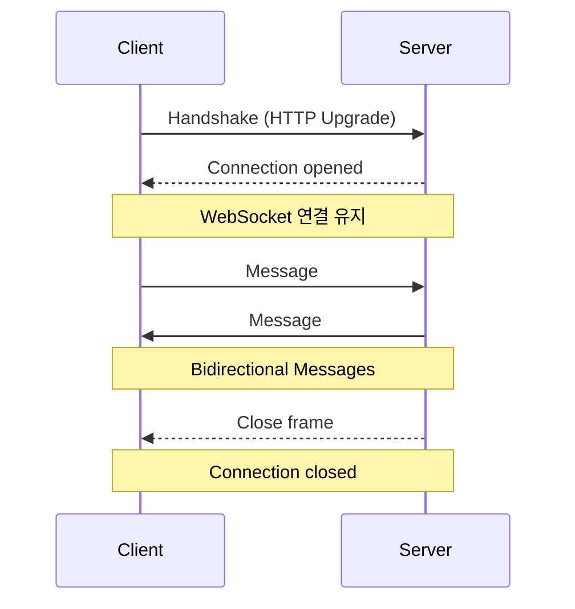
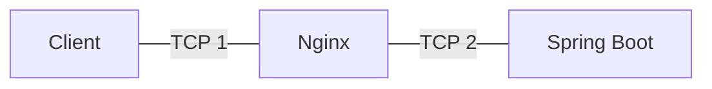

웹소켓은 단일 [[TCP]] 연결로 전이중 통신 채널을 제공하는 실시간 통신 [[protocol|프로토콜]]이다.  

- 연결지향
- 한번 연결 맺은 뒤 유지
- 양방향 통신

> [!INFO] Polling과 비교
> 클라이언트가 n초 간격으로 서버에게 요청을 보내는 방식인 [[Polling]]으로도 충분히 양방향 통신이 가능하다.  
> 그러나 HTTP는 헤더가 무거운 단발성 통신이기에 요청을 지속적으로 보낸다면 서버의 부담이 증가한다.  
> [[Polling#Long Polling|Long Polling]]이라는 비교적 서버의 부담을 줄인 방식도 있지만 결국 데이터가 빈번하게 바뀐다면 소용 없다.  
> 이러한 점들을 고려하여 양방향 통신에 최적화된 WebSocket을 사용한다.  

%%%%
## 동작 방식

1. **WebSocket Handshake**: 클라이언트가 HTTP Upgrade 요청으로 WebSocket 연결을 시도한다.
2. **Connection Opened**: 서버가 요청을 수락하고 WebSocket 연결을 수립한다. (``101 Switching Protocols``)
3. **Bidirectional Messages**: 연결을 유지하면서 클라이언트와 서버가 양방향으로 메시지를 주고받는다.
4. **Connection Closed**: 한쪽에서 연결 종료를 요청하면 종료 절차를 거쳐 연결을 닫는다.



### WebSocket Handshake

HTTP 업그레이드 헤더를 사용하여 HTTP 프로토콜에서 WebSocket 프로토콜로 변경된다.  
요청 본문에는 아래와 같이 Upgrade: websocket을 담아서 보내야 한다.

```http
GET /chat HTTP/1.1 
Host: server.example.com 
Upgrade: websocket 
Connection: Upgrade 
Sec-WebSocket-Key: x3JJHMbDL1EzLkh9GBhXDw== 
Sec-WebSocket-Protocol: chat, superchat 
Sec-WebSocket-Version: 13 
Origin: <http://example.com>
```

응답에는 Status Code 101로 Switching Protocols를 담아서 보낸다.

```http
TTP/1.1 101 
Switching Protocols Upgrade: websocket 
Connection: Upgrade 
Sec-WebSocket-Accept: HSmrc0sMlYUkAGmm5OPpG2HaGWk= 
Sec-WebSocket-Protocol: chat
```

#### 왜 독립적인 프로토콜로 관리하지 않는건가?

기존 웹 인프라를 그대로 통과하고 재사용하기 위해 연결할때만 HTTP를 잠시 사용하고 이후에는 WebSocket 프로토콜로 전환하는 구조를 택했다. HTTP Request를 그대로 사용하기 때문에 기존의 80, 443 포트로 접속을 하므로 추가 방화벽을 열지 않고도 양방향 통신이 가능하고, HTTP 규격인 [[CORS]] 적용이나 인증 등 과정을 기존과 동일하게 가져갈 수 있는 것이 장점이다.   

만약 아래와 같이 별도의 프로토콜로 관리한다면 다음과 같은 문제점이 발생한다.  

```
ws://example.com:12345
```

- 회사/학교 방화벽이 해당 포트를 막을 수 있음
- Proxy가 알 수 없는 프로토콜을 차단할 수 있음
- Load Balancer가 별도 프로토콜을 지원해야 함
- 웹 서버와 별도의 네트워크 설정 필요
- 브라우저의 [^1]**기존 HTTP 보안 모델**을 재활용하기 어려움

## 단점

- WebSocket 연결이 끊어졌을 때의 처리를 직접 구현해야 한다.
- 브라우저 별로 지원하는 웹소켓 버전이 다르며, 모든 브라우저가 WebSocket을 지원하지는 않는다.
- 서버는 수많은 커넥션을 유지해야 하므로 자원을 많이 사용할 수 있다.
    - 실시간으로 많은 데이터가 오가지 않는다면 필요 시 연결을 하는 게 비용적으로 이득

## WebSocket Resource

WebSocket은 연결 수립 뿐만 아니라 연결이 유지되는 동안 서버 자원을 점유한다는 점에서 리소스를 많이 소모하는 작업이다. 이는 동시 접속사가 많을수록 치명적이다.  

1. 연결 수립 비용
2. 연결 유지 비용
3. 메세지 처리 비용

### 연결 유지 비용

WebSocket은 연결을 수립한 이후 클라이언트가 연결을 종료하기 전까지 연결을 유지한다.  

#### 메모리 사용

WebSockt을 연결 하나를 유지하기 위해 여러 자원이 필요하다.  

| 자원           | 설명                       |
| ------------ | ------------------------ |
| TCP 소켓       | 운영체제가 TCP 연결 상태를 관리      |
| 송수신 버퍼       | 네트워크 데이터의 송수신을 위한 버퍼     |
| WebSocket 세션 | 연결 상태, 식별자, 세션 속성 등 관리   |
| 애플리케이션 상태    | 사용자 ID, 인증 정보, 구독 정보 등   |
| 추가 버퍼        | 메시지 대기열, 프레임 처리, 압축 상태 등 |
#### File Descriptor 점유

Linux에서는 소켓 역시 [[File Descriptor]]를 통해 관리된다.  
클라이언트가 서버에 WebSocket 연결을 수립하면 서버 프로세스는 해당 연결을 관리하기 위해 FD를 사용한다.  
동시 연결 수만큼 프로세스가 사용하는 FD도 증가하며 이에 대한 최대치를 넘으면 연결을 수락하는데 실패한다.  

Nginx와 같은 프록시 서버를 앞단에 배치할 경우 다음과 같이 양측에 TCP 연결이 생긴다.  
이 때 nginx는 해당 연결들의 양쪽 소켓을 관리해야 한다.  



#### Headtbeat 비용

WebSocket은 연결을 유지한다고 해서 네트워크가 영원히 정상적인 상태로 유지된다는 보장이 없다.  
클라이언트가 갑자기 네트워크에서 이탈하거나, 중간 프록시가 유휴 연결을 종료할 수 있다.  

이를 감지하기 위해 흔히 Ping/Pong을 활용한다.  

WebSocket 프로토콜에는 Ping/Pong 제어 프레임이 정의되어 있다.  
단순한 제어 메세지이지만 연결 수가 증가하면 전체 처리량도 증가한다.  

#### Reconnection Storm

웹소켓 재연결 로직은 연결이 끊겼을 때 지수 백오프(Exponential Backoff)와 지터(Jitter)를 적용해 재시도 간격을 늘려가며 다시 연결하고, 연결 복구 후 누락된 상태를 동기화하는 방식으로 구현한다. 만약 서버 재시작이나 네트워크 장애로 대규모 연결이 동시에 끊어진 후 클라이언트들이 일제히 재접속을 시도한다면 서버에 급격한 부하가 발생할 것이다. 

> Reconnection Storm은 다수의 클라이언트가 서버에 **짧은 시간 동안 동시에 재연결을 시도하면서 서버에 과도한 부하가 발생하는 현상**을 말한다.  

### 메세지 처리 비용

WebSocket은 연결을 유지하는 비용이 발생하는 대신, 이미 수립된 연결을 재사용하여 메시지를 전송할 수 있다.  
짧은 메시지를 자주 교환하는 경우에는 매번 HTTP 요청-응답 헤더를 교환하는 방식보다 효율적일 수 있다.  

그러나 이러한 메세지 처리에서도 병목이 발생할 수 있다.  

대표적으로 Slow Client Problem이다.  
Slow Client Problem란, 서버가 메시지를 보내는 속도보다 클라이언트가 소비하는 속도가 느린 현상이다.  
이 상태가 지속되면 메모리 사용량이 증가하고, 다른 연결의 처리에도 영향을 미칠 수 있다.  

> [!INFO]
> [[Spring WebSocket|Spring의 STOMP]]는 이러한 상황을 제어하기 위해 `sendTimeLimit`, `sendBufferSizeLimit` 등을 제공한다.    

%%%%

### Server-Client 측면에서 바라보는 WebSocket의 비용 정리

#### Server

- 파일 디스크립터: 소켓 1개마다 서버는 FD 1개를 사용
- 메모리: 연결마다 버퍼, 메세지 큐, 연결 상태 등 메모리 차지
- CPU 처리 시간: 연결 유지, 핑퐁 처리, 이벤트 전파 등에 CPU 시간 소모
- 이벤트 루프 처리량: 연결이 많아질 수록 [[IO|I/O]] 이벤츠 처리량도 부담
- 네트워크 스레드 수: 일부 서버 구조는 연결 수만큼 스레드/컨텍스트 필요

#### Client

- 웹브라우저 메모리
- 핸들러 등록 수 증가
- 전력 소모 (모바일 환경은 치명적)


## 출처 및 참고자료

```cardlink
url: https://ko.wikipedia.org/wiki/%EC%9B%B9%EC%86%8C%EC%BC%93
title: "웹소켓 - 위키백과, 우리 모두의 백과사전"
host: ko.wikipedia.org
favicon: https://ko.wikipedia.org/static/favicon/wikipedia.ico
image: https://upload.wikimedia.org/wikipedia/commons/1/10/Websocket_connection.png?utm_source=ko.wikipedia.org&utm_campaign=index&utm_content=thumbnail_unscaled
```

```cardlink
url: https://jaehoney.tistory.com/362#google_vignette
title: "웹소켓(WebSocket) 개념 이해하기!"
description: "WebSocket(WebSocket)은 클라이언트와 서버를 연결하고 실시간으로 통신이 가능하도록 하는 통신 프로토콜이다. WebSocket은 TCP 접속에 전이중(duplex) 통신 채널을 제공한다. 쉽게 말해, Socket Connection을 유지한 채로 실시간 양방향 통신이 가능하다. 아래 서비스에서 대표적으로 웹소켓을 많이 사용한다. SNS 실시간 채팅 화상 회의 실시간 협업 툴 온라인 게임 증권, 거래소 예시를 보면 동시간 접속자 수가 많으며, 실시간 데이터가 아주 많이 오간다는 것을 알 수 있다. vs HTTP 먼저 일반적으로 사용하는 HTTP 프로토콜과의 차이를 알아보자. 1. State HTTP는 단방향 통신이다. 클라이언트가 서버로 요청을 보내면 응답을 받는 구조로 동작하며, 어떠한 상태.."
host: jaehoney.tistory.com
image: https://img1.daumcdn.net/thumb/R800x0/?scode=mtistory2&fname=https%3A%2F%2Fblog.kakaocdn.net%2Fdna%2FnjBcN%2Fbtso0t4Mgix%2FAAAAAAAAAAAAAAAAAAAAANuzZb16A0bk3FAWUuU--1JbjubiOWpSh5mAszFYqWcC%2Fimg.png%3Fcredential%3DyqXZFxpELC7KVnFOS48ylbz2pIh7yKj8%26expires%3D1793458799%26allow_ip%3D%26allow_referer%3D%26signature%3DycnL8zhIEjAKgQRAdvl4jOGOn4A%253D
```

```cardlink
url: https://www.youtube.com/watch?v=c6infBpWiIE
title: "엄청난 폴링 횟수. 과연 웹소켓에 비해 유리한가?"
description: "#개발자 #프로그래밍 #아키텍트대규모 트래픽 환경에서 폴링에 대한 서버부하 우려를 많이 하십니다. 한번 연결하면 계속 연결을 유지 한채로 필요시 서버에서 값을 전달하는 웹소켓이 더 유리하지 않느냐 하는 의견도 많습니다. 이 영상에서는 왜 폴링을 사용하는지 설명합니다.'아키텍트 인사..."
host: www.youtube.com
favicon: https://www.youtube.com/s/desktop/444d69ff/img/favicon_32x32.png
image: https://i.ytimg.com/vi/c6infBpWiIE/maxresdefault.jpg
```

```cardlink
url: https://www.youtube.com/watch?v=19TrHkprQ7U&t
title: "[10분 테코톡] 니야의 웹소켓 끊김 대응 전략"
description: "🙋‍♀️ 우아한테크코스의 크루들이 진행하는 10분 테크토크입니다. 🙋‍♂️'10분 테코톡'이란 우아한테크코스 과정을 진행하며 크루(수강생)들이 동료들과 학습한 내용을 공유하고 이야기하는 시간입니다. 서로가 성장하기 위해 지식을 나누고 대화하며 생각해보는 시간으로 자기 주도적인 ..."
host: www.youtube.com
favicon: https://www.youtube.com/s/desktop/5b8fd169/img/favicon_32x32.png
image: https://i.ytimg.com/vi/19TrHkprQ7U/maxresdefault.jpg
```

```cardlink
url: https://www.donghanlab.com/posts/websocket-13-backpressure-and-flow-control
title: "WebSocket 완전 정복 13편 — 백프레셔와 흐름 제어: bufferedAmount와 slow consumer"
description: "느린 클라이언트 몇 개가 서버 메모리를 고갈시키는 slow consumer 문제를 bufferedAmount 임계값으로 방어하는 코드와, 메시지를 버릴지 최신값으로 덮어쓸지 연결을 끊을지 데이터 성격에 따라 정하는 정책, 그리고 반대 방향의 rate limit을 다룹니다."
host: www.donghanlab.com
favicon: https://www.donghanlab.com/favicon.ico
```

```cardlink
url: https://jacking75.github.io/Thundering_Herd/
title: "Web 서버에서의 Thundering Herd - jacking75"
description: "online game server programmer"
host: jacking75.github.io
```

```cardlink
url: https://amirsoleimani.medium.com/deal-with-reconnection-storm-two-strategies-4a835d0457f6
title: "Deal with Reconnection Storm — Two Strategies"
description: "It is a big challenge to roll out a new release without causing a Reconnection Storm when dealing with thousands  of active WebSocket…"
host: amirsoleimani.medium.com
favicon: https://miro.medium.com/v2/5d8de952517e8160e40ef9841c781cdc14a5db313057fa3c3de41c6f5b494b19
image: https://miro.medium.com/v2/resize:fit:1200/1*1xG6eLg6BzO59iaMEf-9qg.png
```

```cardlink
url: https://chatgpt.com/share/6afe88ad-552c-83ee-ab1f-96a91ebdb957
title: "이 채팅을 확인해 보세요"
description: "누군가 회원님이 보고 싶어 할 것 같다고 생각한 채팅입니다."
host: chatgpt.com
image: https://ogimg.chatgpt.com/conversation/6afe88ad-552c-83ee-ab1f-96a91ebdb957/response_multicolor_v1.png
```


[^1]: [[Cookie]], Origin, [[TLS]] 등이 있다.

