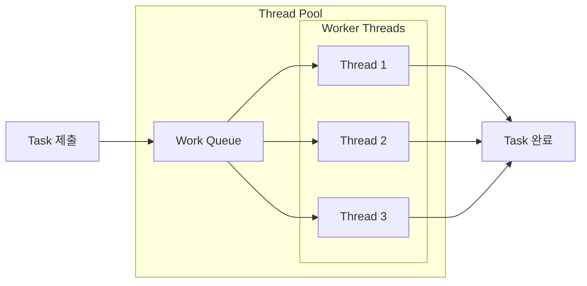
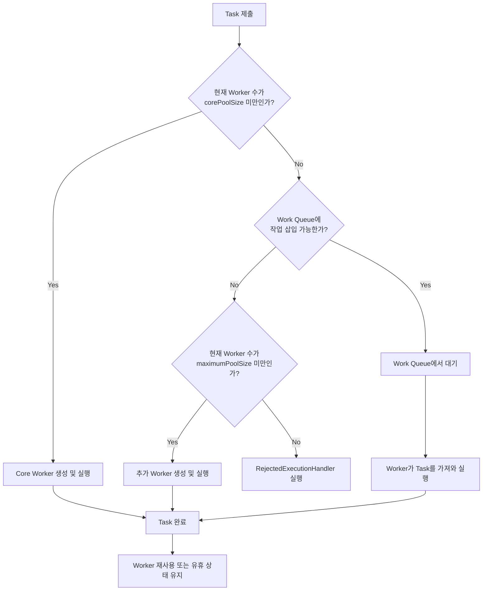

## Thread Pool이란?

Thread Pool은 여러 작업(Task)을 병행 처리하기 위해 일정 개수의 [[thread|스레드]]를 유지하고, 작업이 완료된 스레드를 재사용하는 소프트웨어 [[Design Pattern|디자인 패턴]]이다.

스레드를 매번 생성하고 폐기하는 비용을 줄이고, 동시에 실행되는 스레드의 수를 제어하여 시스템 리소스를 효율적으로 관리하는 것이 목적이다.

- 스레드 재사용을 통한 생성 및 제거 비용 감소
- 동시 실행되는 스레드 수 제한
- 작업 대기열(Queue)을 통한 작업 처리량 조절
- CPU 및 메모리 자원의 효율적인 관리

> [!NOTE] Thread Pool이란?
> Thread Pool 자체는 운영체제의 기능이 아닌 애플리케이션 또는 런타임 수준에서 구현하는 스레드 관리 기법이다.
>
> Java의 Platform Thread는 일반적으로 OS Thread와 1:1로 매핑되어 운영체제의 스케줄링을 받는다.
>
> 또한 Thread Pool을 사용한다고 해서 반드시 모든 스레드가 사전에 생성되는 것은 아니다. Java의 `ThreadPoolExecutor`는 기본적으로 작업이 제출될 때 필요한 스레드를 생성한다.

## Thread Pool이 필요한 이유

### Thread-per-Request 모델

Thread-per-Request는 클라이언트의 각 요청을 별도의 스레드에서 처리하는 동시성 모델이다.

만약 요청이 들어올 때마다 새로운 스레드를 생성하고, 요청 처리가 끝나면 해당 스레드를 폐기한다면 다음과 같은 문제가 발생할 수 있다.

1. 스레드 생성 및 제거 비용
    - 스레드를 생성하고 제거하는 과정에서 CPU와 메모리 등의 시스템 자원이 소모된다.
2. [[Context Switching|컨텍스트 스위칭]] 증가
    - CPU 코어 수에 비해 실행 가능한 스레드가 지나치게 많아지면 컨텍스트 스위칭과 스케줄링 오버헤드가 증가할 수 있다.
    - 실제 작업 처리에 사용될 CPU 시간이 스레드 전환에 소모된다.
3. 메모리 사용량 증가
    - 각 스레드는 스택 등의 메모리 자원을 사용한다.
    - 스레드 수가 과도하게 증가하면 메모리 부족 문제가 발생할 수 있다.

특히 요청이 처리되는 속도보다 새로운 요청이 유입되는 속도가 빠른 상황에서 무제한으로 스레드를 생성한다면 시스템의 안정성이 저하될 수 있다.

### Thread Pool을 활용한 해결

Thread Pool은 일정 범위의 스레드를 유지하면서 작업이 끝난 스레드를 재사용한다.

- 매 요청마다 스레드를 생성하고 폐기하지 않아도 된다.
- 동시에 실행할 수 있는 작업의 수를 제한할 수 있다.
- 모든 스레드가 사용 중이라면 새로운 작업을 Queue에서 대기시킬 수 있다.

> [!IMPORTANT] Thread-per-Request와 Thread Pool의 관계
> 두 개념은 서로 반대되는 개념이 아니다.
>
> Thread-per-Request는 요청을 스레드에 할당하는 처리 모델이며, Thread Pool은 스레드를 관리하고 재사용하는 기법이다.
>
> 예를 들어 Spring MVC 기반의 서블릿 웹 서버는 일반적으로 Thread Pool의 Worker Thread를 사용하여 HTTP 요청을 처리한다.

%%%%
## Thread Pool의 동작 원리

Thread Pool은 일반적으로 다음 요소로 구성된다.

| 구성 요소            | 설명                          |
| ---------------- | --------------------------- |
| Executor         | 작업을 제출받고 실행을 관리             |
| Worker Thread    | 실제 Task를 실행하는 스레드           |
| Work Queue       | 즉시 실행하지 못한 Task가 대기하는 큐     |
| Rejection Policy | 작업을 더 이상 수용할 수 없을 때 적용하는 정책 |

### 기본 동작 구조



위 다이어그램은 Worker Thread가 Queue에서 대기 중인 Task를 가져와 실행하는 구조를 단순화한 것이다.

1. 애플리케이션이 Thread Pool에 Task를 제출한다.
2. 가용 Worker Thread가 있다면 Task를 실행한다.
3. 모든 Worker Thread가 작업 중이라면 새로운 Task는 Queue에서 대기할 수 있다.
4. 작업이 완료된 Worker Thread는 종료되지 않고 다음 Task를 처리한다.

단, 실제 작업 할당 방식은 Thread Pool의 구현과 설정에 따라 달라진다.

### Java ThreadPoolExecutor의 작업 처리 과정

Java의 `ThreadPoolExecutor`는 `corePoolSize`, `maximumPoolSize`, `workQueue` 설정에 따라 작업을 처리한다.



핵심적으로 다음 순서에 따라 동작한다.

1. 현재 Worker 수가 `corePoolSize` 미만이면 새로운 Worker를 생성한다.
2. Core Worker가 모두 생성된 상태라면 새로운 Task를 Queue에 삽입한다.
3. Queue가 가득 차면 `maximumPoolSize`까지 Worker를 추가로 생성할 수 있다.
4. Worker와 Queue가 모두 한계에 도달하면 작업 거부 정책을 적용한다.

> [!NOTE]
> 위 흐름은 Executor가 실행 중인 일반적인 상황을 기준으로 한다.
>
> 특히 Queue가 무제한이라면 작업을 계속 대기시킬 수 있으므로 `maximumPoolSize`까지 Worker가 증가하지 않을 수 있다.

%%%%
## Thread Pool의 주요 사용 사례

### Thread-per-Request

웹 서버에서 다수의 클라이언트 요청을 병행 처리하는 경우

- HTTP 요청을 Worker Thread에 할당
- 요청 처리가 완료되면 Worker Thread 반환 및 재사용

### 병렬 작업 처리

하나의 큰 작업을 여러 Subtask로 분리하여 병렬 실행하는 경우

- 대량 데이터 계산
- 이미지 및 파일 처리
- 독립적인 데이터 가공

### 독립적인 작업 처리

작업 간 실행 순서에 의존성이 없는 여러 Task를 병행 처리하는 경우

- 여러 외부 API 요청
- 서로 독립적인 데이터 조회
- 비동기 이벤트 처리

## 적절한 Thread Pool 크기 결정

Thread Pool의 적절한 크기는 CPU 코어 수와 Task의 특성에 따라 달라진다.  
대표적으로 작업은 CPU-bound와 I/O-bound로 구분할 수 있다.

- **CPU-bound Task**: 스레드 수를 CPU 코어 수와 비슷하거나 약간 많은 수준으로 설정
- **IO-bound Task**:  CPU 코어 수의 1.5~3배를 고려할 수 있지만, 이는 절대적인 기준이 아니며 직접 측정/비교 필요

### Thread Pool 크기 추정 공식

CPU 활용률을 높이기 위한 단순화된 추정 공식은 다음과 같다.

$$
N_{threads} \approx N_{CPU} \times \left(1 + \frac{W}{C}\right)
$$

- $N_{threads}$: 적절한 스레드 수
- $N_{CPU}$: 사용 가능한 CPU 코어 수
- $W$: 작업이 대기하는 시간
- $C$: CPU 연산을 수행하는 시간

예를 들어 CPU 코어가 4개이고, 작업의 I/O 대기 시간이 CPU 연산 시간의 2배라면 다음과 같이 추정할 수 있다.

$$
N_{threads} \approx 4 \times (1 + 2) = 12
$$

즉, 12개의 스레드를 초기 설정 후보로 고려할 수 있다.

> [!IMPORTANT] 실제 운영 환경에서는?
> 위 공식은 최적의 Thread Pool 크기를 보장하지 않는다.
>
> 실제로는 CPU 사용률, 처리량(Throughput), 응답 지연(Latency), 메모리 사용량, 외부 시스템의 처리 용량 등을 함께 고려해야 한다.
>
> 예를 들어 DB Connection Pool이 10개라면 스레드를 100개로 늘리더라도 DB 처리량이 비례해서 증가하는 것은 아니다.
>
> 따라서 최종 설정은 부하 테스트와 성능 측정을 통해 결정하는 것이 적절하다.

%%%%
## Thread Pool의 Queue 관리

Thread Pool을 사용할 때는 스레드 개수뿐 아니라 Work Queue의 크기도 중요하다.  
스레드 수를 제한하더라도 Queue의 크기에 제한이 없다면 새로운 Task가 계속 쌓일 수 있기 때문이다.

### 무제한 Queue의 위험성

작업 유입 속도가 처리 속도보다 지속적으로 빠르다면 다음과 같은 문제가 발생할 수 있다.  
따라서 처리할 Task의 개수를 제한할 수 없다면 Queue 크기에 제한이 있는지 반드시 확인해야 한다.

1. 모든 Worker Thread가 작업을 실행하고 있는 상태가 된다.
2. 새로운 Task가 Queue에 계속 쌓인다.
3. Queue 대기 시간이 증가하면서 전체 응답 지연이 발생한다.
4. Queue에 저장된 Task 객체들이 메모리를 계속 차지한다.
5. 최악의 경우 메모리 고갈로 OOM이 발생할 수 있다.

### Executors.newFixedThreadPool()의 문제점

Java에서 고정된 개수의 스레드를 사용하는 대표적인 방법은 `Executors.newFixedThreadPool()`이다.

```java
ExecutorService executorService = Executors.newFixedThreadPool(10);
```

위 코드는 최대 10개의 Worker Thread를 사용하는 Thread Pool을 생성한다.
이 때 `LinkedBlockingQueue`가 사용된다.  

```java
public static ExecutorService newFixedThreadPool(int nThreads) {
    return new ThreadPoolExecutor(
            nThreads,
            nThreads,
            0L,
            TimeUnit.MILLISECONDS,
            new LinkedBlockingQueue<Runnable>()
    );
}
```

`LinkedBlockingQueue`의 기본 생성자는 다음과 같으며 Queue의 최대 크기가 `Integer.MAX_VALUE`로 설정된다.

```java
public LinkedBlockingQueue() {
    this(Integer.MAX_VALUE);
}
```

$$
Integer.MAX\_VALUE = 2^{31}-1 = 2,147,483,647
$$

현실적인 메모리 환경에서는 사실상 무제한에 가깝다.  
따라서 `newFixedThreadPool()`을 사용하면 Worker Thread 수는 제한되지만 대기 Task는 계속 증가할 수 있다.

> [!WARNING] 주의사항
> `newFixedThreadPool()`이 항상 잘못된 선택이라는 의미는 아니다.  
> 제출되는 Task 수가 제한되어 있거나 작업 유입량을 충분히 통제할 수 있다면 적절하게 사용할 수 있다.  
> 그러나 작업 유입량을 예측하기 어려운 시스템에서는 Queue의 무제한 증가를 고려해야 한다.  

%%%%
## Bounded Queue를 통한 개선

Queue의 최대 크기를 제한하여 과도한 Task 적재를 방지할 수 있다.  
Java에서는 `ThreadPoolExecutor`를 직접 생성하여 스레드 수와 Queue 용량을 설정할 수 있다.

```java
ExecutorService executorService = new ThreadPoolExecutor(
        4,                              // corePoolSize
        8,                              // maximumPoolSize
        60L,                            // keepAliveTime
        TimeUnit.SECONDS,
        new ArrayBlockingQueue<>(100), // Queue Capacity
        new ThreadPoolExecutor.AbortPolicy()
);
```

각 설정의 의미는 다음과 같다.

| 옵션 | 설정값 | 설명 |
|---|---|---|
| corePoolSize | 4 | 기본적으로 유지할 Worker 수 |
| maximumPoolSize | 8 | 허용하는 최대 Worker 수 |
| keepAliveTime | 60초 | 초과 Worker가 유휴 상태로 유지되는 시간 |
| workQueue | 100 | 대기할 수 있는 Task의 최대 개수 |
| RejectedExecutionHandler | AbortPolicy | 작업 거부 시 예외 발생 |

### 작업 거부 정책

Worker와 Queue가 모두 한계에 도달하면 `RejectedExecutionHandler`를 통해 작업 거부 정책을 적용한다.  
Java에서 제공하는 대표적인 정책은 다음과 같다.

| 정책 | 동작 |
|---|---|
| AbortPolicy | `RejectedExecutionException` 발생 |
| CallerRunsPolicy | 작업을 제출한 스레드가 직접 실행 |
| DiscardPolicy | 새로 제출된 작업을 조용히 버림 |
| DiscardOldestPolicy | Queue에서 가장 오래 대기한 작업을 제거하고 재제출 시도 |

각 정책은 서로 다른 특성을 가지므로 작업의 중요도와 시스템 요구사항에 맞게 선택해야 한다.

특히 `CallerRunsPolicy`는 Executor가 실행 중일 때 작업을 제출한 스레드가 직접 실행하도록 하여 작업 제출 속도를 늦추는 효과를 기대할 수 있다.

다만 제출 스레드의 처리 지연이 발생하므로 항상 적절한 방식은 아니다.

> [!NOTE] Backpressure
> Backpressure는 작업을 소비하는 속도보다 생산하는 속도가 빠를 때 생산자 측에 압력을 전달하여 작업 유입 속도를 조절하는 개념이다.
>
> Bounded Queue와 적절한 거부 정책을 함께 활용하면 과도한 작업 유입으로부터 시스템을 보호하는 데 도움이 된다.

%%%%
## 핵심 정리

1. Thread Pool은 스레드를 재사용하고 동시 실행 규모를 제어하기 위한 디자인 패턴이다.
2. 스레드를 반복적으로 생성 및 폐기하는 비용을 줄일 수 있다.
3. Thread-per-Request 모델과 Thread Pool은 함께 사용할 수 있다.
4. 적절한 스레드 수는 CPU 코어 수와 Task의 특성에 따라 달라진다.
5. CPU-bound Task는 CPU 코어 수와 비슷한 스레드 수를 초기 기준으로 고려할 수 있다.
6. I/O-bound Task는 대기 시간이 존재하므로 CPU 코어 수보다 많은 스레드가 유리할 수 있다.
7. Thread Pool의 스레드 수를 제한하더라도 Queue에 제한이 없다면 메모리 고갈 위험이 존재한다.
8. 실제 운영 환경에서는 Thread Pool 크기, Queue 용량, 작업 거부 정책을 함께 고려해야 한다.
9. 최적의 설정은 부하 테스트와 성능 측정을 통해 검증해야 한다.

## 출처 및 참고자료

```cardlink
url: https://www.youtube.com/watch?v=B4Of4UgLfWc
title: "BJ.18 스레드 풀(thread pool)은 왜 쓰는 걸까요? 어떻게 쓰는게 잘 쓰는 걸까요? 이번 영상으로 깔끔하게 정리하시죠!"
description: "#스레드풀 #threadpool #pool스레드를 생성하고 폐기하는 것은 제법 비싼 작업입니다.그리고 막 써서도 안되는게 스레드죠~이런 이유로 등장한 것이 스레드풀입니다!스레드풀이 무엇이고 어떻게 쓰는게 좋은지 설명드립니다!같이 고고씽 하시죠!!00:00 오프닝00:11 threa..."
host: www.youtube.com
favicon: https://www.youtube.com/s/desktop/bb2198ae/img/favicon_32x32.png
image: https://i.ytimg.com/vi/B4Of4UgLfWc/maxresdefault.jpg
```

```cardlink
url: https://youtu.be/um4rYmQIeRE?si=mPnk3xQGuyHqd_aH
title: "[10분 테코톡] 조조그린의 Thread Pool"
description: "🙋‍♀️ 우아한테크코스의 크루들이 진행하는 10분 테크토크입니다. 🙋‍♂️'10분 테코톡'이란  우아한테크코스 과정을 진행하며 크루(수강생)들이 동료들과 학습한 내용을 공유하고 이야기하는 시간입니다. 서로가 성장하기 위해 지식을 나누고 대화하며 생각해보는 시간으로 자기 주도적인..."
host: youtu.be
favicon: https://www.youtube.com/s/desktop/bb2198ae/img/favicon_32x32.png
image: https://i.ytimg.com/vi/um4rYmQIeRE/maxresdefault.jpg
```

```cardlink
url: https://engineerinsight.tistory.com/197#google_vignette
title: "[JAVA] 쓰레드 풀(Thread Pool): 개념, 장점, 사용 방법, 코드 예시 (feat. Baeldung)"
description: "💋 쓰레드 풀의 필요성 서버는 동시에 여러 사용자가 접속할 수 있습니다. 자바에서는 스레드를 운영 체제의 자원으로 사용합니다. 우리가 스레드를 계속해서 만들면, 운영 체제의 자원이 빨리 소진될 수 있어요. 서버는 동시 접속자가 많아지면 스레드가 무한대로 생성되면서 서버가 다운될 위험이 있습니다. 애플리케이션 프로세스에서 사용되고 있는 쓰레드의 개수를 관리하기 위해서 쓰레드 풀을 도입할 수 있습니다. 💋 쓰레드 풀이란? ✔ 개념 쓰레드 풀은 미리 일정 개수의 쓰레드를 생성하여 관리하는 기법입니다. 이렇게 생성된 쓰레드들은 작업을 할당받기 위해 대기 상태에 있게 되는데, 작업이 발생하면 대기 중인 쓰레드 중 하나를 선택하여 작업을 수행합니다. 작업이 완료되면 해당 스레드는 다시 대기 상태로 돌아가고, 새로운.."
host: engineerinsight.tistory.com
favicon: https://t1.daumcdn.net/tistory_admin/favicon/tistory_favicon_32x32.ico
image: https://img1.daumcdn.net/thumb/R800x0/?scode=mtistory2&fname=https%3A%2F%2Fblog.kakaocdn.net%2Fdna%2FpPlJs%2Fbtstxmf0B3D%2FAAAAAAAAAAAAAAAAAAAAAHiBrFz5GYtiZKkJD5J1uUmaQwVCFPMQaeUGGQ30Pv1Y%2Fimg.png%3Fcredential%3DyqXZFxpELC7KVnFOS48ylbz2pIh7yKj8%26expires%3D1796050799%26allow_ip%3D%26allow_referer%3D%26signature%3DNdGNlC1QalGghB4mB9ZDUdu6mQY%253D
```

```cardlink
url: https://www.baeldung.com/thread-pool-java-and-guava
title: "Introduction to Thread Pools in Java | Baeldung"
description: "Quick and practical guide to different ThreadPool implementations in Java and Guava."
host: www.baeldung.com
favicon: https://www.baeldung.com/wp-content/themes/baeldung/favicon/favicon.ico
image: https://www.baeldung.com/wp-content/uploads/2018/10/Social-Guava-2-k-featured.jpg
```
