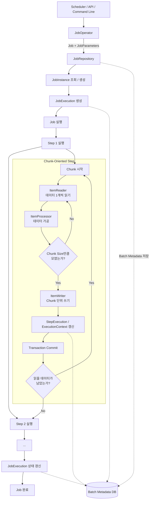

> [!INFO]
> 해당 동작 방식은 **Spring Batch 6.0.6** 기준이다.

JobOperator → JobRepository → JobExecution 생성 → Job → Step → Reader → Processor → Writer → Commit → 다음 Chunk → Job 종료



청크 내부 동작


## 출처 및 참고자료

```cardlink
url: https://chatgpt.com/share/6ae9e6f6-d128-83ee-b87f-75e1f7d662e4
title: "이 채팅을 확인해 보세요"
description: "누군가 회원님이 보고 싶어 할 것 같다고 생각한 채팅입니다."
host: chatgpt.com
favicon: /favicon.ico
image: https://ogimg.chatgpt.com/conversation/6ae9e6f6-d128-83ee-b87f-75e1f7d662e4/response_multicolor_v1.png
```

