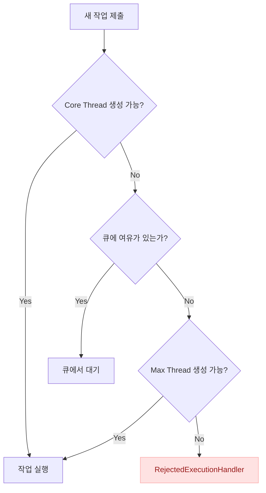

ThreadPoolTaskExecutor는 Spring에서 제공해주는 클래스로 자바에서 제공하는 [[java-thread#ThreadPoolExecutor|ThreadPoolExecutor]]를 사용하기 쉽게 만들어 사용하도록 구현 되어 있어 [[Thread Pool|스레드 풀]]을 쉽고 간단하게 설정하고 관리할 수 있다.  

다음과 같이 빈 등록하여 사용한다.  

```java
@Configuration
public class AsyncConfig {
    @Bean(name = "taskExecutor")
    public Executor taskExecutor() {
        ThreadPoolTaskExecutor taskExecutor = new ThreadPoolTaskExecutor();
        taskExecutor.initialize();
        return taskExecutor;
    }
}
```

> [!INFO]
> Spring Boot는 별도의 Executor Bean이 없는 상황에서 비동기 실행기를 자동 구성할 수 있으므로, 모든 애플리케이션이 직접 Bean을 선언해야 하는 것은 아니다.

아래와 같이 설정하며 사용 방법에 대한 설명은 [공식문서](https://docs.spring.io/spring-framework/docs/current/javadoc-api/org/springframework/scheduling/concurrent/ThreadPoolTaskExecutor.html)와 [블로그](https://dev-coco.tistory.com/186) 참고

```java
@Bean(name = "taskExecutor")  
public Executor taskExecutor() {  
    ThreadPoolTaskExecutor taskExecutor = new ThreadPoolTaskExecutor();  
    taskExecutor.initialize();  
    taskExecutor.setCorePoolSize(10);  
    taskExecutor.setMaxPoolSize(20);  
    taskExecutor.setQueueCapacity(100);  
    taskExecutor.setRejectedExecutionHandler((task, pool) -> {  
        log.error("스레드 실행 거부");  
    });  
    return taskExecutor;  
}
```

호출부에서는 다음과 같이 [[@Async|Async 어노테이션]]를 통해 사용 가능하다.  

```java
@Service
public class NotificationService {

    @Async("taskExecutor")
    public void sendNotification() {
        System.out.println(
            Thread.currentThread().getName()
        );
    }
}
```

### 내부 구조

내부적으로 `ThreadPoolExecutor`를 사용한다.  

![[IMG-20261117021440192.png]]

주요 차이점으로는 객체 생성시 Work Queue의 자료구조를 매개변수로 전달하느 것이 아닌 Integer로 설정한다.  

```java
@Bean(OAUTH_UNLINK_EXECUTOR)  
public Executor oauthUnlinkExecutor() {  
    ThreadPoolTaskExecutor executor = new ThreadPoolTaskExecutor();  
    // 자료 구조가 아닌 capacity만 전달
    executor.setQueueCapacity(100);  
    return executor;  
}
```

`queueCapacity`가 0보다 크면 `LinkedBlockingQueue`를 사용하고, 0 이하라면 `SynchronousQueue`를 사용한다. 

![[IMG-20261117034211859.png]]

>`SynchronousQueue`는 작업을 저장하지 않고 유휴 스레드에게 직접 전달하는 방식이다. 유휴 스레드가 없다면 `maxPoolSize`까지 새로운 스레드 생성을 시도하며, 추가 생성이 불가능하면 작업 거부 정책이 실행된다.

그리고 해당 `createQueue` 메서드는 초기화 메서드(`initializeExecutor`)에서 호출된다.  

![[IMG-20261117034757183.png]]

해당 초기화 메서드는 `ExecutorConfigurationSupport#initialize()`에서 호출된다.     

![[IMG-20261117034457051.png]]

## ThreadPoolExecutor과 비교

| 구분             | `ThreadPoolExecutor`   | `ThreadPoolTaskExecutor`                    |
| -------------- | ---------------------- | ------------------------------------------- |
| 제공             | Java JDK               | Spring Framework                            |
| 패키지            | `java.util.concurrent` | `org.springframework.scheduling.concurrent` |
| 역할             | 스레드 풀 직접 구현 및 관리       | JDK 스레드 풀을 Spring 환경에 통합                    |
| 스레드 풀 엔진       | 자기 자신                  | 내부의 `ThreadPoolExecutor`                    |
| 설정 방식          | 생성자 중심                 | Setter 기반                                   |
| Spring Bean 관리 | 직접 등록 가능               | Bean 등록 및 생명주기 관리에 적합                       |
| `@Async` 연동    | 가능                     | Spring 비동기 실행에 최적화                          |
| 종료 관리          | 직접 `shutdown()` 등 호출   | Spring 컨텍스트 종료와 연동                          |
| 부가 기능          | JDK 표준 기능              | `TaskDecorator`, 모니터링 및 Spring 예외 추상화 등     |

## 추가 제공 기능

- **생명주기 관리:** Spring ApplicationContext의 종료 과정과 연동하여 스레드 풀을 정리할 수 있다.  
- **[[TaskDecorator]]:** 작업 실행 전후에 공통 로직을 적용할 수 있다. 
- **모니터링:** `getPoolSize()`, `getActiveCount()`, `getQueueSize()` 등으로 실행 상태를 확인할 수 있습니다.
- **예외 추상화:** 작업 거부 시 Spring의 `TaskRejectedException`을 사용한다.  

### 생명주기 관리

스레드 풀도 생성부터 종료까지 관리가 필요한 객체이다.  
애플리케이션이 종료되는 시점에도 비동기 작업이 실행되고 있을 수 있다.  
이런 상황에서 스레들 풀을 종료하면 기존 작업에 대한 수행을 진행하거나 중단을 요청하도록 결정할 수 있다.  


```java
@Bean(OAUTH_UNLINK_EXECUTOR)  
public Executor oauthUnlinkExecutor() {  
    ThreadPoolTaskExecutor executor = new ThreadPoolTaskExecutor();  
    executor.setThreadNamePrefix("oauth-unlink-");  
    executor.setCorePoolSize(2);  
    executor.setMaxPoolSize(4);  
    executor.setQueueCapacity(100);  
    executor.setRejectedExecutionHandler((task, pool) -> log.error("Reject"));  
    // 종료할 때 실행 중인 작업을 인터럽트하지 않고, 큐에 남은 작업까지 처리하도록 설정
    executor.setWaitForTasksToCompleteOnShutdown(true);  
    // 스레드 풀이 종료될 때까지 최대 10초 동안 종료 절차를 기다리도록 설정
    executor.setAwaitTerminationSeconds(10);  
    return executor;  
}
```

> [!CAUTION]
> 다만 이 설정만으로 장애 상황에서 작업 완료가 보장되는 것은 아니다.  
> 프로세스 강제 종료, 서버 장애 등에서는 미완료 작업이 유실될 수 있다.  

%%%%

### TaskDecorator

[[TaskDecorator]]란 ThreadPool에서 작업을 시작하직전에 진행할 작업을 추가할 수 있도록 만든 인터페이스이다.  
`setTaskDecorator()` 메서드로 미리 만들어 둔 TaskDecorator를 등록할 수 있다.  

```java
taskExecutor.setTaskDecorator(new ClonedTaskDecorator());
```

### 모니터링

`ThreadPoolTaskExecutor`는 현재 스레드 풀의 상태를 확인할 수 있는 메서드를 제공한다. 이를 활용하여 스레드 사용량이나 작업 대기 상태를 파악할 수 있다.

|메서드|설명|
|---|---|
|`getPoolSize()`|현재 생성된 스레드 수|
|`getActiveCount()`|현재 작업을 실행 중인 스레드 수|
|`getQueueSize()`|큐에서 대기 중인 작업 수|

이러한 지표를 활용하면 **스레드 부족이나 대기 작업 증가 등의 상황을 파악**할 수 있다.

또한 Spring Boot에서는 Micrometer 및 Actuator를 통해 스레드 풀의 상태를 메트릭으로 수집하고, Prometheus와 Grafana로 모니터링할 수 있다.

> [!NOTE]  
> JDK의 `ThreadPoolExecutor`에서도 상태 조회가 가능하다. Spring에서는 Bean 관리 및 Micrometer 연동을 통해 모니터링하기 편리하다는 차이가 있다.

%%%%
### 예외 추상화

스레드 풀의 용량이 모두 소진되거나 Executor가 종료된 상태라면 새로운 작업 제출을 거부할 수 있다.  




JDK의 `ThreadPoolExecutor`는 기본 거부 정책에서 `RejectedExecutionException`을 발생시킨다.  
Spring의 `ThreadPoolTaskExecutor`는 이를 Spring의 `TaskRejectedException`으로 변환한다.  

`TaskRejectedException`는  `RejectedExecutionException`의 하위 타입이다.  

![[IMG-20261117031002486.png]]

그렇기에 Spring 레벨에서 JDK의 `RejectedExecutionHandler`를 사용할 수 있다.  

```java
executor.setRejectedExecutionHandler(new ThreadPoolExecutor.CallerRunsPolicy());
```

|정책|동작|
|---|---|
|`AbortPolicy`|예외 발생 (기본값)|
|`CallerRunsPolicy`|호출 스레드에서 직접 작업 수행|
|`DiscardPolicy`|작업을 조용히 버림|
|`DiscardOldestPolicy`|큐의 가장 오래된 작업을 버리고 재시도|


## 출처 및 참고자료

```cardlink
url: https://dev-coco.tistory.com/186
title: "[Spring] ThreadPoolTaskExecutor 설정으로 비동기 처리 효과적으로 하기"
description: "이전 글에 이어서 Spring Boot에서 ThreadPoolTaskExecutor 설정을 통해 비동기 처리를 효율적으로 수행하는 방법을 알아보려 한다. ThreadPoolTaskExecutor ThreadPoolTaskExecutor는 Spring에서 제공해주는 클래스로 자바에서 제공하는 ThreadPoolExecutor를 사용하기 쉽게 만들어 사용하도록 구현 되어 있어 스레드 풀을 쉽고 간단하게 설정하고 관리할 수 있다. java.util.concurrent Executor를 최상위 인터페이스로 가진다. Bean 등록 우선 ThreadPoolTaskExecutor를 사용하기 위해 Bean으로 등록한다. @Configuration public class ThreadPoolConfig { @Bean(na.."
host: dev-coco.tistory.com
image: https://img1.daumcdn.net/thumb/R800x0/?scode=mtistory2&fname=https%3A%2F%2Ft1.daumcdn.net%2Ftistory_admin%2Fstatic%2Fimages%2FopenGraph%2Fopengraph.png
```

```cardlink
url: https://pompitzz.github.io/blog/Java/threadPoolExecutor.html
title: "Java의 ThreadPoolExecutor, Spring의 ThreadPoolTaskExecutor | BLOG"
host: pompitzz.github.io
favicon: https://pompitzz.github.io/blog/img/favicon.svg
```
